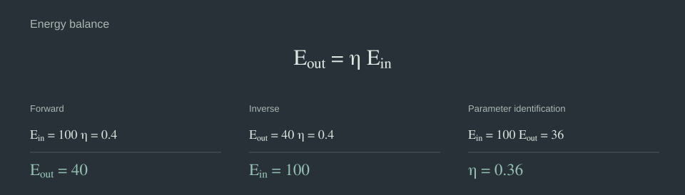
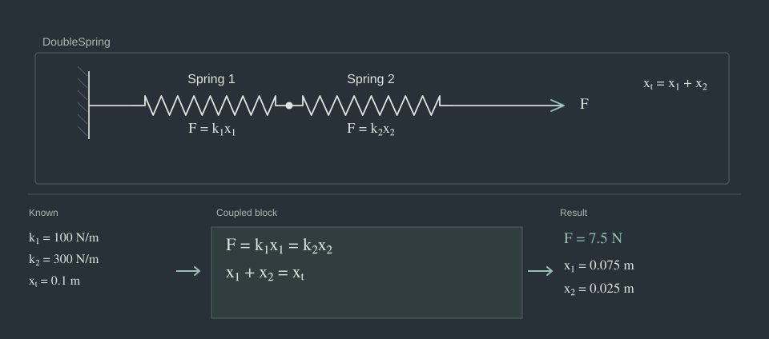
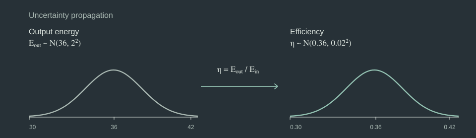

<h1>Bilt<br><sub>Causal and acausal systems models in Python</sub></h1>

[Documentation](https://aviation-impact-accelerator.github.io/bilt/) · [Worked examples](https://aviation-impact-accelerator.github.io/bilt/#worked-examples) · [Issues](https://github.com/aviation-impact-accelerator/bilt/issues) · [Discussions](https://github.com/aviation-impact-accelerator/bilt/discussions)


[](LICENSE)

Bilt is a Python framework for building scientific and engineering models from equations and reusable systems. You define how quantities relate to one another, then supply known values and request what you want to calculate. Bilt works out a supported calculation, including coupled solves across subsystem boundaries.

## One model, different questions



```python
from bilt import Implementation, Interface, equation, field, system


@system
class Converter(metaclass=Interface):
    energy_in: float = field()
    energy_out: float = field()
    efficiency: float = field()


@equation
def energy_balance(energy_in: float, energy_out: float, efficiency: float) -> bool:
    return energy_out == energy_in * efficiency


model = Implementation(Converter, [energy_balance])

with model:
    # Forward
    assert Converter(energy_in=100.0, efficiency=0.4).energy_out == 40.0

    # Inverse
    assert Converter(energy_out=40.0, efficiency=0.4).energy_in == 100.0

    # Parameter identification
    assert Converter(energy_in=100.0, energy_out=36.0).efficiency == 0.36
```

The model is unchanged in each case. Only the known values and requested result differ.

## Systems of systems and coupled equations



This example uses the same `Spring` implementation twice in a `DoubleSpring` system. The parent equations connect their forces and add their extensions.

If we know both stiffnesses and the total extension, we need to calculate the shared force and both spring extensions together. Bilt identifies the coupled linear equations, including those in the child systems, and solves them without us having to flatten the model or assemble a matrix.

[Explore the complete two-spring model](https://aviation-impact-accelerator.github.io/bilt/worked_examples/two-springs-in-series/) · [Coupled systems guide](https://aviation-impact-accelerator.github.io/bilt/guide/coupled-systems/)

## Physical quantities and dimensional analysis


Fields can declare their dimensions with `Annotated[Quantity, DIMENSION]`. Use `Annotated[Quantity | QuantityTensor, DIMENSION]` for fields accepting scalar or tensor quantities.

Bilt checks the dimensions in an equation when it is defined. It also converts compatible units during evaluation, so models do not need to enforce a particular input unit.

[Units guide](https://aviation-impact-accelerator.github.io/bilt/guide/units/) · [Quantity annotations](https://aviation-impact-accelerator.github.io/bilt/api/quantity-annotations/)

## Uncertainty propagation with named tensors

Named tensors let the same model evaluate many samples or scenarios. Here we supply a distribution of possible output energies and calculate an efficiency for each sample.



```python
import numpy as np

from bilt import dim, tensor

sample = dim("sample")
rng = np.random.default_rng(42)
measured_output = tensor(rng.normal(36.0, 2.0, 10_000), over=sample)

with model:
    inferred_efficiency = Converter(
        energy_in=100.0,
        energy_out=measured_output,
    ).efficiency

print(np.quantile(inferred_efficiency.values, [0.05, 0.5, 0.95]))
```

This propagates the sampled uncertainty through the inverse calculation. It does not fit one shared parameter to many noisy observations or produce a Bayesian posterior. Those problems need additional statistical or optimisation methods.

## Other features

- Directed transforms for calculations with a defined direction, alongside acausal equations.
- Named tensor dimensions, broadcasting, reductions and selection.
- Supported `if`/`elif`/`else` logic within equations.
- Python and JAX execution backends.
- `bilt check .` to discover and validate model definitions.

## Worked examples

- [Two springs in series](https://aviation-impact-accelerator.github.io/bilt/worked_examples/two-springs-in-series/): composing systems and solving coupled equations.
- [Two-shaft gas turbine](https://aviation-impact-accelerator.github.io/bilt/worked_examples/two-shaft-gas-turbine/): a larger engineering model with interacting components.
- [Battery-electric mission uncertainty analysis](https://aviation-impact-accelerator.github.io/bilt/worked_examples/battery-electric-mission-model-with-quasi-monte-carlo-broadcasting/): evaluating 196,608 combinations of samples, routes and payload cases with named tensors.
- [Compiling a Bilt model with JAX](https://aviation-impact-accelerator.github.io/bilt/worked_examples/compiling-a-bilt-model-with-JAX/): Python and compiled JAX execution.

## Getting started

Bilt requires Python 3.15 or newer. Install [uv](https://docs.astral.sh/uv/) and a [Rust toolchain](https://www.rust-lang.org/tools/install), then add Bilt from GitHub:

```bash
uv init --python 3.15 my-bilt-project
cd my-bilt-project
uv add "git+https://github.com/aviation-impact-accelerator/bilt.git"
```

For development:

```bash
git clone https://github.com/aviation-impact-accelerator/bilt.git
cd bilt
uv sync
```

[Read the guide](https://aviation-impact-accelerator.github.io/bilt/) for units, tensors, subsystems, backends and model-checking examples.

## AI coding assistants

Bilt has two optional [Agent Skills](https://agentskills.io/) for coding assistants:

- [`bilt`](.agents/skills/bilt/SKILL.md) for writing and debugging models using Bilt.
- [`bilt-development`](.agents/skills/bilt-development/SKILL.md) for contributing to the framework, including testing and code review.

You can add the user-facing skill to another project with:

```bash
npx skills add aviation-impact-accelerator/bilt --skill bilt
```

For the development skill, use `--skill bilt-development`. In a Bilt checkout, GitHub Copilot, Codex and the `skills` CLI can discover the skills in `.agents/skills/`. Copilot code review also uses the [repository review instructions](.github/copilot-instructions.md).

These skills provide instructions for coding assistants. They do not install the Bilt Python package.

## Scope and direction

Not every equation can be rearranged automatically. Coupled blocks currently need to be linear in the values being solved together, although other parts of the model can be nonlinear. General statistical calibration and nonlinear coupled solving are not supported yet.

## Contributing

Bilt is developed at the [Aviation Impact Accelerator, University of Cambridge](https://aiazero.org/) and is still under active development. The API may change. If you have a question or an example to share, open an [issue](https://github.com/aviation-impact-accelerator/bilt/issues) or start a [discussion](https://github.com/aviation-impact-accelerator/bilt/discussions).

The README figures are generated from [`scripts/readme_figures.json`](scripts/readme_figures.json) with [`scripts/generate_readme_svgs.py`](scripts/generate_readme_svgs.py). Run `python scripts/generate_readme_svgs.py` to regenerate them, or add `--check` to verify the committed figures.

Maintained by [James Emberton](https://github.com/j-emberton) and [Sam Brockie](https://github.com/brocksam). [MIT license](LICENSE).
