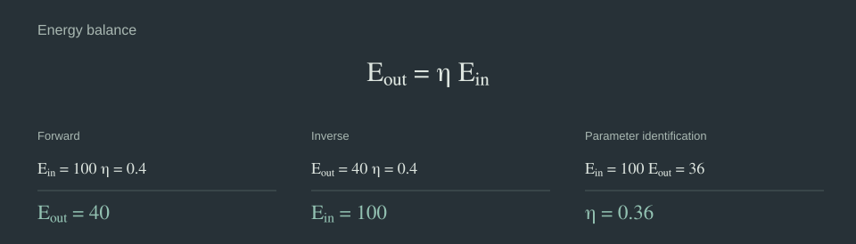
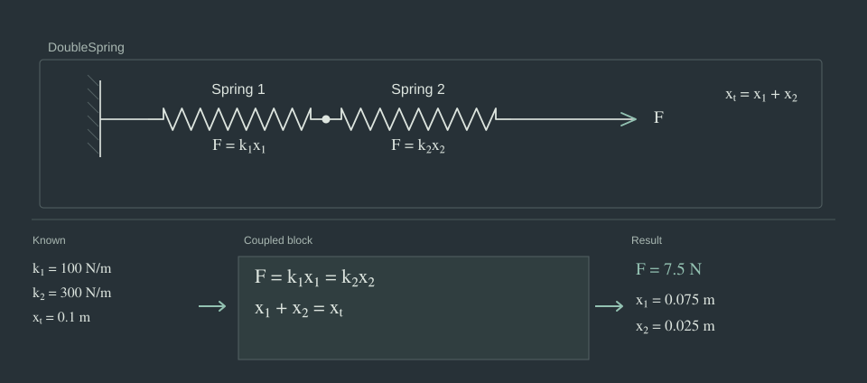
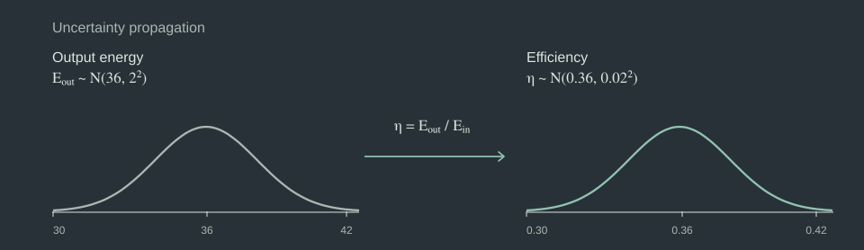

<h1>Bilt<br><sub>Causal and acausal systems models in Python</sub></h1>

[Documentation](https://bilt-framework.github.io/bilt/) · [First model](https://bilt-framework.github.io/bilt/getting-started/first-model/) · [Worked examples](https://bilt-framework.github.io/bilt/#worked-examples) · [Discussions](https://github.com/bilt-framework/bilt/discussions)


[](LICENSE)

Bilt is a Python framework for scientific and engineering models built from equations and reusable systems. Describe how quantities relate, supply what you know, and ask for the value you need. Bilt determines a supported calculation instead of requiring a fixed sequence of computations.

## Quick start

Bilt requires **Python 3.15 or newer** and [uv](https://docs.astral.sh/uv/). Released wheels are available from the Bilt package index once the release build has completed. No Rust toolchain is needed for a supported platform:

```sh
uv init --python 3.15 my-bilt-project
cd my-bilt-project
uv add bilt --index bilt=https://bilt-framework.github.io/bilt/packages/ --no-build-package bilt
```

The index targets Linux x86-64 (glibc 2.28+), macOS (Apple Silicon and Intel) and Windows x86-64. It serves stable releases only. For unreleased changes or an unsupported platform, install from GitHub with a [Rust toolchain](https://www.rust-lang.org/tools/install):

```sh
uv add "git+https://github.com/bilt-framework/bilt.git"
```

If your existing project uses Bilt from its previous GitHub location, run the appropriate `uv add` command above to update the dependency source. The named index keeps Bilt tied to its own package source rather than a similarly named package on PyPI.

Replace `main.py` with this model:

```python
from bilt import Implementation, Interface, equation, field, system


@system
class Converter(metaclass=Interface):
    energy_in: float = field()
    energy_out: float = field()
    efficiency: float = field()


@equation
def energy_balance(energy_in: float, energy_out: float, efficiency: float) -> bool:
    return energy_out == energy_in * efficiency


model = Implementation(Converter, [energy_balance])

with model:
    print(Converter(energy_in=100.0, efficiency=0.4).energy_out)  # 40.0
    print(Converter(energy_out=40.0, efficiency=0.4).energy_in)  # 100.0
```

Run it with `uv run python main.py`. Both requests use the **same equation**; only the known values and the requested output change.

[Build your first model step by step](https://bilt-framework.github.io/bilt/getting-started/first-model/)

## Why Bilt?

### One model, different questions



The same relationships can be used for forward calculations, inverse questions or parameter identification where supported. You do not need to write a separate function for each direction.

[Equations and acausal modelling](https://bilt-framework.github.io/bilt/guide/equations-and-acausal-modelling/)

### Reusable systems and coupled equations



Build larger models from reusable systems. Bilt can solve supported coupled linear equations across subsystem boundaries without requiring you to flatten the model or assemble the matrix yourself.

[Two springs in series](https://bilt-framework.github.io/bilt/worked_examples/two-springs-in-series/) · [Coupled systems](https://bilt-framework.github.io/bilt/guide/coupled-systems/)

### Physical quantities and dimensional analysis


Declare physical dimensions on model fields. Bilt checks equation dimensions and converts compatible units during evaluation.

[Units in models](https://bilt-framework.github.io/bilt/guide/units/) · [Quantity annotations](https://bilt-framework.github.io/bilt/api/quantity-annotations/)

### Named tensors and uncertainty propagation



Supply values over named dimensions such as samples, scenarios and routes. Bilt aligns and broadcasts those dimensions, allowing the same relationships to be evaluated across many cases. Propagating samples is not the same as fitting a statistical model or estimating a Bayesian posterior.

[Battery-electric mission uncertainty analysis](https://bilt-framework.github.io/bilt/worked_examples/battery-electric-mission-model-with-quasi-monte-carlo-broadcasting/)

Bilt also supports directed transforms, conditional equations, Python and JAX execution backends, and a `bilt check .` command for model definitions.

## Where next?

- **[First model](https://bilt-framework.github.io/bilt/getting-started/first-model/)** — a guided introduction, from a system to forward and inverse evaluation.
- **[User guide](https://bilt-framework.github.io/bilt/)** — systems, equations, units, tensors, backends and model composition.
- **[Worked examples](https://bilt-framework.github.io/bilt/#worked-examples)** — two springs, a two-shaft gas turbine, mission uncertainty and JAX.
- **[API reference](https://bilt-framework.github.io/bilt/#api-reference)** — signatures, supported operations and limitations.
- **[Model checking](https://bilt-framework.github.io/bilt/check/)** — validate model definitions locally or in CI.

## Development and project status

Bilt is developed at the [Aviation Impact Accelerator, University of Cambridge](https://aiazero.org/) and remains under active development. The API may change. Not every equation can be rearranged; coupled blocks currently need to be linear in the unknowns solved together. General nonlinear coupled solving and statistical calibration are not yet supported.

To contribute:

```sh
git clone https://github.com/bilt-framework/bilt.git
cd bilt
uv sync
```

For an existing checkout, update the remote with `git remote set-url origin https://github.com/bilt-framework/bilt.git`.

Questions and suggestions are welcome in [issues](https://github.com/bilt-framework/bilt/issues) and [discussions](https://github.com/bilt-framework/bilt/discussions).

Bilt provides optional coding-assistant skills: [`bilt`](.agents/skills/bilt/SKILL.md) for users and [`bilt-development`](.agents/skills/bilt-development/SKILL.md) for contributors. Install the user skill with `npx skills add bilt-framework/bilt --skill bilt`. Skills provide instructions for assistants; they do not install the Python package.

The README figures are generated from [`scripts/readme_figures.json`](scripts/readme_figures.json) with [`scripts/generate_readme_svgs.py`](scripts/generate_readme_svgs.py). Run `python scripts/generate_readme_svgs.py --check` to verify them.

Maintained by [James Emberton](https://github.com/j-emberton) and [Sam Brockie](https://github.com/brocksam). [MIT license](LICENSE).
