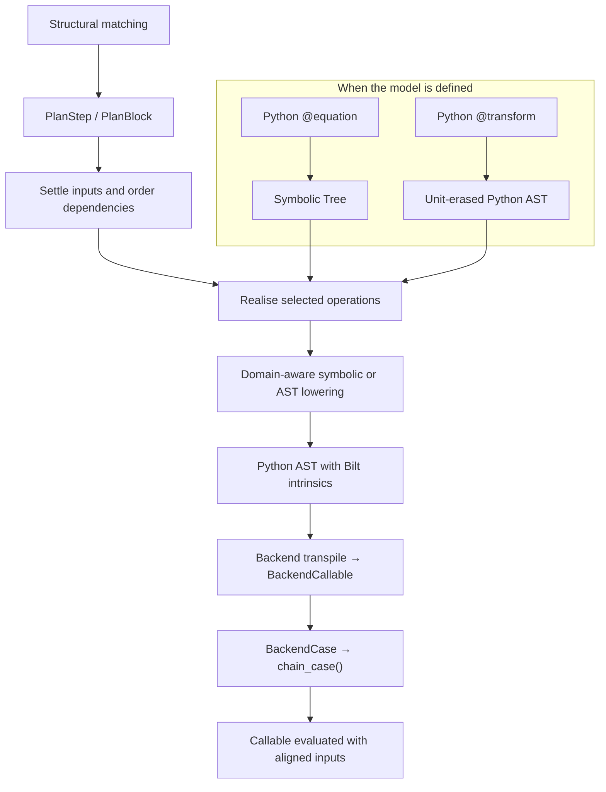
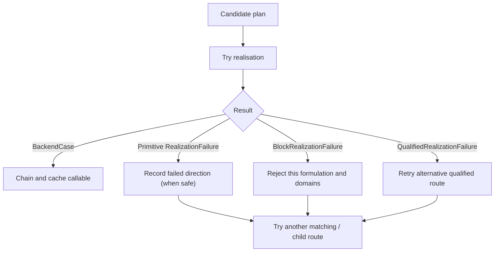

# Computational planning, realisation and lowering

This developer guide follows Bilt **after structural matching**: choosing a target-specific dependency route, checking that the chosen operations can actually be performed, and compiling them for a backend. Read [Structural analyser internals](structural-analysis.md) for discovery, validation, matching and search retries.

> Reviewed against Bilt `main` at [`25806b9`](https://github.com/aviation-impact-accelerator/bilt/commit/25806b96e1a0a4cafe915398b71683a3f3ae240c). Names in this guide are private implementation details.

## What counts as Bilt's IR today?

There is **no single, standalone program-level "Bilt IR" conversion pass between realisation and backend lowering** in the current implementation. Several existing representations serve different purposes:

| Representation | Created when | Contains |
| --- | --- | --- |
| `symbolic.Tree` | When an `@equation` is defined and symbolically traced | Backend-independent mathematical relationships, operators, named dimensions and symbols |
| `PlanStep`, `PlanBlock`, `AnalysisPlan` | After selecting and settling a matching | Directed operation choices, dependencies and ordered coupled blocks, but not executable expressions |
| `QualifiedStep`, `QualifiedBlock`, `QualifiedPlan` | Expanded search across subsystem paths | Original primitive relationships, qualified names and selected unknowns |
| `LinearBlock` / `LinearOperatorBlock` | When a coupled block is analysed | Symbolic linear coefficients or supported unknown-dependent tensor operators |
| `LoweredExpression` | While realising a chosen equation | A `Tree` with named tensor operations lowered to positional operations, **plus its `Domain`** |
| Python `ast.FunctionDef` | While realising an equation, transform or linear solve | A backend-facing function, potentially containing Bilt intrinsic calls |
| `BackendCallable` / `BackendCase` | After transpiling operations | Compiled callables and the sequence used to compose them |

In this document, **Bilt symbolic representation** means `symbolic.Tree` (and its `Expr` wrapper). It is useful to think of this as a *symbolic expression IR*, but the project does not yet have one unified backend-independent **program IR** combining equations, transforms, subsystems and control flow.

That distinction affects the order of events: equations are converted to `Tree` **at definition time**, before structural search; realisation later isolates a chosen equation output, lowers the symbolic expression, generates Python AST and transpiles it. Transforms take a different path via a unit-erased Python AST.

## Pipeline at a glance



The diagram shows the common flow, not a guarantee that every operation passes through identical intermediate objects. A child subsystem may reuse an already compiled child callable; coupled blocks generate solve and projection functions.

## 1. Build a dependency-aware plan

**Code:** `core/_structural_analysis/_causalization_block_solver/_planning.py`, `_settle_assignments.py`, `_dependency_graph.py`, `_blocks.py`; data classes in `core/_structural_analysis/_plan.py`.

The ordinary search yields a mapping from unknown attributes to chosen producers. `plan_blocks()` then:

1. Uses `settle_assignments()` to establish child inputs where possible, querying a child's required input ports rather than treating every boundary port as necessary.
2. Follows only the requested output's dependencies, ignoring selected assignments that do not contribute to the target.
3. Builds a directed producer-to-consumer dependency graph; missing required producers are rejected.
4. Groups strongly connected components (SCCs) and orders them topologically. A cyclic component is a `PlanBlock(is_cyclic=True)`.
5. Checks that cyclic blocks have a supported symbolic linear formulation; an unsupported block rejects this candidate route.

A `PlanStep` identifies an operation and the output it has been asked to produce. For a child, `child_inputs` records the route's required child-local ports. An `AnalysisPlan` contains the request and ordered `PlanBlock` objects. It is **a plan**, not lower-level executable code.


For supported unavoidable cross-boundary coupling, `_expanded_planning.py` instead builds ordered `QualifiedStep` or `QualifiedBlock` entries. The qualified path retains each source equation's subsystem instance path; `_realize_qualified.py` uses `QualifiedPlan`.

## 2. Realise the plan, carrying domains forward

**Code:** `core/_structural_analysis/_realize.py` (`realize_plan()`), `_realize_qualified.py` (`realize_qualified_plan()`).

`realize_plan()` begins with the supplied input domains and visits ordered blocks in dependency order. After successfully realising each operation, it records the resulting `Domain` so later steps can infer axes and validate constraints.

For a single equation, it checks minimum required dimensions on consumed inputs **before** compiling, and checks the inferred output domain **afterwards**. These are requirements attached to the selected equation, not global constraints that should invalidate every other route.

For a coupled block, realisation checks relevant domain requirements, compiles one joint solve and its per-unknown projections, and then records all block output domains. Failed blocks can be memoised for the current request by the specific steps/child routes and incoming domains.

Successful ordinary or qualified realisation returns a `BackendCase`. This is already a container of **compiled** `BackendCallable` objects, not an unlowered IR.

## 3. Equations: symbolic representation to a callable

**Code:** `core/_equation.py`, `symbolic/_tree.py`, `symbolic/_isolation/_isolate.py`, `core/_tensors/_expression_lowering.py`, `core/_to_ast.py`, `core/_structural_analysis/_realize.py`.

An equation such as:

```python
@equation
def motion(distance: float, speed: float, time: float) -> bool:
    return distance == speed * time
```

is validated and symbolically traced when the `BasicEquation` object is constructed. The relationship is stored in `__bilt_equation_tree__` as an immutable `Tree`; it is **not** converted to a Bilt tree only after a matching has been chosen. The equation's Python syntax is checked first, and supported conditional syntax is normalised for symbolic tracing.

When a later request chooses the equation to produce `speed`, `_equation_to_callable()` performs roughly this sequence:

```python
target = Expr.symbol(plan_step.output)
isolated = isolate(equation.__bilt_equation_tree__, target)
lowered = lower_expression(
    isolated.rhs,
    symbol_domains=symbol_domains,
    canonical_order=current_evaluation().canonical_order,
)
function_ast = tree_to_functiondef(
    lowered.tree,
    name=plan_step.output,
    parameter_order=equation.__bilt_parameters__,
)
# Name-mangle and call backend.transpile(function_ast).
```

Here the isolated equation is conceptually `speed = distance / time` (provided Bilt supports that isolation). The isolated expression is still symbolic; `lower_expression()` resolves tensor dimension and domain semantics for the selected request. The generated Python AST is then name-mangled and passed to the chosen backend.


`LoweredExpression.tree` remains a Bilt `Tree` but no longer contains named dimension atoms: named reductions and selections have been resolved to positional axes and operations. The accompanying `domain` describes the output's named tensor axes. `tree_to_functiondef()` turns the lowered tree into ordinary Python AST, including Bilt intrinsic calls where necessary.

An unsupported isolation, domain inference or backend compilation returns `RealizationFailure` for that **specific selected direction**; a different matching may still be usable.

## 4. Transforms: a distinct AST-first path

**Code:** `core/_transform.py`, `core/_unit_erasure.py`, `core/_tensors/_transform_lowering.py`.

`BasicTransform` extracts Python source and keeps a **unit-erased function AST** at construction. At realisation, `_transform_to_callable()` deep-copies that AST and calls `lower_transform()` to remove annotations and translate supported named tensor operations into backend intrinsics.

Unlike an equation, a transform does **not** generally become a `symbolic.Tree` or undergo symbolic isolation. The transform's declared output is already fixed.

For a single-return expression that the transform lowerer recognises, Bilt infers an output domain; otherwise the existing implementation retains the AST with a fallback domain based on its inputs. This is one reason not to describe every transform as passing through a universal expression IR.

The resulting Python AST is transpiled and wrapped as a `BackendCallable`, with its inferred or fallback domain.

## 5. Subsystems: compile the selected child route

**Code:** `core/_structural_analysis/_realize.py::_sub_system_to_callable()`; `core/_system/_implementation.py`.

An ordinary child step already carries selected `child_inputs`. Realisation translates parent-qualified names to child-local input ports, obtains the child's `EvaluationRequest`, and calls `child.implementation.get_evaluation()`.

The returned callable is wrapped to adapt its input names back to the parent. **The ordinary hierarchical path does not flatten a child's operations into the parent's Python AST.** The expanded qualified path is different: it works on primitive source equations across child boundaries and preserves their qualified identities.

## 6. Coupled blocks: symbolic linear form to a solve

**Code:** `_linear_block.py`, `_linear_operator.py`, `_realize_linear.py`, `_linear_operator_lowering.py` under `core/_structural_analysis/`.

A supported cyclic `PlanBlock` or `QualifiedBlock` is not realised by isolating each equation independently.

`extract_supported_linear_block()` (or its qualified counterpart) first attempts a symbolic affine extraction into `LinearBlock`: coefficient and right-hand-side `Tree` expressions for `coefficients @ unknowns = rhs`. For supported tensor operators that cannot be represented as a simple pointwise affine form, the extractor may retain the original equations as `LinearOperatorBlock`.

`realize_linear_block()` then uses input domains and the evaluation's canonical axis order to infer output domains and choose a pointwise or joint-tensor layout. It generates a solve function AST containing the `__bilt_linear_solve__` intrinsic, plus a projection function for each unknown. The backend must implement `LinearSolveBackend`; the Python and JAX implementations supply different numerical bindings.

This stage tests supported **symbolic linear form and compatible domain layout**. It does not prove the numerical matrix is nonsingular for actual input values.

## 7. Lowering boundary and backends

**Code:** `core/_to_ast.py`, `core/_structural_analysis/_realize*.py`, `_backend/_base_backend.py`, `_backend/_in_process_python_mixin.py`, `_backend/_python/_backend.py`, `_backend/_jax/_backend.py`.

The current backend boundary is **Python `ast.FunctionDef`** (not a shared Bilt program-IR object). `Backend.transpile()` compiles one function AST to `BackendCallable`; `LinearSolveBackend.transpile_linear_solve()` adds the optional linear-solve capability.

Generated AST can contain Bilt intrinsics such as `__bilt_sum__`, `__bilt_isel__`, `__bilt_where__` and `__bilt_linear_solve__`. These are bound to backend-specific implementations during compilation.

- The **Python backend** compiles functions in-process and executes intermediates in sequence in `chain_case()`.
- The **JAX backend** checks and transforms the function AST for supported JAX semantics, and constructs a chained callable through its own compilation path.

`BackendCase` holds `name`, supplied `parameters`, a sequence of compiled `intermediates`, and `return_name`. `Implementation.get_evaluation()` calls `backend.chain_case(case)` to obtain the final callable, which can be cached for the compilation request and context.

When evaluating, `Implementation.evaluate()` aligns and lowers input tensors before calling that callable, then lifts and validates the output. These input/output alignment steps are **not** the same as symbolic expression lowering during realisation.

## 8. Failure boundaries and retries



The errors are intentionally scoped:

- `RealizationFailure` identifies one selected `PlanStep`; unsupported isolation or backend transpilation may eliminate that direction. A domain-specific equation requirement error is **not** permanently blacklisted.
- `BlockRealizationFailure` rejects a complete coupled formulation under its incoming domains, rather than every primitive equation inside the block.
- `QualifiedRealizationFailure` retains either the exact qualified step or qualified block, including source ownership.
- A failed child realisation can trigger another child route query; the route cache is invalidated when failure knowledge changes.

A numerical failure **during evaluation** is not automatically a structural-search retry: realisation and search happen before the final callable runs.

## Debugging by representation

| Symptom | Inspect first |
| --- | --- |
| Wrong producer or missing prerequisite | `_planning.py`, `_settle_assignments.py`, `PlanStep.consumed` |
| Spurious cycle / unsupported block | `_dependency_graph.py`, `_blocks.py`, `_linear_operator.py` |
| Equation can match but not execute | `__bilt_equation_tree__`, `isolate()`, `_equation_to_callable()` |
| Named tensor axis or output-domain error | `lower_expression()`, `LoweredExpression.domain`, `lower_transform()` |
| Transform fails only on JAX | `JAXBackend.transpile()`, `_jax/_supports.py`, `_jax/_ast.py` |
| Coupled block rejected | `_realize_linear.py`, `extract_supported_linear_block()`, backend linear-solve capability |
| Child works alone but fails in parent | `PlanStep.child_inputs`, `_sub_system_to_callable()` and child `get_evaluation()` |
| Failure occurs only on supplied values | Backend callable evaluation, input alignment or numerical solve (not structural matching) |

Regression tests worth starting with include `tests/core/test_plan.py`, `tests/core/test_realize.py`, `tests/core/test_tree_to_ast.py`, `tests/core/test_equation_ast.py`, `tests/core/test_conditional_lowering.py`, `tests/core/linear/test_linear_block_execution.py`, `tests/core/linear/test_qualified_blocks.py`, `tests/_backend/test_python_backend.py` and `tests/_backend/test_jax_backend.py`.

## What a future unified Bilt program IR would change

A future design **could** introduce a backend-independent realised program IR *between* dependency planning and backend-specific compilation, representing ordered scalar operations, transforms, child calls and joint linear solves in one format. That is a potential architecture, **not a stage implemented on `main` today**.

Today the common boundaries are the symbolic `Tree` (for equations), the planning data classes, backend-facing Python AST, and compiled `BackendCallable` / `BackendCase` objects. Any IR refactor should preserve the distinct failure scopes and domain information described above.

[← Structural analyser internals](structural-analysis.md) · [Index](../index.md)
