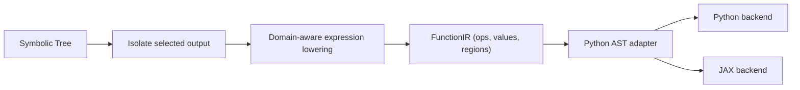

# Experimental realised-function IR

This document describes the narrow prototype in `core/_ir.py`. It is a
backend-neutral representation inspired by MLIR, **not** MLIR bindings, a
full typed compiler IR, or a replacement for Bilt's symbolic `Tree`.

## Location in the pipeline



`Tree` remains the mathematical relationship representation created at model
definition time. `FunctionIR` is created only **after** a route has been
chosen, isolated, and its named tensor operations have been resolved to
positional axes. The IR represents a directed function, not an acausal equation.

The compiler still accepts `ast.FunctionDef` in `Backend.transpile()`. No
backend ABI change or new runtime dependency is introduced in this prototype.

## Prototype operations

- `Value`: a function argument or a uniquely numbered operation result.
- `Operation`: an opcode, operand references and literal attributes.
- `Block`: a sequence of operations and its yielded result.
- `FunctionIR`: a name, parameters, a root block and output `Domain`.

Operations use dialect-like names: `arith.add`, `arith.mul`,
`arith.pow`, `arith.inv`, `arith.neg`, `arith.constant`, `cmp.*`,
`bilt.sum`, `bilt.isel`, `bilt.where`, and `bilt.mask_*`.

A scalar `scf.if` has two independent nested regions; only the chosen
region runs in the Python backend. JAX continues to turn the resulting Python
`IfExp` into `jax.lax.cond`. `bilt.where` remains elementwise, not lazy.

For example, a realised scalar expression `a + b * c` resembles:

```text
func @result(%a, %b, %c) {
  %0 = arith.mul %b, %c
  %1 = arith.add %a, %0
  return %1
}
```

This is illustrative notation, not a parser or serialisation format.

## What has and has not changed

The **equation** path uses `tree_to_ir()` followed by
`ir_to_functiondef()` before existing name-mangling and transpilation.
The same adapter is exercised against the Python and JAX backends by tests.

The prototype does **not yet** migrate:

- `@transform` functions, which may contain arbitrary unit-erased Python
  statements, local assignments, calls and closure bindings;
- joint linear-solve AST construction, projection functions or operator blocks;
- the parent/child execution-plan sequence held by `BackendCase`;
- type inference beyond the already-inferred output `Domain`, IR validation,
  optimisation passes, canonical serialization, or a native MLIR dependency.

For future work, use a *separate explicit* function/region lowering pass for
transforms and coupled solves rather than passing Python AST objects through
IR operations as opaque payloads. The longer-term shared representation should
also model child calls and the dependency-plan composition without losing
qualified names, tensor domains, or the existing failure/retry boundaries.

## Validation required before production use

`tests/core/test_function_ir.py` checks arithmetic, conditional regions,
tensor selection and reductions on Python and JAX. Existing regression
coverage for realisation, equations and named tensors should also run.
Compare numerical parity and compile-time/cold-start performance against
`main` before making this the default architecture across all operations.

The experimental IR currently reconstructs nested Python expressions from
SSA references, rather than emitting a flat sequence of AST assignments.
This preserves simple expression semantics but does not yet demonstrate
large-DAG reuse or support general statements. It should be treated as an
executable architecture experiment, not a ready basis for arbitrary backends.

## Follow-up experiment: transforms, validation and program scheduling

The stacked follow-up introduces a conservative `ast_to_ir()` adapter for
unit-erased transforms containing simple assignments, arithmetic, comparisons,
scalar conditional expressions and known Bilt tensor intrinsics. Unsupported
calls, loops, indexing and preserved closure values retain the original AST
backend path. This is intentional: the presence of an IR must not silently
reinterpret arbitrary Python.

`ir_to_functiondef()` emits temporary SSA bindings in evaluation order before
the final return. The shared verifier checks unique SSA definitions, region
dominance, operation arity and supported positional-axis attributes. Value-type
metadata currently records broad numerical/Boolean categories and optional
named domains; it is **not** a dimensional consistency proof or a general
shape/type inference engine.

`ProgramIR` and `CallStep` offer a first immutable backend-independent
dependency schedule. The schedule can be constructed from an existing
`BackendCase` and verified without embedding Python AST or callable objects,
but **does not yet drive backend compilation or execution**. In particular,
ordinary child calls and coupled block solves still use the existing
specialised compilation and realisation paths.

This permits separate validation of IR structure and dependency sequencing.
The next architectural step would lower selected plans into `ProgramIR`
*before* compiling individual steps, with explicit child/linear-solve operation
kinds and typed outputs. It must preserve Bilt's existing path-specific
realisation failures and search retries.
