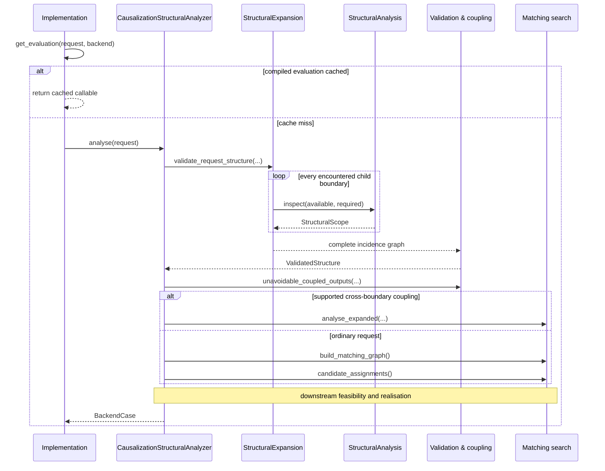
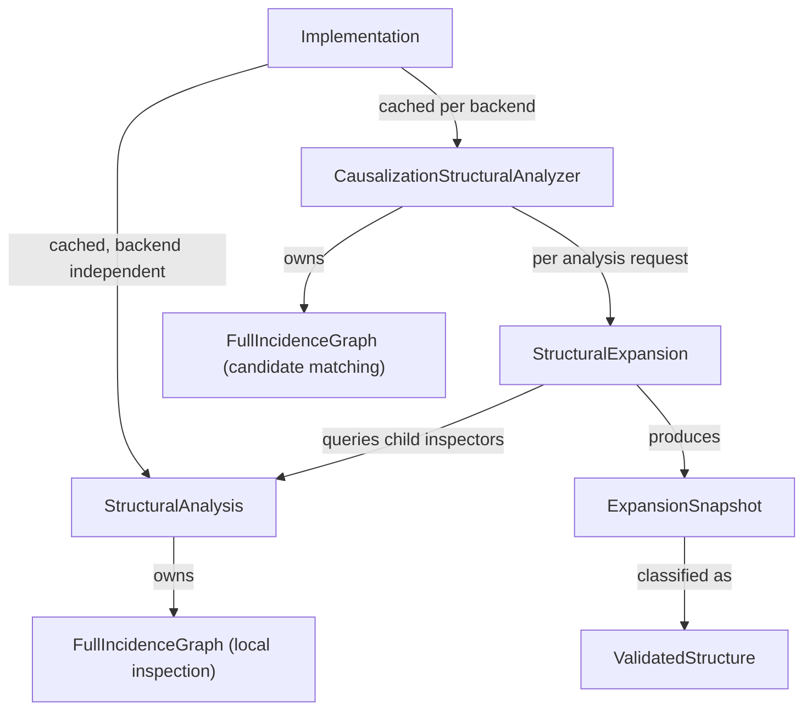

# Structural analyser internals

This page maps Bilt's default structural-search implementation: **which objects own each stage, how a request travels between them, what is cached, and where to debug failures**. Read [How structural search works](../guide/structural-search.md) for the algorithmic concepts.

> Reviewed against `main` at [`25806b9`](https://github.com/aviation-impact-accelerator/bilt/commit/25806b96e1a0a4cafe915398b71683a3f3ae240c). All names below are private implementation details, not public APIs. Computational-plan construction and realisation are a separate subject; this page marks their entry points but does not explain them.

Unless otherwise noted, the modules below live under `src/bilt/core/_structural_analysis/_causalization_block_solver/` (abbreviated **solver/**).

## Code map

| Module | Owner / responsibility |
| --- | --- |
| `core/_system/_implementation.py` | `Implementation`: builds requests, caches evaluations and owns analysers. |
| `solver/_backend.py` | `CausalizationStructuralAnalyzer`: coordinates validation, preflight, search and retries. |
| `solver/_full_incidence_graph.py` | `FullIncidenceGraph`: local constituent-to-attribute `rustworkx.PyGraph`. |
| `solver/_structural_scope.py` | `StructuralAnalysis`, `StructuralScope`, `StructuralBoundary`: inspect local structural evidence. |
| `solver/_expand_structure.py` | `StructuralExpansion`, `ExpansionSnapshot`, `ExpandedConstraint`: discover qualified primitive rows. |
| `solver/_structural_validation.py`, `_dm.py` | `ValidatedStructure`, `DMPartition`: classify request constraints. |
| `solver/_coupling.py` | `unavoidable_coupled_outputs()`: conservative coupling preflight. |
| `solver/_matching.py`, `_search.py` | Hierarchical producer graph, preferences, matching and retries. |
| `solver/_expanded_planning.py`, `_expanded_search.py` | Separate qualified primitive matching path for cross-boundary coupling. |
| `solver/_structural_cache.py`, `_route_cache.py` | Nested request-scoped inspection and route caches. |

## One request, end to end

`Implementation.evaluate()` returns a supplied output directly. Otherwise it creates an `EvaluationRequest` carrying the output name and input domains. `get_evaluation()` checks for an already compiled evaluation before calling `analyser_for(backend).analyse(request)`.



The analyser's `_analyse()` validates the **combined request structure before** building the ordinary matching graph. Its `_preflight()` may route supported unavoidable cross-boundary linear coupling to expanded primitive search, reject proven unsupported coupling, or fall through to the normal hierarchical path. An inconclusive coupling proof does not reject the request.

## Object lifetime and ownership



`Implementation.structural_analysis()` lazily retains a backend-independent `StructuralAnalysis`. `Implementation.analyser_for(backend)` caches an analyser per backend. They each own separate local incidence graph objects, built from the same model constituents.

| Record | Important state |
| --- | --- |
| `StructuralScope` | Local equations and transforms, touched attributes and unresolved child boundaries. |
| `StructuralBoundary` | Encountered child operation and its supplied/required ports; not a promise of a route. |
| `StructuralExpansion` | Open contexts keyed by instance path, discovered source rows, pending queries and unresolved child paths. |
| `ExpandedConstraint` | Original primitive operation, instance path and qualified attribute set. |
| `ExpansionSnapshot` | Immutable snapshot with `constraints`, `attributes`, `available` and `unresolved`. |
| `ValidatedStructure` | Full snapshot and extracted `well_determined` region. |
| `DMPartition` | Sets of under-, well- and overdetermined graph nodes. |

## Structural discovery workflow

`inspect_structure()` in `_structural_scope.py` calls `_scope_nodes()` to explore the relevant local incidence graph. It stops at supplied attributes, follows equations through any participating value, enters transforms only through their declared output, and records child ports as opaque `StructuralBoundary` objects.

`StructuralExpansion` begins with root inspection. Its `expand(path)` opens one encountered child; `snapshot()` can still be incomplete. Definitive validation calls `collect()`:

```python
def collect(self):
    while self.boundaries:
        self._expand(min(self.boundaries))
    return self.snapshot().to_incidence()
```

This completes **all reached** child paths, not all children in the entire model.

When a child is opened, `_open()` queries its implementation's structural inspector. `_add_attributes()` and `_schedule()` revisit newly exposed attributes in relevant open contexts, and `_drain()` batches pending attributes by context. Newly discovered child ports may reveal more parent or sibling constraints, which is why inspection repeats to a fixed point.

The dictionary of primitive rows is keyed by `(instance_path, id(source_operation))`. It deduplicates repeated discovery of the same row while keeping equations from two instances of one implementation distinct. Recursive subsystem containment is rejected.

## Validation and coupling workflow

`validate_request_structure()` in `_structural_validation.py` returns `None` if the requested output was supplied. Otherwise it runs `StructuralExpansion.collect()` and passes the complete graph to `validate_structure()`.

`dulmage_mendelsohn()` in `_dm.py` classifies the graph using a maximum-cardinality matching. Validation rejects any overdetermined region in the scoped constraints, or underdetermination intersecting the **requested** unknown. `ValidatedStructure` preserves the full expansion plus the well-determined region needed for coupling preflight.

`_preflight()` calls `unavoidable_coupled_outputs()` from `_coupling.py`. The proof is conservative and only applies to a complete, square, closed, directionally matchable region (possibly selected from a larger rectangular request). It distinguishes child-local supported linear blocks from supported cross-boundary blocks and provably unsupported coupling.

This stage does **not** choose an execution route.

## Hierarchical candidate search

`build_matching_graph()` in `_matching.py` copies the local incidence graph, retains only declared-output edges for transforms, replaces subsystem nodes with `PlanStep(operation=child, output=port)` candidates for unsupplied ports, and removes supplied attribute nodes. A child `PlanStep` is candidate identity, **not** a committed computation.

`_prefer_available_inputs()` assigns weight **1** to a primitive direction when all its other inputs are supplied and **0** otherwise (child candidates start at 0). `_prefer_child_producers()` can use a complete structural snapshot to give forward-reachable producers weight **2**, but only when there is more than one immediate child. `find_matching()` calls `rustworkx.max_weight_matching(max_cardinality=True)`, prioritising cardinality over weights.

The generator `candidate_assignments()` in `_search.py` maintains a stack of reduced candidate graphs and visited edge signatures. It:

1. Removes edges for recorded failed primitive directions.
2. Drops a graph if the unsupplied target has no possible producer edge, or if the edge set was seen.
3. Yields a maximum matching (even if the target is unmatched but still has a possible edge).
4. After the caller resumes, retries with newly recorded failures or branches by removing selected matching edges.

`_target_matching_edges()` restricts alternatives to those that could change the requested target's dependency route, including producers currently matched to other outputs. Search does not pre-enumerate all matchings.

## Expanded primitive search

For certain supported unavoidable cross-boundary coupled cases, `_expanded_planning.matching_graph()` uses **original primitive rows qualified by child path**. Transforms remain directed, and child-port producer placeholders are absent.

`_expanded_search.candidate_assignments()` uses unweighted maximum-cardinality matching and can branch on any selected matching edge. Failure identity includes the qualified path (`QualifiedStep`). Duplicate edge sets and graphs without a remaining target producer are skipped. **Do not apply hierarchical weight or target-pruning assumptions to this path.**

## Request state, caches and retries

| State | Key / owner | Lifetime or invalidation |
| --- | --- | --- |
| Structural inspection object | `Implementation._structural_analysis` | Implementation lifetime |
| Backend-specific analyser | `Implementation._analysers[backend]` | Implementation lifetime |
| Structural inspection results | `(incidence, supplied, required)` in `_structural_cache.py` | Shared by nested calls; cleared at outermost analysis exit |
| Child-route answers | `(analyser, frozenset(available), output)` in `_route_cache.py` | Shared by nested calls; reset at exit or on invalidation |
| Failed primitive directions | `CausalizationStructuralAnalyzer._failures` | Analyser-owned, used to exclude specific choices |
| Compiled evaluations | `Implementation._evaluation_cache` | Implementation-owned; keyed by request and compilation context |

`analyse()` opens both request-cache scopes; nested analyses reuse them. The structural cache holds evidence unaffected by execution failures. `invalidate_route_cache()` clears child-route answers when failed realisation changes what is known about possible routes.

Retries are intentionally narrow: a domain-specific `BiltEquationDomainRequirementError` does not permanently blacklist an equation, a failed coupled formulation does not blacklist an individual primitive direction, and child failures may prompt a fresh child-route query. **Failures never rewrite the original structural incidence graph.**

## Testing and debugging

Start with the corresponding regression tests under `tests/core/structural/scc/`:

| Area | Tests |
| --- | --- |
| Local scope and child expansion | `test_structural_scope.py`, `test_resumable_expansion.py`, `test_batched_expansion.py` |
| DM validation | `test_dm.py`, `test_request_validation.py`, `test_structural_validation.py` |
| Unavoidable coupling | `test_coupling.py`, `test_rectangular_coupling.py` |
| Producer weights and child hints | `test_matching.py`, `test_producer_preferences.py` |
| Alternative search and pruning | `test_candidate_assignments.py` |
| Caching and retries | `test_structural_cache.py`, `test_route_cache.py` |

When diagnosing a failure, trace **request → scope → completed expansion → DM partition → coupling preflight → matching graph → alternative candidates**. If structural matching succeeds but downstream checks reject the candidate, move to the separate planning/realisation modules (`_planning.py`, `_settle_assignments.py`, `_realize*.py`).

The target-route pruning tests include exhaustive small-graph comparisons. Keep them when changing heuristics: reducing search work must not lose viable alternatives.

## Related reading

- [How structural search works](../guide/structural-search.md) — algorithms and search biases.
- [From models to computation](../guide/models-to-computation.md) — the modelling perspective.
- [Systems of systems](../guide/systems-of-systems.md) — child interfaces.
- [Coupled systems](../guide/coupled-systems.md) — supported linear coupling.
