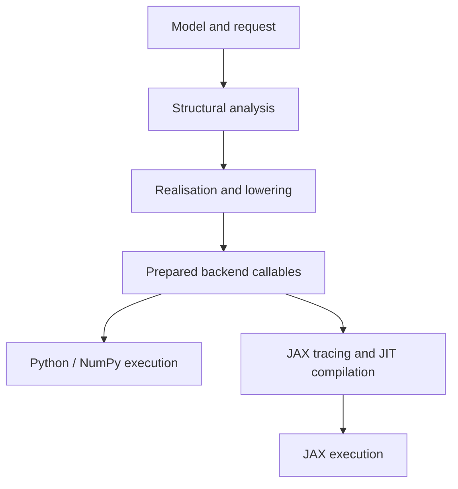

# Backends

For backend selection and supported operations, see the [Backends API](../api/backends.md).

Bilt separates the model from the way its computations are executed.

Systems, equations, and transforms describe the model. A **backend** determines
how Bilt runs the calculation.

Bilt currently provides Python and JAX backends.

## Python backend

The Python backend is included in Bilt's standard installation. Bilt currently
installs from [GitHub](https://github.com/aviation-impact-accelerator/bilt), and
requires Python 3.15 or newer and a Rust toolchain.

With `uv`:

```console
uv add "git+https://github.com/aviation-impact-accelerator/bilt.git"
```

Or with `pip` in a Python 3.15 environment:

```console
python -m pip install "bilt @ git+https://github.com/aviation-impact-accelerator/bilt.git"
```

The Python backend is used by default. No additional dependencies are required.

## Install the JAX backend

JAX is an optional dependency.

With `uv`:

```console
uv add "bilt[jax] @ git+https://github.com/aviation-impact-accelerator/bilt.git"
```

Or with `pip`:

```console
python -m pip install "bilt[jax] @ git+https://github.com/aviation-impact-accelerator/bilt.git"
```

This installs Bilt together with its supported JAX dependency.

## Run the same model on Python and JAX

A JAX-compatible Bilt model does not need to be rewritten to change backend.

For example:

```python exec="on" source="above" session="motion"
from bilt import Implementation, Interface, equation, field, system


@system
class Motion(metaclass=Interface):
    distance: float = field()
    speed: float = field()
    time: float = field()


@equation
def kinematic_relation(
    distance: float,
    speed: float,
    time: float,
) -> bool:
    return distance == speed * time


motion_model = Implementation(
    Motion,
    [kinematic_relation],
)
```

First evaluate with the default Python backend:

```python exec="on" source="above" session="motion"
with motion_model:
    python_motion = Motion(speed=20.0, time=5.0)
    assert python_motion.distance == 100.0
```

To select a backend explicitly, use its context alongside the implementation:

```python exec="on" source="above" session="motion"
from bilt import JAX_BACKEND, PYTHON_BACKEND

with PYTHON_BACKEND, motion_model:
    python_distance = Motion(speed=20.0, time=5.0).distance

with JAX_BACKEND, motion_model:
    jax_distance = Motion(speed=20.0, time=5.0).distance

assert python_distance == jax_distance == 100.0
```

Changing the backend does not change the system or the available relationships.
Use a fresh instance for each comparison: reading a value that was already
calculated on an instance returns the cached value, even in a different backend
context.

## Python and JAX

For many models, the Python backend is the simplest choice. It executes
prepared Python callables and uses NumPy for tensor operations. JAX adds
just-in-time (JIT) compilation of numerical operations, which has an initial
cost but can make repeated calculations faster.

Both backends use Bilt's structural analyser. There are several activities
between defining a model and obtaining a result:



- **Structural analysis** determines which relationships and coupled blocks
  are needed, given the supplied values and requested result.
- **Realisation and lowering** turn the selected relationships into backend
  operations, including rearranging equations and resolving named tensor
  operations. Bilt prepares executable Python functions for both backends.
- **JAX compilation** specialises numerical functions for compatible input
  signatures. Python does not have this additional JIT step.
- **Execution** supplies the numerical inputs, runs the calculation and
  returns the requested values with their domains and units.

These are distinct responsibilities, not necessarily separate passes.
For example, a structural candidate may be rejected during realisation
if the required calculation is unsupported.

### What Bilt can reuse

Bilt caches more than just numerical results.

| Reused information | What it saves |
| --- | --- |
| Plans on an implementation | Repeating analysis and realisation for compatible requests. |
| Prepared backend callables | Rebuilding executable calculations. |
| JAX-compiled functions | Repeating JIT compilation for compatible input signatures. |
| Calculated values on a system instance | Recalculating outputs and intermediates already obtained. |

The first two can be reused across fresh instances of the same implementation.
The cache keys account for the request, supplied input domains, backend and
relevant coordinate bindings. Executable variants also depend on which
intermediates can be reused. JAX can compile a new numerical variant when
array shapes or data types change, even if Bilt can reuse its plan.

For example, after the first JAX request above, we can ask the same
implementation to calculate a new journey:

```python exec="on" source="above" session="motion"
with JAX_BACKEND, motion_model:
    next_distance = Motion(speed=30.0, time=5.0).distance

assert next_distance == 150.0
```

The inputs have changed, so the numerical calculation must run again. The
prepared work can be reused. This is different from reading
`python_motion.distance` a second time, which returns the previously
calculated result.

Calculated instance values are not treated as additional supplied constraints
during structural planning. See [Models to computation](models-to-computation.md)
and the [Systems API](../api/systems.md) for details.

### Cold and warm evaluations

A cold evaluation may include structural analysis, preparation of backend
callables and, for JAX, numerical compilation. A warm evaluation on a fresh
instance can reuse compatible prepared work but still executes the calculation.

When comparing performance, reuse the implementation but create a fresh
instance for each numerical request. State which requests and input shapes
were warmed up, and ensure the numerical results are materialised before
stopping the timer. JAX can dispatch work asynchronously.

JAX can be useful for large parameter sweeps, uncertainty propagation,
optimisation and other repeated numerical evaluations. It is not automatically
faster: for small or one-off calculations, preparation and JIT compilation
may cost more than they save.

The [JAX worked example](../worked_examples/compiling-a-bilt-model-with-JAX.md)
compares Python, cold JAX and warm JAX on a larger array calculation.

## Writing JAX-compatible relationships

Code evaluated with the JAX backend must use operations supported by Bilt's JAX
backend.

Simple numerical expressions work naturally. For example, the same kinetic energy equation works with both backends:

```python exec="on" source="above" session="motion"
@system
class KineticEnergy(metaclass=Interface):
    kinetic_energy: float = field()
    mass: float = field()
    velocity: float = field()


@equation
def kinetic_energy_relation(
    kinetic_energy: float,
    mass: float,
    velocity: float,
) -> bool:
    return kinetic_energy == 0.5 * mass * velocity**2


kinetic_model = Implementation(KineticEnergy, [kinetic_energy_relation])

for backend in (PYTHON_BACKEND, JAX_BACKEND):
    with backend, kinetic_model:
        assert KineticEnergy(mass=2.0, velocity=3.0).kinetic_energy == 9.0
```

Supported JAX operations can also be used where required, for example
`jnp.sqrt(value)` in a JAX-compatible transform. See the
[Backends API](../api/backends.md#supported-operations) for transform syntax.

The JAX backend is well suited to array-based numerical calculations built from
supported arithmetic and JAX operations.

Both backends support `if/elif/else`, nested conditionals and numeric-literal
`match/case` inside an `@equation`. Conditions can select from scalar values or named tensors; a tensor
predicate selects elementwise and broadcasts over named dimensions. The same
equation syntax works on Python and JAX, but elementwise selection evaluates
both branches, even where the mask excludes one. See
[Using `if/else` in an equation](equations-and-acausal-modelling.md#using-ifelse-in-an-equation),
[Using `match/case` in an equation](equations-and-acausal-modelling.md#using-matchcase-in-an-equation)
and [Conditional selection](../api/tensors.md#conditional-selection-in-equations).

Some ordinary Python behaviour is not suitable for JAX execution. Examples
include file or network access, Python side effects, and calls to libraries that
do not provide JAX-compatible operations.

Not all Python code can be used in transforms with JAX. In particular,
ordinary `if` statements inside a `@transform` are not currently supported:

The following is a Python-only syntax example, not a JAX-compatible calculation:

```python exec="off"
@transform
def absolute(value: float) -> float:
    if value > 0:
        return value
    return -value
```

Additional syntax and JAX capabilities may be supported by Bilt in the future.
For now, relationships intended for JAX execution should use the operations and
syntax supported by the current backend.

## Lists and arrays

With the JAX backend, list literals in transforms are converted to JAX arrays.
Nested lists similarly become multidimensional JAX arrays. See the
[Backends API](../api/backends.md#supported-operations) for supported operations.

## Choosing a backend

For most use, start with the Python backend.

| Use Python when | Use JAX when |
| --- | --- |
| the calculation is small or one-off | the numerical calculation is substantial |
| ordinary Python compatibility matters | the calculation is JAX-compatible |
| Python-only libraries or dynamic behaviour are required | the same calculation is evaluated repeatedly |
| compilation would not pay off | the whole relevant calculation can remain visible to Bilt under JAX |

The model describes **what** to compute. The backend determines **how** that
calculation runs.

## Advanced: nested backend evaluation

The preferred approach is to evaluate a Bilt model with a single backend.

This keeps the complete chain of relationships used to produce an output
visible to Bilt. If the model is JAX-compatible, selecting the JAX backend
around the whole implementation preserves that transparency while allowing JAX
to compile the calculation.

There is currently an escape hatch for cases where this is not possible.
A transform running with the Python backend can explicitly evaluate another
Bilt implementation using JAX. See the
[executable nested-backend example](../worked_examples/compiling-a-bilt-model-with-JAX.md#current-workaround-a-nested-jax-subproblem).

This can be useful when an unavoidable Python-only operation must happen before
a substantial JAX-compatible numerical calculation.

However, the nested evaluation creates a boundary in the model. The outer Bilt
evaluation sees the transform as one operation; it cannot inspect the chain of
relationships used inside the nested JAX evaluation. Treat this as a workaround,
not the preferred way to compose a model.

[← Coupled systems](coupled-systems.md) · [Index](../index.md) · [Units →](units.md)
