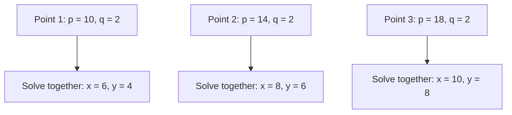
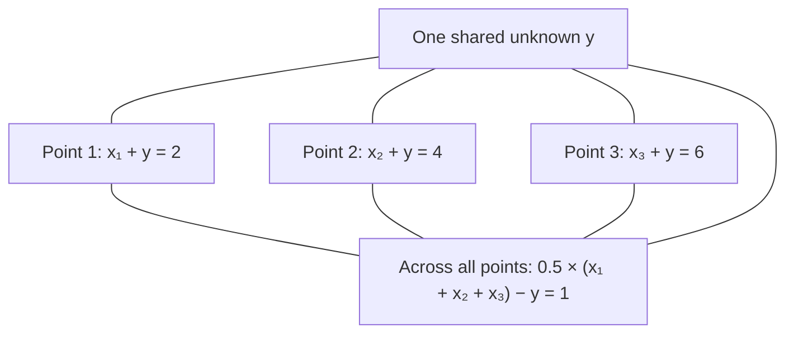
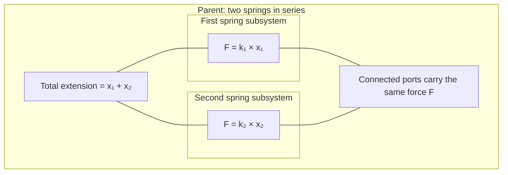

## Coupled linear systems

So far, our computation plans have been chains of calculations.

One relationship produces a value. Another relationship uses it. Each step can run once its inputs are known.

But some equations need to be solved together.

Consider:

\[
x+y=p
\]

\[
x-y=q
\]

If `p` and `q` are known, neither equation can calculate `x` without `y`, or `y` without `x`.

Together, however, they determine both values.

Bilt calls this group a **coupled block**. When the block is linear in its unknowns, Bilt can assemble and solve a linear system for it.

The surrounding model can still contain ordinary equations and transforms. Only the coupled part needs a simultaneous solve.

**Coupled equations can span systems and subsystems.** A parent can describe connections and balances while each child describes its own physics. Bilt can solve supported linear relationships from those different levels together, without requiring you to flatten the model or evaluate each child independently first.

Bilt uses the causalization (SCC) structural analyser by default. It identifies the calculations needed for a request and groups equations that must be solved together. Choosing the Python or JAX backend determines how those calculations execute.

The examples use the ordinary Bilt API:

```python exec="on" source="above" session="linear-systems"
import numpy as np

from bilt import Implementation, Interface, PYTHON_BACKEND, field, system, equation
```

### Start with two unknowns

We declare four values and two equations:

```python exec="on" source="above" session="linear-systems"
@system
class Pair(metaclass=Interface):
    x: float = field()
    y: float = field()
    p: float = field()
    q: float = field()


@equation
def total(x: float, y: float, p: float) -> bool:
    return x + y == p


@equation
def difference(x: float, y: float, q: float) -> bool:
    return x - y == q


pair_model = Implementation(Pair, [total, difference])

scalar_inputs = {"p": 10.0, "q": 2.0}
x = pair_model.evaluate(scalar_inputs, "x", PYTHON_BACKEND)
y = pair_model.evaluate(scalar_inputs, "y", PYTHON_BACKEND)

assert np.isclose(x, 6.0)
assert np.isclose(y, 4.0)
```

We did not rearrange the equations or declare a matrix.

Bilt identifies that `x` and `y` depend on one another, extracts their coefficients, and solves the block.

Although we requested one value at a time, each request can require both unknowns to be solved together.

You can also request both outputs from one instance. Bilt retains the original constructor inputs as the boundary values; a cached result does not become an extra supplied constraint:

```python exec="on" source="above" session="linear-systems"
with PYTHON_BACKEND, pair_model:
    pair = Pair(p=10.0, q=2.0)
    assert np.isclose(pair.x, 6.0)
    assert np.isclose(pair.y, 4.0)
```

Requested outputs are cached individually. This does not mean every intermediate result of a block is cached for later requests.

### A different request can give a different plan

Now supply `x` and `q`, and ask for `p`:

```python exec="on" source="above" session="linear-systems"
with PYTHON_BACKEND, pair_model:
    inverse = Pair(x=6.0, q=2.0)
    assert np.isclose(inverse.p, 10.0)
```

For this request, Bilt can calculate `y=x-q`, then `p=x+y`.

There is no need for a coupled solve.

The equations did not change. The values supplied changed what remained unknown, and therefore how the model could be evaluated.

### Linear in which unknowns?

A block is linear **in the values being solved together**.

For example:

\[
a x+y=p
\]

is linear in `x` and `y` when `a` is supplied.

The coefficient `a` might itself have been calculated by a nonlinear relationship earlier in the plan. That does not make this block nonlinear in `x` and `y`.

But if both `a` and `x` must be solved inside the block, their product is nonlinear. The current linear solver cannot handle that formulation.

This distinction matters in engineering models. A compressor pressure-ratio expression can be nonlinear while a later temperature and work balance is linear in its remaining unknowns.

### Independent solves over a domain

A **tensor** holds values over named dimensions, such as operating point or time. Its **domain** tells us which dimensions it varies over. A scalar has no such dimensions: it is one value.

Suppose `p` varies over operating points, while `q` is the same at each point:

```python exec="on" source="above" session="linear-systems"
from bilt import dim, domain, tensor

operating_point = dim("operating_point")

pointwise = pair_model.evaluate(
    {"p": tensor([10.0, 14.0, 18.0], over=operating_point), "q": 2.0},
    "x",
    PYTHON_BACKEND,
)

assert pointwise.domain == domain(operating_point)
np.testing.assert_allclose(pointwise.values, [6.0, 8.0, 10.0])
```

**Broadcasting** means reusing a value wherever it has no varying dimension. Here, the supplied `q=2` is used at all three operating points.

Each point has its own unknown `x` and `y`:



The points are independent. Bilt can perform these small coupled solves as a batch; it does not need one large system connecting all three points.

Reusing a **known** scalar does not introduce a shared **unknown**. That distinction matters in the next example.

### One unknown can be shared

Now consider a different pair of relationships:

\[
x_t+y=p_t
\]

\[
\tfrac12\sum_t x_t-y=q
\]

The subscript `t` means “at this time point”. Here `x` has a value at each time point, while there is only one unknown `y` for the whole set.

`x.sum(time)` is a **reduction**: it adds the values along `time` and removes that dimension from the result. For three points, it means `x₁ + x₂ + x₃`. A `.mean(time)` reduction averages them instead. If other dimensions remain, the operation is performed separately for each combination of those dimensions.

The second equation relates that sum to the shared `y`. All three points must therefore be solved together.

```python exec="on" source="above" session="linear-systems"
from bilt import Tensor

time = dim("time")


@equation
def shared_balance(x: Tensor, y: float, p: Tensor) -> bool:
    return x + y == p


@equation
def aggregate(x: Tensor, y: float, q: float) -> bool:
    return 0.5 * x.sum(time) - y == q


shared_model = Implementation(Pair, [shared_balance, aggregate])
shared_inputs = {"p": tensor([2.0, 4.0, 6.0], over=time), "q": 1.0}

varying = shared_model.evaluate(shared_inputs, "x", PYTHON_BACKEND)
shared = shared_model.evaluate(shared_inputs, "y", PYTHON_BACKEND)

assert varying.domain == domain(time)
np.testing.assert_allclose(varying.values, [0.0, 2.0, 4.0])
assert np.isclose(shared, 2.0)
```

For these inputs, the relationships expand to:



These lines show which unknowns the equations share, rather than an execution order.

There are four unknown values: `x₁`, `x₂`, `x₃` and one `y`. The three point balances and the cross-point equation provide four equations. Bilt solves them as one four-by-four system, giving `x=[0, 2, 4]` and `y=2`.

The shared unknown is represented once, rather than copied into an independent solve at every point.

The same idea applies when a shared value varies over only some axes. For example, `x(site,time)` can be coupled to `y(site)` by a reduction over time.

### How does Bilt know what varies?

In the previous example, we did not provide `Domain` hints for the unknowns.

Bilt infers which unknowns need values at each point and which can be shared. It uses the supplied tensor domains, the equations and any reductions or selections.

In this example:

| Evidence | What Bilt learns |
| --- | --- |
| `p` contains three values over `time` | The time dimension and its size are already known. |
| The equation uses `x.sum(time)` | `x` must vary over `time`. |
| The full set of equations permits a scalar `y` | One shared `y` is sufficient; it need not acquire a time dimension. |

Bilt chooses a supported layout whose dimensions are contained in every other valid layout. This is called the **least layout**. It avoids introducing variation unnecessarily. If there is no such choice, add a hint to state the intended layout.

A Python `float` annotation alone is not an exact scalar-domain constraint. Use `Domain.scalar()` if the unknown must be shared.

Inference does not invent a dimension's size. The named axes and their concrete extents must already be established by known block inputs.

### When to add a hint

Sometimes two possible layouts make different unknowns vary, and neither is contained in the other. Bilt asks for a **domain hint** rather than choosing arbitrarily.

A hint states which named dimensions an unknown has. Even when inference already works, hints can make the modelling intention explicit:

```python exec="on" source="above" session="linear-systems"
from typing import Annotated

from bilt import Domain

OverTime = Annotated[Tensor, domain(time)]
Shared = Annotated[float, Domain.scalar()]


@equation
def hinted_aggregate(x: OverTime, y: Shared, q: float) -> bool:
    return 0.5 * x.sum(time) - y == q


hinted_model = Implementation(Pair, [shared_balance, hinted_aggregate])

hinted = hinted_model.evaluate(shared_inputs, "y", PYTHON_BACKEND)

assert np.isclose(hinted, shared)
```

This replaces the unannotated aggregate equation; we do not add a second copy of the same constraint.

Put hints on primitive equation parameters. They specify named axes, not coordinate counts, numerical guesses or physical units. `Domain.scalar()` specifies no axes.

Bilt preserves explicit hints as constraints. A hint that conflicts with the equations is an error. One hint may be enough to resolve an ambiguity; every unknown does not need an annotation.

### Units stay attached to each physical result

Domain inference answers **where a value varies**. Physical-dimension declarations and unit-carrying inputs answer **what it measures**. These are separate: inferring `time` as an axis does not infer seconds as a unit or supply missing physical declarations.

The same unit checks apply to coupled equations as to ordinary calculations. Bilt handles compatible input units during numerical preparation and returns each result with units appropriate to its physical declaration and its own inferred or hinted domain. You can use `convert_to()` to choose a display unit; an output need not use the exact unit representation of an input.

For example, the [two springs in series](../worked_examples/two-springs-in-series.md#9-a-request-that-requires-a-coupled-solve) solve the shared force and both extensions together:

| Output | Result | Physical dimension |
| --- | --- | --- |
| Common force | 7.5 N | Force |
| First extension | 0.075 m | Length |
| Second extension | 0.025 m | Length |

Solving these unknowns in one block does not give them the same units. Likewise, a joint block can return a tensor over `time` and a separate scalar without forcing both outputs onto the same domain.

A `sum` or `mean` reduction preserves the physical units of the values it combines. Summing power samples over `time` does not calculate energy: a time integral also needs duration factors. See [Units in models](units.md) for declarations and conversions.

### Solving across systems and subsystems

In the [two springs in series](../worked_examples/two-springs-in-series.md#9-a-request-that-requires-a-coupled-solve), each child owns its spring law. The parent connects their forces and adds their extensions:



The boxes show where the equations belong. The links show shared values, rather than an execution order.

Supply the total extension and both stiffnesses. Neither child can determine its extension independently because the force is unknown. Bilt combines the parent balance, the force connections and both child spring laws to solve for the force and extensions together. The runnable example gives **7.5 N**, **0.075 m** and **0.025 m**.

The same principle applies through several levels of nested subsystems. A coupled block can contain equations from a parent, its children and their descendants. Each child occurrence keeps its own identity, even when the same implementation is reused. Only the coupled part of the calculation needs the simultaneous solve; other steps remain separate.

Each output retains its own physical units and inferred or explicitly hinted domain. Crossing a subsystem boundary does not force a shared scalar to become a tensor or make different physical quantities use the same units.

The [gas turbine example](../worked_examples/two-shaft-gas-turbine.md#14-close-the-loop-with-recuperation) demonstrates a larger feedback loop: exhaust temperature affects recuperator preheating, which affects turbine inlet temperature and therefore the exhaust again. The model stays composed of reusable child systems while Bilt solves the supported linear coupling across their boundaries.

### What if the solve fails?

There are two different stages to consider.

**Before numerical execution**, Bilt may find that an input is missing, a domain layout is ambiguous, a block is nonlinear in its unknowns, or a required operation is unsupported. Planning can try alternative supported formulations. If none works, the request fails with an analysis error and its underlying cause.

**During numerical execution**, the supplied coefficients may make the matrix singular or otherwise invalid. A structurally square block does not guarantee a unique numerical answer.

For example, these equations become dependent when `a=1`:

\[
a x+y=p,\qquad x+y=q
\]

A numerical failure depends on the values supplied for that evaluation. It does not permanently invalidate the model or blacklist the same route for other coefficient values.

Neither a successful solve nor matching units establishes that an operating point is physically sensible. A model can still predict a negative flow or an efficiency above one. Those require engineering checks.

For supported operations, layout restrictions and exception handling, see the [Linear systems reference](../api/linear-systems.md).

[← Systems of systems](systems-of-systems.md) · [Index](../index.md) · [Backends →](backends.md)
