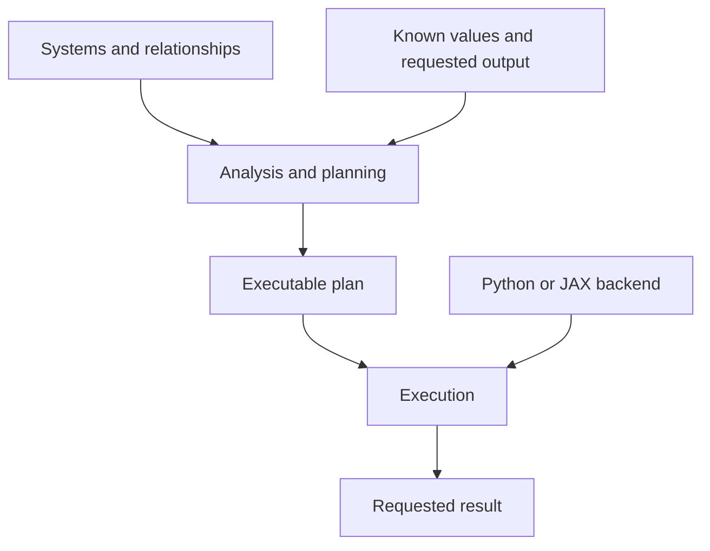

# Modelling with Bilt

Bilt is a Python framework for modelling interacting scientific and engineering systems.

We describe the systems, the quantities they expose and the relationships between them. We then supply what is known and request what we want to calculate. Bilt works out a supported way to obtain it.

This guide explains why we take that approach and how it shapes the rest of Bilt.

## 1. Why we built Bilt

We developed Bilt at the Aviation Impact Accelerator at the University of Cambridge. Our work involves low order models of interacting systems: models that capture the important behaviour and trade-offs while remaining practical for broad scenario analysis.

We need to look at those systems from several viewpoints. Given an energy supply, what can an aircraft achieve? Given a flight requirement, what energy supply and infrastructure would it need?

The relationships overlap, but the known quantities and the questions change.

We also need to connect models, compare technologies and replace assumptions without repeatedly rewriting the surrounding calculations. Analysts who are not software specialists should be able to develop these models and understand what they are doing.

Bilt grew out of those needs. We want the structure and mathematics of a model to remain visible as it grows.

## 2. A relationship can answer more than one question

Consider a simple relationship between useful power, efficiency, fuel flow and fuel heating value:

\[
P = \eta\,\dot m\,H
\]

If we know fuel flow, efficiency and heating value, we can calculate power. If we know required power instead, we can calculate fuel flow.

These are two uses of the same relationship.

In ordinary procedural code, we would usually choose a direction when writing a function. Changing the question may mean writing another function and reorganising the calculations around it. Across a larger model, dependency ordering, conversions and array handling become part of that work too.

Bilt keeps equations as relationships. The known values and requested output determine how they are used.

> The model describes the available relationships. The request determines the computation.

Some calculations do have an intrinsic direction. A numerical routine or empirical function may naturally calculate one output from particular inputs. Bilt represents these as **transforms**, which can be combined with equations in the same model.

Equations are usable in the directions Bilt supports; this does not make every model arbitrarily invertible.

## 3. Separate description, planning and execution

There are three distinct responsibilities:

| Layer | Responsibility |
| --- | --- |
| Modelling API | Describe systems, quantities, relationships and assumptions in Python. |
| Analysis and planning | Find a supported route from known values to the requested output. |
| Execution | Carry out the resulting plan using a backend. |

The modeller defines the engineering meaning. Bilt handles the structural analysis, dependency ordering, supported equation rearrangements, tensor alignment and lowering needed to construct the calculation.

This separation reduces the bespoke computational code needed to ask different questions of a model. Particular numerical methods may still need a solver or routine supplied through a transform.

It also lets the modelling API, planning algorithms and execution backends develop separately, provided they preserve the meaning of the model.

## 4. Keep the structure close to the engineering

A **system** defines a meaningful boundary and the quantities it exposes. An **implementation** supplies equations, transforms and internal subsystems.

An aircraft model might contain propulsion and energy-storage systems. Their connections express shared quantities and constraints. The order of calculation follows from the values we know and the result we request.

The same system boundary can support different implementations. For example, a simple efficiency relationship and a more detailed component model may expose the same quantities. If they honour the same interface and conventions, we can compare them within the surrounding model.

Choosing an implementation selects the relationships and assumptions. Choosing an execution backend selects how the resulting calculation runs.

## 5. Give quantities and arrays meaning

Physical units are part of the model. They let Bilt check dimensional consistency and convert compatible inputs, while making the meaning of quantities more explicit.

Array dimensions matter too. A quantity may vary over time, location, technology or scenario. Bilt represents these axes through symbolic tensor dimensions and domains.

For example, time-varying demand and a set of technology efficiencies can participate in the same calculation. Their named dimensions tell Bilt how to align and broadcast them, rather than leaving that relationship implicit in positional reshaping.

The modeller supplies the meaning of each quantity and axis. Bilt handles the corresponding array mechanics.

These checks help catch inconsistencies. Choosing valid scientific relationships, suitable assumptions and appropriate data remains the modeller's responsibility.

## 6. Make the planning process open to inspection

We want to understand how a calculation was chosen as well as how it produced a result.

Compiler decisions are often hidden unless something fails, when the user receives an error message. In scientific modelling, a successful calculation also deserves scrutiny. Which relationships were selected? Why was one route chosen? Which alternatives were rejected? What assumptions does the result depend on?

If no valid route exists, we want to understand where the difficulty arose: missing information, incompatible relationships or a computation Bilt cannot yet support.

> Explainability is a central aspiration: the reasoning from model to execution should be transparent and interrogable.

Bilt's explicit model structure provides a basis for that inspection. The aim is to make the planning process something modellers can examine and question, including when it succeeds. This is a design goal; the full inspection interface is still to be developed.

The guides that follow introduce systems, equations, transforms, units and domains in practice.

[Index](../index.md) · [Systems-and-values →](systems-and-values.md)
