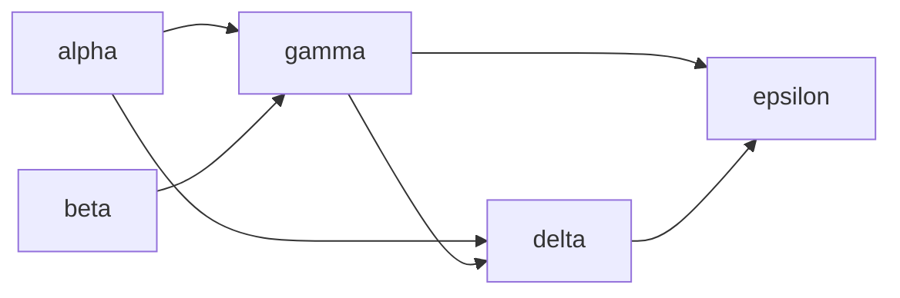
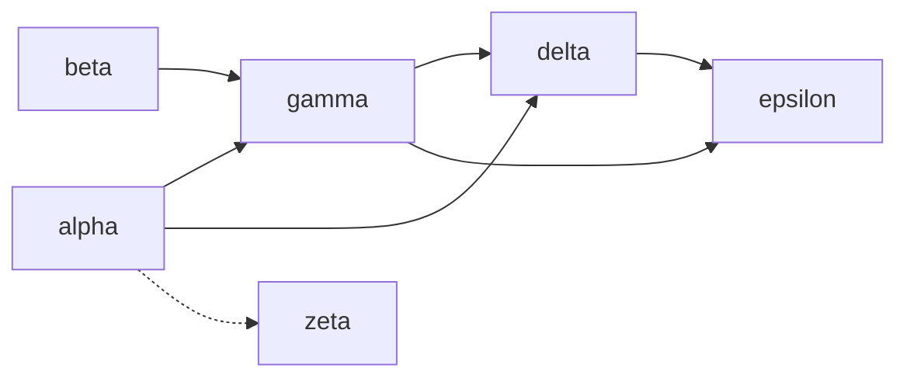

## From models to computation

So far, we have given Bilt two kinds of relationship.

A transform describes a directed calculation:

```text
speed, time ──► distance
```

An equation describes a mathematical relationship that may be usable in several directions:

```text
distance = speed × time
```

Neither tells Bilt which calculations should run for a particular analysis.

Together, they describe computations that *might* be possible.

A transform contributes one fixed direction.

An equation may contribute several possible directions.

When we ask a system for a value, Bilt uses the values already known to work out which of those possibilities can satisfy the request.

We will start with transforms because their direction is already fixed. This makes the structural analysis easier to see.

### Start with what is known

Consider this abstract system. We use simple arithmetic transforms here to make the dependencies easy to follow; in a real model these relationships would usually be equations.

```python exec="on" source="above" session="computation"
from bilt import Implementation, Interface, equation, field, system, transform


@system
class Demo(metaclass=Interface):
    alpha: float = field()
    beta: float = field()
    gamma: float = field()
    delta: float = field()
    epsilon: float = field()
```

with these transforms:

```python exec="off"
@transform
def gamma(alpha: float, beta: float) -> float:
    return alpha + beta


@transform
def delta(alpha: float, gamma: float) -> float:
    return alpha + gamma


@transform
def epsilon(gamma: float, delta: float) -> float:
    return gamma + delta
```

<!-- markdown-exec: hidden setup -->

```python exec="on" session="computation"
from pathlib import Path
from runpy import run_path
from tempfile import TemporaryDirectory

# Execute the displayed transform definitions from a real Python source file.
guide = Path("docs/guide/models-to-computation.md").read_text(encoding="utf-8")
source = next(
    block.split("```", 1)[0] for block in guide.split('```python exec="off"\n')[1:] if block.startswith("@transform\n")
)
with TemporaryDirectory() as directory:
    module = Path(directory) / "computation_transforms.py"
    module.write_text("from bilt import transform\n\n" + source, encoding="utf-8")
    definitions = run_path(str(module))
gamma = definitions["gamma"]
delta = definitions["delta"]
epsilon = definitions["epsilon"]
```

and an implementation:

```python exec="on" source="above" session="computation"
basic = Implementation(Demo, [gamma, delta, epsilon])
```

Now create an instance:

```python exec="on" source="above" session="computation"
demo = Demo(alpha=1.0, beta=2.0)
```

At this point, Bilt has two known values:

```text
alpha = 1
beta = 2
```

and three values that have not yet been calculated:

```text
gamma
delta
epsilon
```

Creating the instance records the supplied values. It does not calculate the missing values.

It is only when we request a value:

```python exec="on" source="above" session="computation"
with basic:
    result = demo.epsilon
```

that Bilt has a question to answer:

> Given `alpha` and `beta`, can this implementation produce `epsilon`?

### Finding a route

For this directed model, we can understand the required calculations by working backwards from the requested value. This illustrates the dependencies, rather than describing the exact search algorithm.

To obtain `epsilon`, it needs:

```text
gamma, delta ──► epsilon
```

`gamma` is not known, but it can be obtained from:

```text
alpha, beta ──► gamma
```

`delta` is also not known, but it can be obtained from:

```text
alpha, gamma ──► delta
```

Since `alpha` and `beta` are already available, Bilt can assemble a complete route:



That gives a computation plan:

```text
1. gamma from alpha and beta
2. delta from alpha and gamma
3. epsilon from gamma and delta
```

Bilt can then execute that plan and return:

```python exec="on" source="above" session="computation"
with basic:
    assert demo.epsilon == 7.0
```

This process of working out which relationships can satisfy a request is **structural analysis**.

### Structural analysis is about relationships

At this stage, Bilt does not need to know that:

```text
return alpha + beta
```

happens to perform addition.

For structural analysis, the important information about this transform is:

```text
alpha, beta ──► gamma
```

or, equivalently:

```text
requires: alpha, beta
provides: gamma
```

The numerical calculation matters later, when the plan is executed.

This lets Bilt reason about the structure of a model before carrying out the calculations themselves.

For transforms, the direction is already fixed.

For equations, Bilt must also consider which participating values are unknown. It matches relationships to unknowns in the relevant part of the model, then determines how the resulting dependencies can be evaluated. A transform can only be matched to its declared output.

Some dependencies can be ordered into individual calculations. Others form coupled blocks that need to be solved together. Structural analysis must also check that the selected formulation is supported; the existence of a matching alone is not enough.

The overall process is:

```text
model relationships
        │
        ▼
request + known values
        │
        ▼
structural analysis
        │
        ▼
computation plan
        │
        ▼
execution
```

Bilt uses the **causalization analyser**, also called the SCC analyser, by default.

SCC stands for strongly connected components: groups of mutually dependent calculations. The analyser orders the groups and Bilt realises supported groups as executable steps. Supported coupled linear groups can cross subsystem boundaries. This does not provide a general nonlinear solver.

The Python and JAX backends determine how the resulting plan executes. Choosing a backend does not change the structural analyser.

First decide **what needs to be done**.

Then do it.

### Bilt only needs the relevant part of the model

Suppose we add another value and relationship:

```python exec="on" source="above" session="computation"
@system
class ExtendedDemo(metaclass=Interface):
    alpha: float = field()
    beta: float = field()
    gamma: float = field()
    delta: float = field()
    epsilon: float = field()
    zeta: float = field()


@equation
def extra_relation(alpha: float, zeta: float) -> bool:
    return zeta == alpha * 10.0


extended = Implementation(ExtendedDemo, [gamma, delta, epsilon, extra_relation])
```

If we supply `alpha` and `beta` and ask for `epsilon`, there is no reason to calculate `zeta`.



```python exec="on" source="above" session="computation"
with extended:
    example = ExtendedDemo(alpha=1.0, beta=2.0)
    assert example.epsilon == 7.0
    assert example.zeta == 10.0
```

The second lookup is a different request. Bilt can restrict each computation to the relationships it needs. That does not mean it can ignore simultaneous constraints that affect the requested result.

### Sometimes there is no route

Suppose we supply only `alpha` to our original directed model. Bilt needs `beta` to calculate `gamma`, and no relationship provides `beta`.

```text
alpha, beta ──► gamma
       ?
```

The request for `epsilon` is underconstrained. Bilt reports a `BiltAnalysisError` rather than executing a plan with missing inputs. We can check the expected failure in ordinary Python:

```python exec="on" source="above" session="computation"
from bilt.errors import BiltAnalysisError

with basic:
    try:
        Demo(alpha=1.0).epsilon
    except BiltAnalysisError:
        pass
    else:
        raise AssertionError("Expected an underconstrained request")
```

A different request may still be possible; a model does not need to determine every value in its interface for every set of inputs.

### Equations add possible routes

Transforms are the simplest case because they already have a direction.

Equations make structural analysis more interesting.

Recall our motion equation:

```python exec="on" source="above" session="computation"
@system
class Motion(metaclass=Interface):
    distance: float = field()
    speed: float = field()
    time: float = field()


@equation
def motion(distance: float, speed: float, time: float) -> bool:
    return distance == speed * time


motion_model = Implementation(Motion, [motion])
```

The equation itself is not directional.

It simply states:

```text
distance = speed × time
```

But that relationship may support several possible calculations:

```text
speed, time ─────► distance

distance, time ──► speed

distance, speed ─► time
```

Suppose we create:

```python exec="on" source="above" session="computation"
journey = Motion(distance=100.0, time=5.0)
```

and request:

```python exec="on" source="above" session="computation"
with motion_model:
    assert journey.speed == 20.0
```

Bilt can see that `distance` and `time` are already available.

For this request, it can use the equation in the direction:

```text
distance, time ──► speed
```

If instead `speed` and `time` were known and `distance` were requested, the same equation could contribute:

```text
speed, time ──► distance
```

The relationship has not changed.

What changes is how Bilt uses it in the computation plan.

This is an important distinction.

The model contains relationships.

The computation plan contains particular directed uses of those relationships.

### Transforms and equations can work together

A computation plan does not need to use only one kind of relationship. In the [aircraft drag model](transforms-and-implementations.md), a lookup transform provides a drag coefficient and an equation relates it to drag, reference area and dynamic pressure.

If drag is supplied and area is requested, Bilt first obtains the coefficient from the transform, then rearranges the drag equation.

```text
lift coefficient ──► drag coefficient

drag, dynamic pressure, drag coefficient ──► reference area
```

The transform retains its direction. The equation can be used in another direction when the known values change.

### Alternative directions are not alternative constraints

One equation may support several computational directions. That does not mean Bilt can freely choose between different equations that independently determine the same unknown.

For example, suppose we add another equation to our motion model:

```python exec="on" source="above" session="computation"
@equation
def alternative_motion(distance: float, speed: float, time: float) -> bool:
    return distance == 2.0 * speed * time


overconstrained = Implementation(Motion, [motion, alternative_motion])
```

With speed and time supplied, both equations determine distance. They are competing constraints, not alternative algorithms to choose between.

```python exec="on" source="above" session="computation"
with overconstrained:
    try:
        Motion(speed=20.0, time=5.0).distance
    except BiltAnalysisError:
        pass
    else:
        raise AssertionError("Expected an overconstrained request")
```

Even two equations giving the same numerical answer can be structurally overconstraining. If they represent alternative modelling assumptions, put them in separate implementations, as in the preceding chapter.

### Some equations must be solved together

Consider two equations:

```text
x + y = p
x - y = q
```

When `p` and `q` are supplied, neither equation can be evaluated independently. The two unknowns form a coupled block.

```python exec="on" source="above" session="computation"
@system
class Pair(metaclass=Interface):
    x: float = field()
    y: float = field()
    p: float = field()
    q: float = field()


@equation
def total(x: float, y: float, p: float) -> bool:
    return x + y == p


@equation
def difference(x: float, y: float, q: float) -> bool:
    return x - y == q


pair_model = Implementation(Pair, [total, difference])

with pair_model:
    pair = Pair(p=10.0, q=2.0)
    assert abs(pair.x - 6.0) < 1e-10
    assert abs(pair.y - 4.0) < 1e-10
```

If we instead supply `x` and `q`, Bilt can calculate `y` and then `p` without a simultaneous solve:

```python exec="on" source="above" session="computation"
with pair_model:
    assert Pair(x=6.0, q=2.0).p == 10.0
```

The relationships stay the same. The request changes the plan. See [Coupled systems](coupled-systems.md) for linear blocks, tensor domains and subsystem coupling.

### The plan is the program Bilt actually runs

There is a useful way to think about the layers we have built so far.

The model contains relationships:

```text
alpha, beta ──► gamma

alpha, gamma ──► delta

gamma, delta ──► epsilon
```

The request adds a goal:

```text
known: alpha, beta

want:  epsilon
```

Structural analysis turns the two into something much closer to a conventional program:

```text
gamma = gamma(alpha, beta)

delta = delta(alpha, gamma)

epsilon = epsilon(gamma, delta)
```

That plan is directional, ordered, and executable. A step can be an ordinary calculation or a supported simultaneous solve.

An equation can participate in exactly the same kind of plan once Bilt has chosen how to use it.

For example:

```text
speed = distance / time
```

is not the equation itself.

It is one directed use of the equation selected for this particular analysis.

A plan may combine transform calls, directed uses of equations and coupled blocks.

So although the model does not prescribe a single execution order, the result of analysing it does.

You can think of Bilt as moving through increasingly concrete descriptions:

```text
relationships
     │
     ▼
request + known values
     │
     ▼
computation plan
     │
     ▼
executed values
```

The public model stays concerned with relationships.

Bilt takes responsibility for turning those relationships into a computation.

### Supplied and calculated values

When we asked for `pair.x`, the coupled solve also calculated `pair.y`. Bilt can retain both values on that instance, so a later lookup can reuse the result.

For a new output request, Bilt still plans using the original constructor-supplied inputs, not every cached value as a new constraint. It can then reuse calculated values needed by the validated plan.

This distinction matters: a cached result is a consequence of the model, not an independently imposed boundary condition. Use a fresh instance when changing the supplied values, implementation or backend.

### Structural and numerical solvability

Structural analysis works with the available relationships, known values and requested result. A request may be underconstrained, overconstrained, or require a calculation Bilt does not support.

A structurally valid plan can still fail numerically. For example, the coefficients of a linear block may make its matrix singular for a particular set of inputs. And a successful calculation does not establish physical validity.

See [Coupled systems](coupled-systems.md#what-if-the-solve-fails) for more on these distinctions.

### Why separate the model from the plan?

For our five-value example, writing the calculation directly would certainly be easier.

```text
gamma = alpha + beta
delta = alpha + gamma
epsilon = gamma + delta
```

Bilt becomes useful when the answer to "what should I calculate?" depends on the problem being asked.

Different evaluations may provide different known values.

Equations may be usable in different directions.

Transforms and equations may contribute to the same analysis.

Large implementations may contain many relationships of which only a few are relevant.

The directions of equations and the coupled blocks may change with the request.

And composed models may require calculations across several constituent systems.

Separating the **model** from the **computation plan** lets the same model support those different analyses.

> You describe the relationships once. Bilt works out how to use them for the problem at hand.

So far, all of our values have been simple scalars.

Real engineering models quickly need values that vary over time, location, operating point, or other dimensions.

The next chapter introduces **dimensions, domains and tensors**, which let Bilt carry these same modelling ideas beyond scalar values.

[← Transforms and implementations](transforms-and-implementations.md) · [Index](../index.md) · [Dimensions, domains and tensors →](dimensions-domains-and-tensors.md)
