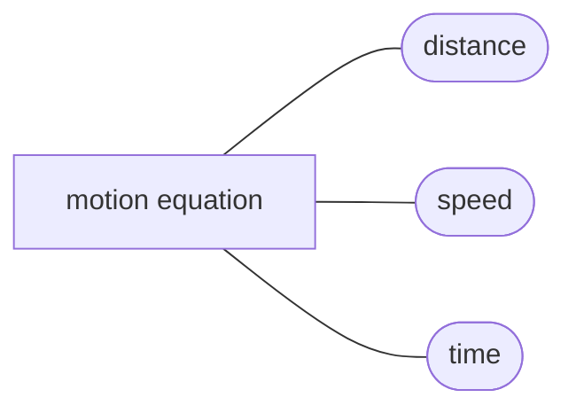
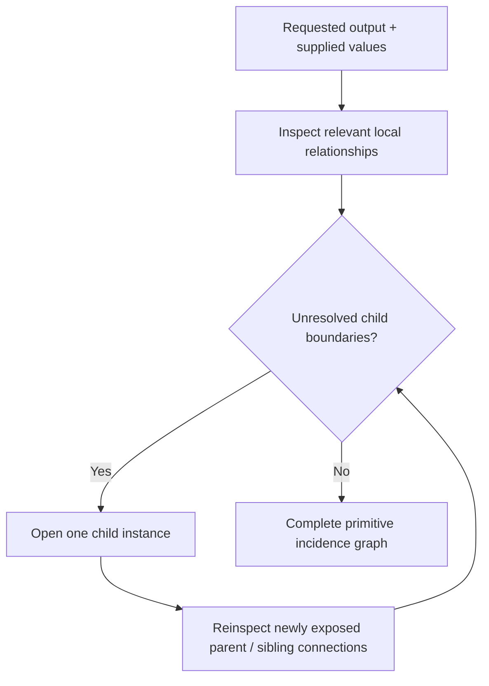
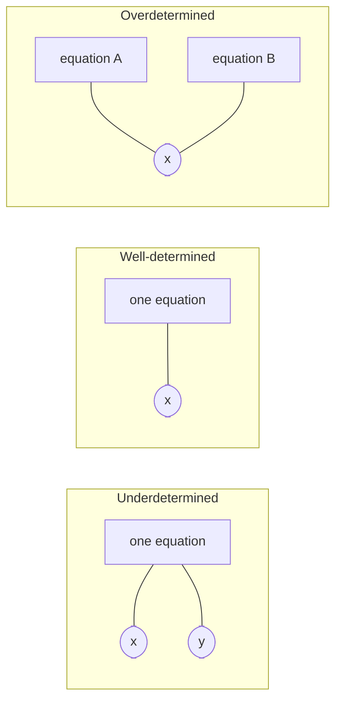
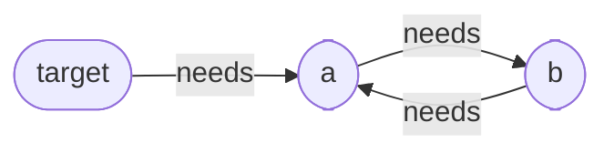
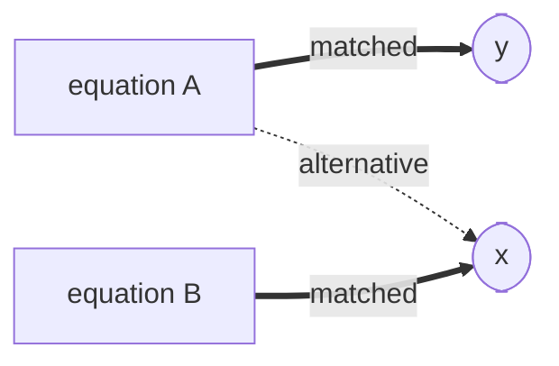
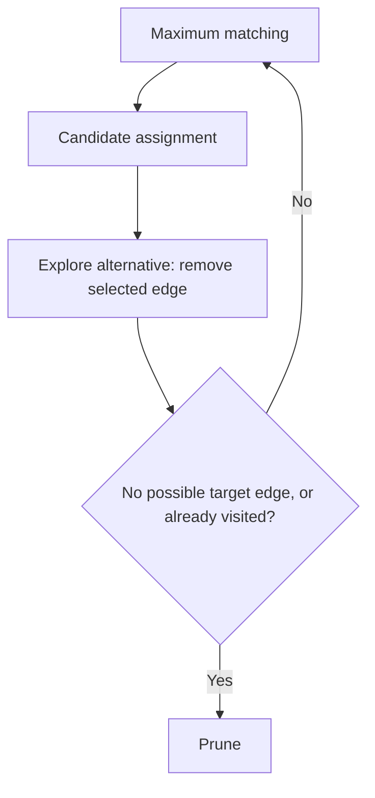

# How structural search works

Bilt describes relationships between values rather than a fixed calculation sequence. When an output is requested, it searches for **relationships that could determine that value** from the supplied inputs.

This explanation covers the default causalization (SCC) analyser: request-scoped discovery, structural validation, producer matching and search biases. It assumes basic software development knowledge, but not experience with graph algorithms.

> This page covers **structural search**, not computational-plan construction or execution. A plausible structural assignment need not be executable. For source code objects and workflows, see [Structural analyser internals](../development/structural-analysis.md).

## 1. Relationships form an incidence graph

Consider a motion equation:

```python
@equation
def motion(distance: float, speed: float, time: float) -> bool:
    return distance == speed * time
```

Bilt first records the values that participate in each relationship:



This is a **bipartite incidence graph**: relationship nodes connect to value nodes. The edges are undirected. An edge means *participates in*, not *computes*.

- **Equations** can potentially determine different participating unknowns, subject to later feasibility checks.
- **Transforms** have a fixed declared output. Their inputs are incident to the transform but cannot be obtained by running it backwards.
- **Subsystems** expose child ports initially without replacing the child with an assumed calculation.

Parent-to-child connection equations remain original constraint rows. Production Bilt does not currently merge equal ports into aliases.

## 2. Discover only the request-relevant structure

Suppose `speed` and `time` are known, and `distance` is requested. Discovery begins at `distance` and explores connected relationships, stopping at supplied values. It need not include unrelated parts of the model.

When discovery reaches a child subsystem, Bilt first records an **unresolved child boundary** and its relevant ports. That boundary is not a promise that the child can produce the port.

For definitive structural validation, Bilt then **expands every encountered child boundary** until all relevant original constraints are exposed:



Opening a child can reveal additional parent or sibling equations, so this expansion repeats to a fixed point. The implementation is **eager within the discovered request scope**, but does not indiscriminately flatten all subsystems.

The graph retains original constraints and distinct instance identities: `left.pressure` and `right.pressure` are separate even if the two children reuse an implementation. Repeated discovery of a source row is deduplicated by instance path and source identity.

When the requested value is already supplied, the analyser does not need to derive or structurally validate it.

## 3. Validate the constraints

Having expanded all relevant children, Bilt considers the primitive equations and transforms together. Supplied values are fixed rather than treated as unknowns.

Counting equations and variables is insufficient: the **shape of their connections** matters. Bilt uses maximum-cardinality bipartite matching and **Dulmage–Mendelsohn (DM) decomposition** to identify structural regions.



Bilt rejects overdetermined regions in the discovered scope. It rejects underdetermination **when it affects the requested output**; a separate underdetermined branch can be tolerated if the requested value is structurally determined.

DM classification is about graph structure, not numerical solvability. In particular, it does not prove that an equation can be isolated in a given direction, or that the backend supports its evaluation. Transform direction is respected when constructing producer candidates.

## 4. Detect unavoidable coupling conservatively

Two or more unknowns may depend on each other. These can form a **strongly connected component** (SCC) of the dependency graph:



But a cycle in *one possible assignment* does not prove that every alternative is coupled.

Before general candidate search, Bilt therefore checks for **unavoidable** target-relevant coupling only when it has a complete, closed, square and directionally matchable structural region. For a larger rectangular request it can use its well-determined region.

Supported local linear coupling may remain within its owning subsystem. Certain supported linear groups crossing subsystem boundaries instead use an **expanded primitive search**, preserving equations and qualified instance paths. If coupling is provably unavoidable and unsupported, Bilt can reject it early. Otherwise it leaves the ordinary search available.

## 5. Match unknowns to possible producers

In ordinary hierarchical search, the matching graph describes **candidate directions**:

- An equation can be paired with a participating unknown.
- A transform can be paired only with its declared output.
- A child contributes a separate possible producer for each unsupplied boundary port, subject to child-route validation later.
- Supplied values are removed from the set of outputs requiring producers.

Each relationship and each unknown can participate in at most one selected pair. Bilt selects a **maximum-cardinality matching** before considering preferences.



Matching equation A to `x` instead might leave `y` unmatched. A maximum matching attempts to cover as many unknowns as possible, but it is not yet a usable computation.

### What the search prefers

The ordinary matching path uses edge weights as **ordering hints** among equally large matchings:

| Weight | Meaning |
| --- | --- |
| **0** | Default for a primitive direction not ready from supplied values, or a child-port candidate. |
| **1** | All other values consumed by a primitive direction are already supplied. |
| **2** | A forward-reachable producer discovered by optional structural propagation. |

Propagation starts with supplied values. It can reach an equation's last unknown or a transform's declared output once its inputs are reached. When propagation stalls it can recognise certain ready supported linear coupled groups, considering child-local groups before mixed-owner groups.

The additional producer hint is applied when there are **multiple immediate child systems** and complete structural evidence. Bilt avoids extra expansion solely for ordering hints when there are zero or one immediate children; this does not affect the eager validation described above.

**Weights do not remove alternatives**, override maximum cardinality, or represent numerical cost. They only make some candidates more likely to be tried early.

## 6. Search alternatives and prune dead branches

A maximum matching can omit the requested target, choose an unsupported equation direction, or select a child producer with no suitable internal route.

Bilt explores alternatives by removing a selected matching edge and rematching a reduced graph. It processes candidates with a stack rather than enumerating all matchings upfront:



The hierarchical path focuses its alternative branches on selected edges that can affect the **target's dependency route**, including producer conflicts that could free a missing dependency. A matching that *omits* the target is still explored while a possible target edge remains.

Known failed primitive directions can be excluded on retries. A domain-specific rejection does not permanently invalidate an equation for all requests.

The expanded primitive path for supported cross-boundary coupling uses **unweighted** maximum-cardinality matching over qualified primitive rows; it can branch on any selected matched edge. Both paths reject duplicate edge sets and branches that have lost their last target edge.

This pruning saves work but does not guarantee cheap search for a highly connected model.

## What structural matching cannot prove

A chosen pairing is not proof that an equation can be rearranged, child-route dependencies can be satisfied, tensor domains are compatible, or numerical execution will succeed. These questions belong to downstream feasibility checks and computational planning.

For the implementation itself, continue with [Structural analyser internals](../development/structural-analysis.md). For modelling context, see [From models to computation](models-to-computation.md), [Systems of systems](systems-of-systems.md) and [Coupled systems](coupled-systems.md).
