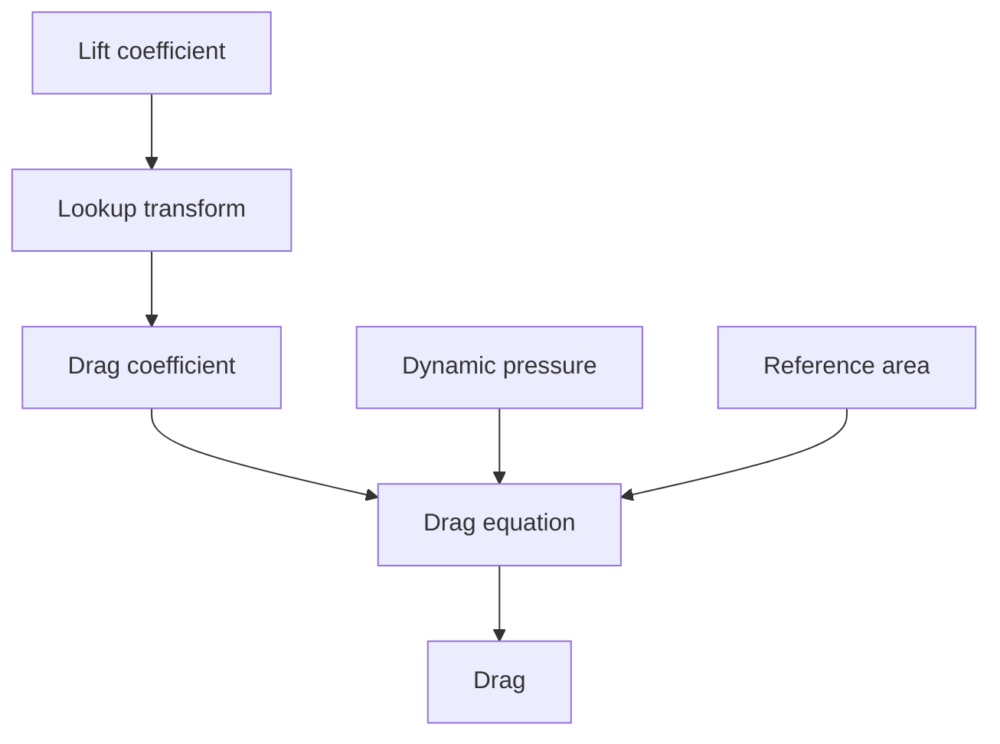

## Transforms and implementations

An equation describes a mathematical relationship. A **transform** describes a calculation with a fixed direction: given these values, calculate this result.

Both can be used in the same implementation. We will build a small aircraft drag model to see how they work together, and then compare two implementations of that model.

For simplicity, the examples use plain numbers in consistent SI units. See [Units in models](units.md) for how to declare physical dimensions.

### Start with a system

```python exec="on" source="above" session="drag-model"
from bilt import Implementation, Interface, equation, field, system, transform


@system
class Drag(metaclass=Interface):
    dynamic_pressure: float = field()
    reference_area: float = field()
    lift_coefficient: float = field()
    drag_coefficient: float = field()
    drag: float = field()
```

The system describes the values available at its boundary. It does not yet say how to calculate any of them.

### A transform describes a directed calculation

Suppose we have a simple lookup rule for the drag coefficient based on the lift coefficient. The values below are illustrative, not aircraft performance data.

```python exec="on" source="above" session="drag-model"
@transform
def drag_coefficient(lift_coefficient: float) -> float:
    if lift_coefficient < 0.5:
        return 0.025
    return 0.04
```

The parameter name identifies the required value. The function name identifies the result it provides, and its return annotation declares the result's type.

```text
lift_coefficient ──► drag_coefficient
```

Many lift coefficients produce the same drag coefficient, so there is no unique inverse. Bilt does not attempt to rearrange the transform.

Transforms are useful for empirical lookups, data processing and calls to external numerical routines. They can contain ordinary Python code when using the Python backend, subject to Bilt's declaration and domain rules. The JAX backend supports a more restricted subset of Python; see [Backends](backends.md).

Define transforms in Python source files so Bilt can read their source. Imports needed by a Python-only routine can go inside the transform body; ordinary globals and closure state are not automatically carried into the compiled calculation.

### Combine a transform with an equation

The drag force itself has an ordinary mathematical relationship:

```python exec="on" source="above" session="drag-model"
@equation
def drag_relation(
    drag: float,
    dynamic_pressure: float,
    reference_area: float,
    drag_coefficient: float,
) -> bool:
    return drag == dynamic_pressure * reference_area * drag_coefficient
```

Unlike the lookup, this relationship can be rearranged to calculate other values when enough information is available.

Collect the two relationships in an implementation:

```python exec="on" source="above" session="drag-model"
lookup_model = Implementation(Drag, [drag_relation, drag_coefficient])
```

The system defines the boundary. The implementation supplies the relationships and assumptions for that boundary.

### Ask for a result

Supply the known values and select the implementation:

```python exec="on" source="above" session="drag-model"
with lookup_model:
    aircraft = Drag(
        dynamic_pressure=1000.0,
        reference_area=20.0,
        lift_coefficient=0.6,
    )
    assert abs(aircraft.drag - 800.0) < 1e-10
```

Bilt first obtains the drag coefficient from the transform, then uses the equation to calculate drag.



The equation is listed first in the implementation, but the transform runs first for this request. The order of the relationships in an implementation is not the order of execution.

If we request only the drag coefficient, Bilt does not need the drag equation or its other inputs:

```python exec="on" source="above" session="drag-model"
with lookup_model:
    assert Drag(lift_coefficient=0.6).drag_coefficient == 0.04
```

### Ask a different question

The transform still runs in its original direction, but the equation can be used differently. Suppose we know the drag and want to calculate the reference area consistent with those assumptions:

```python exec="on" source="above" session="drag-model"
with lookup_model:
    aircraft = Drag(
        dynamic_pressure=1000.0,
        lift_coefficient=0.6,
        drag=800.0,
    )
    assert abs(aircraft.reference_area - 20.0) < 1e-10
```

Bilt obtains the coefficient in the same way, then rearranges the drag equation. We did not need to define an inverse transform or another drag equation.

### Compare implementations

We could use a continuous drag polar instead of the lookup rule:

```python exec="on" source="above" session="drag-model"
@equation
def drag_polar(
    drag_coefficient: float,
    lift_coefficient: float,
) -> bool:
    return drag_coefficient == 0.02 + 0.05 * lift_coefficient**2


polar_model = Implementation(Drag, [drag_relation, drag_polar])
```

Both implementations use the same system and the same drag equation. They differ only in how they represent the drag coefficient. The polar coefficients are also illustrative.

We can compare them under the same conditions:

```python exec="on" source="above" session="drag-model"
conditions = {
    "dynamic_pressure": 1000.0,
    "reference_area": 20.0,
    "lift_coefficient": 0.6,
}

with lookup_model:
    lookup_drag = Drag(**conditions).drag

with polar_model:
    polar_drag = Drag(**conditions).drag

assert abs(lookup_drag - 800.0) < 1e-10
assert abs(polar_drag - 760.0) < 1e-10
```

The caller uses the same interface in both cases. Changing the implementation changes the relationships, not the interface.

Use a fresh system instance for each comparison. An instance retains the implementation selected on its first calculated lookup and caches calculated values. Entering a different implementation context does not replace that instance's implementation or invalidate its results.

The two coefficient models are separate implementations, not competing constraints in one implementation.

### Choosing equations and transforms

Use an equation when you want to describe a mathematical relationship. Use a transform when you want to describe a particular calculation, such as a lookup or a call to an external routine. An equation need not be invertible in every direction to be useful.

An implementation can combine either kind of relationship, and can later include other systems. The known values and requested result determine which relationships Bilt needs to use.

The next chapter explains how Bilt turns those relationships into a computation plan.

See the [Equations and transforms API](../api/relationships.md) and [Systems and implementations API](../api/systems.md) for details and restrictions.

[← Equations and acausal modelling](equations-and-acausal-modelling.md) · [Index](../index.md) · [Models to computation →](models-to-computation.md)
