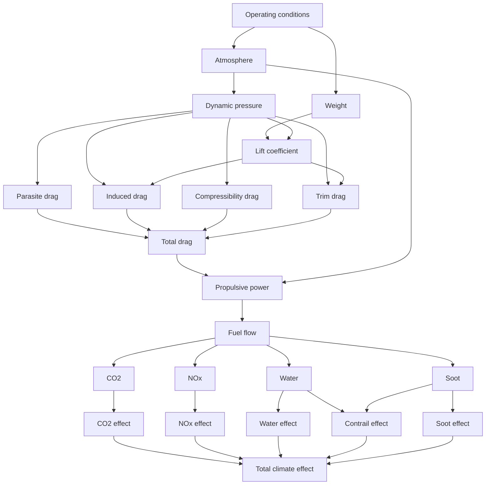

# Compiling a Bilt model with JAX

This example evaluates the same Bilt model with the Python and JAX backends and
compares their performance on a large array calculation.

The model represents a simplified cruise-impact calculation. Cruise conditions
feed atmosphere, aerodynamic, propulsion, emissions, and illustrative
climate-effect calculations before combining into a final output.

The climate-effect relationships are deliberately illustrative rather than a
validated aircraft climate model. The point of the example is the shape and
size of the numerical calculation.



## The model

The full model contains a number of small transforms. For example:

<!-- model-source: aerodynamic-excerpt -->

```python exec="off"
@transform
def dynamic_pressure(density: Density, true_airspeed: Speed) -> Pressure:
    return 0.5 * density * true_airspeed**2


@transform
def induced_drag(
    dynamic_pressure: Pressure,
    wing_area: Area,
    lift_coefficient: Ratio,
    induced_drag_factor: Ratio,
) -> Force:
    return dynamic_pressure * wing_area * induced_drag_factor * lift_coefficient**2
```

The system uses named pointwise aliases such as `PointwiseRatio` for fields accepting
scalar or tensor quantities, and scalar aliases such as `Ratio` for transforms.
The transforms lift over compatible tensor domains, so the model does not
prescribe the shape of the ensemble. Efficiencies, Mach number, aerodynamic
coefficients, and emission indices are dimensionless quantities supplied with `UNITLESS`.

The atmosphere uses absolute temperatures and relative temperature offsets.
Gravity, lapse rate, gas constant, reference pressure, and fuel heating value
carry units in the full model. Absolute temperatures are explicitly expressed
in kelvin before their numerical values enter the empirical correlations.

Emission rates and the illustrative weighted-emission score have units of kg/s.
The score uses arbitrary weights; it is not a validated climate metric or a
CO2-equivalent emission rate. The soot-dependent factor uses an explicit
inverse mass-rate coefficient so its correction is dimensionless.

The remaining model declarations are in [Model source](#model-source) below. The documentation build combines the displayed blocks into one Python module, so the backend comparison runs exactly these definitions.

<!-- markdown-exec: hidden setup -->

```python exec="on" session="jax-backend"
import importlib.util
import sys
import tempfile
from pathlib import Path

guide = Path("docs/worked_examples/compiling-a-bilt-model-with-JAX.md").read_text(encoding="utf-8")


def model_block(name: str) -> str:
    section = guide.split(f"<!-- model-source: {name} -->", 1)[1]
    return section.split('```python exec="off"\n', 1)[1].split("```", 1)[0]


_model_source = "\n\n".join(
    model_block(name) for name in ("cruise-definitions", "aerodynamic-excerpt", "cruise-implementation", "hybrid")
)
_example_dir = Path(tempfile.mkdtemp(prefix="bilt_jax_example_"))
_example_module = _example_dir / "jax_backend_cruise.py"
_example_module.write_text(_model_source, encoding="utf-8")

_spec = importlib.util.spec_from_file_location("jax_backend_cruise", _example_module)
assert _spec is not None and _spec.loader is not None
_module = importlib.util.module_from_spec(_spec)
sys.modules[_spec.name] = _module
_spec.loader.exec_module(_module)

CruiseImpact = _module.CruiseImpact
cruise_impact = _module.cruise_impact
HybridModel = _module.HybridModel
hybrid_model = _module.hybrid_model
```

## Build a large ensemble

We evaluate the model over 262,144 (`2**18`) cruise conditions.

The inputs use Bilt tensors over a named `scenario` dimension:

```python exec="on" session="jax-backend" source="above"
import numpy as np

from bilt import Quantity, dim, tensor
from bilt.units import UNITLESS, kelvin, kilogram, meter, second

scenario = dim("scenario")
scenario_count = 2**18
rng = np.random.default_rng(42)

inputs = {
    "altitude": tensor(
        rng.uniform(8_000.0, 12_000.0, scenario_count).astype(np.float32),
        over=scenario,
        unit=meter,
    ),
    "mach": tensor(
        rng.uniform(0.70, 0.88, scenario_count).astype(np.float32),
        over=scenario,
        unit=UNITLESS,
    ),
    "mass": tensor(
        rng.uniform(50_000.0, 80_000.0, scenario_count).astype(np.float32),
        over=scenario,
        unit=kilogram,
    ),
    "temperature_offset": tensor(
        rng.normal(0.0, 8.0, scenario_count).astype(np.float32),
        over=scenario,
        unit=kelvin,
    ),
    "wing_area": Quantity(float(np.float32(122.6)), meter**2),
    "zero_lift_drag_coefficient": Quantity(float(np.float32(0.021)), UNITLESS),
    "induced_drag_factor": Quantity(float(np.float32(0.045)), UNITLESS),
    "propulsive_efficiency": Quantity(float(np.float32(0.38)), UNITLESS),
    "nox_emission_index": Quantity(float(np.float32(0.015)), UNITLESS),
    "soot_emission_index": Quantity(float(np.float32(0.00003)), UNITLESS),
}

print(f"Scenarios: **{scenario_count:,}**")
```

The scalar aircraft parameters are broadcast across the `scenario` dimension.

## Run with the Python backend

Python is Bilt's default backend, so it does not need to be selected explicitly:

```python exec="on" session="jax-backend" source="above"
python_model = CruiseImpact(**inputs)

with cruise_impact:
    python_result = python_model.total_climate_effect

print(f"Output shape: `{python_result.values.shape}`")
print(f"Output unit: `{python_result.unit}`")
```

## Run with the JAX backend

The model and inputs do not change. Only the backend selection changes:

```python exec="on" session="jax-backend" source="above"
from bilt import JAX_BACKEND

jax_model = CruiseImpact(**inputs)

with JAX_BACKEND, cruise_impact:
    jax_result = jax_model.total_climate_effect

print(f"Output shape: `{jax_result.values.shape}`")
print(f"Output unit: `{jax_result.unit}`")
```

Both backends return a unit-carrying tensor. Before comparing performance,
express both results in kg/s and check their numerical values:

```python exec="on" session="jax-backend" source="above"
np.testing.assert_allclose(
    np.asarray(python_result.convert_to(kilogram / second).values),
    np.asarray(jax_result.convert_to(kilogram / second).values),
    rtol=1e-4,
    atol=1e-5,
)

print("Python and JAX results agree.")
```

Small floating-point differences are expected because the two backends may
evaluate equivalent numerical expressions differently.

## Compare Python, cold JAX, and warm JAX

A fair JAX comparison should separate compilation from reuse.

For the cold measurement below, the persistent JAX compilation cache is
disabled and JAX's in-memory caches are cleared immediately before evaluation.
The following warm measurements then reuse the compiled calculation.

The benchmark materialises `result.values` as a NumPy array before stopping
the clock. This ensures the returned result is complete without assuming that
`Tensor.values` exposes a JAX array. The timed evaluation includes Bilt input
validation, unit conversion, and output wrapping as well as backend execution.

```python exec="on" session="jax-backend" source="above"
import statistics
import time

import jax

from bilt import PYTHON_BACKEND

repeats = 5

python_times = []
for _ in range(repeats):
    model = CruiseImpact(**inputs)

    start = time.perf_counter()
    with PYTHON_BACKEND, cruise_impact:
        result = model.total_climate_effect
    np.asarray(result.values)
    python_times.append(time.perf_counter() - start)

python_seconds = statistics.median(python_times)

persistent_cache_enabled = jax.config.jax_enable_compilation_cache
jax.config.update("jax_enable_compilation_cache", False)

try:
    jax.clear_caches()

    model = CruiseImpact(**inputs)

    start = time.perf_counter()
    with JAX_BACKEND, cruise_impact:
        result = model.total_climate_effect
    np.asarray(result.values)
    jax_cold_seconds = time.perf_counter() - start

    jax_warm_times = []
    for _ in range(repeats):
        model = CruiseImpact(**inputs)

        start = time.perf_counter()
        with JAX_BACKEND, cruise_impact:
            result = model.total_climate_effect
        np.asarray(result.values)
        jax_warm_times.append(time.perf_counter() - start)

    jax_warm_seconds = statistics.median(jax_warm_times)
finally:
    jax.config.update(
        "jax_enable_compilation_cache",
        persistent_cache_enabled,
    )

print("| Execution | Time |")
print("| --- | ---: |")
print(f"| Python | {python_seconds * 1e3:.2f} ms |")
print(f"| JAX cold | {jax_cold_seconds * 1e3:.2f} ms |")
print(f"| JAX warm | {jax_warm_seconds * 1e3:.2f} ms |")
print()
print(f"**Warm JAX speed-up: {python_seconds / jax_warm_seconds:.2f}×**")
```

The exact numbers depend on the machine, JAX version, array size, and available
hardware. The useful comparison is between the initial cost of compiling the
calculation and the cost of running it again once compiled.

## Try different ensemble sizes

The point at which JAX becomes worthwhile depends on the size of the
calculation. The following compares several ensemble sizes.

```python exec="on" session="jax-backend" source="above"
print("| Scenarios | Python | JAX warm | Speed-up |")
print("| ---: | ---: | ---: | ---: |")

for exponent in (12, 14, 16, 18):
    scenario_count = 2**exponent
    rng = np.random.default_rng(42)

    size_inputs = {
        "altitude": tensor(
            rng.uniform(8_000.0, 12_000.0, scenario_count).astype(np.float32),
            over=scenario,
            unit=meter,
        ),
        "mach": tensor(
            rng.uniform(0.70, 0.88, scenario_count).astype(np.float32),
            over=scenario,
            unit=UNITLESS,
        ),
        "mass": tensor(
            rng.uniform(50_000.0, 80_000.0, scenario_count).astype(np.float32),
            over=scenario,
            unit=kilogram,
        ),
        "temperature_offset": tensor(
            rng.normal(0.0, 8.0, scenario_count).astype(np.float32),
            over=scenario,
            unit=kelvin,
        ),
        "wing_area": Quantity(float(np.float32(122.6)), meter**2),
        "zero_lift_drag_coefficient": Quantity(float(np.float32(0.021)), UNITLESS),
        "induced_drag_factor": Quantity(float(np.float32(0.045)), UNITLESS),
        "propulsive_efficiency": Quantity(float(np.float32(0.38)), UNITLESS),
        "nox_emission_index": Quantity(float(np.float32(0.015)), UNITLESS),
        "soot_emission_index": Quantity(float(np.float32(0.00003)), UNITLESS),
    }

    python_times = []
    for _ in range(3):
        model = CruiseImpact(**size_inputs)

        start = time.perf_counter()
        with PYTHON_BACKEND, cruise_impact:
            result = model.total_climate_effect
        python_times.append(time.perf_counter() - start)

    python_seconds = statistics.median(python_times)

    jax.clear_caches()

    model = CruiseImpact(**size_inputs)
    with JAX_BACKEND, cruise_impact:
        result = model.total_climate_effect
    np.asarray(result.values)

    jax_times = []
    for _ in range(3):
        model = CruiseImpact(**size_inputs)

        start = time.perf_counter()
        with JAX_BACKEND, cruise_impact:
            result = model.total_climate_effect
        np.asarray(result.values)
        jax_times.append(time.perf_counter() - start)

    jax_seconds = statistics.median(jax_times)

    print(
        f"| {scenario_count:,} "
        f"| {python_seconds * 1e3:.2f} ms "
        f"| {jax_seconds * 1e3:.2f} ms "
        f"| {python_seconds / jax_seconds:.2f}× |"
    )
```

For small arrays, the Python backend may be entirely adequate. As the numerical
work grows, reusing a compiled JAX calculation can become increasingly useful.

## Current workaround: a nested JAX subproblem

The preferred approach is the one used above: run the complete compatible Bilt
model with the JAX backend. That keeps the full calculation visible to Bilt.

There are cases where part of a model cannot currently run under JAX. As a
workaround, a Python-backed transform can explicitly evaluate a separate Bilt
implementation using the JAX backend.

The following handoff demonstration uses plain mathematical values rather
than physical quantities. Its plain values are separate from the
unit-aware cruise model above. The JAX-compatible subproblem is an ordinary Bilt model. The following definitions are part of the same source module as the cruise model:

<!-- model-source: hybrid -->

```python exec="off"
@system
class JaxSubproblem(metaclass=Interface):
    value: float = field()
    result: float = field()


@transform
def result(value: float) -> float:
    return value**2 + 2.0 * value + 1.0


jax_subproblem = Implementation(
    JaxSubproblem,
    [result],
)


@system
class HybridModel(metaclass=Interface):
    input_value: float = field()
    output_value: float = field()


@transform
def output_value(input_value: float) -> float:
    from bilt import JAX_BACKEND
    from jax_backend_cruise import JaxSubproblem, jax_subproblem

    value = abs(input_value)

    with JAX_BACKEND, jax_subproblem:
        return JaxSubproblem(value=value).result


hybrid_model = Implementation(
    HybridModel,
    [output_value],
)
```

The outer transform delegates to the JAX subproblem, while the outer model still uses Python.

The caller still evaluates only the outer model:

```python exec="on" session="jax-backend" source="above"
from bilt import PYTHON_BACKEND

model = HybridModel(input_value=-3.0)

with PYTHON_BACKEND, hybrid_model:
    result = model.output_value

print(f"Hybrid result: {result}")
```

For `-3.0`, the Python part produces `3.0`, and the nested JAX calculation
returns `16.0`.

This proves that the handoff is possible, but it comes with an important
trade-off: the outer Bilt evaluation cannot inspect how the nested JAX result
was produced. The nested calculation is therefore an opaque boundary in the
otherwise transparent chain from inputs to outputs.

Use this pattern judiciously. It is best treated as an escape hatch for an
unavoidable Python/JAX boundary, not as the preferred way to structure a Bilt
model. Future Bilt support may provide a way to cross backend boundaries while
preserving transparency across the complete calculation.

## What this example shows

The same Bilt model can be evaluated with Python or JAX without rewriting the
model.

For small or one-off calculations, Python may be the better choice. For larger
calculations that are evaluated repeatedly, the cost of JAX compilation can be
recovered through faster warm execution.

Where possible, select one backend around the complete Bilt model so that the
full calculation remains visible and explainable. Nested backend evaluation can
bridge an unavoidable compatibility boundary, but should currently be treated
as a workaround.

## Model source

The remaining definitions for the cruise model follow. The two aerodynamic transforms shown in [The model](#the-model) are included when these definitions are assembled into the executable module.

<!-- model-source: cruise-definitions -->

```python exec="off"
"""Models for the Bilt JAX worked example."""

from __future__ import annotations

from typing import Annotated

from bilt import Implementation, Interface, Quantity, QuantityTensor, field, system, transform

from bilt.units import UNITLESS, absolute_kelvin, joule, kelvin, kilogram, meter, pascal, second
from bilt.units.dimensions import ABSOLUTE, DIMENSIONLESS, ENERGY, FORCE, LENGTH, MASS, TEMPERATURE, TIME


Length = Annotated[Quantity, LENGTH]
Mass = Annotated[Quantity, MASS]
Area = Annotated[Quantity, LENGTH**2]
TemperatureChange = Annotated[Quantity, TEMPERATURE]
AbsoluteTemperature = Annotated[Quantity, TEMPERATURE, ABSOLUTE]
Pressure = Annotated[Quantity, FORCE / LENGTH**2]
Density = Annotated[Quantity, MASS / LENGTH**3]
Speed = Annotated[Quantity, LENGTH / TIME]
Force = Annotated[Quantity, FORCE]
Power = Annotated[Quantity, ENERGY / TIME]
MassRate = Annotated[Quantity, MASS / TIME]
Ratio = Annotated[Quantity, DIMENSIONLESS]
PointwiseLength = Annotated[Quantity | QuantityTensor, LENGTH]
PointwiseRatio = Annotated[Quantity | QuantityTensor, DIMENSIONLESS]
PointwiseMass = Annotated[Quantity | QuantityTensor, MASS]
PointwiseTemperatureChange = Annotated[Quantity | QuantityTensor, TEMPERATURE]
PointwiseArea = Annotated[Quantity | QuantityTensor, LENGTH**2]
PointwiseAbsoluteTemperature = Annotated[Quantity | QuantityTensor, TEMPERATURE, ABSOLUTE]
PointwisePressure = Annotated[Quantity | QuantityTensor, FORCE / LENGTH**2]
PointwiseDensity = Annotated[Quantity | QuantityTensor, MASS / LENGTH**3]
PointwiseSpeed = Annotated[Quantity | QuantityTensor, LENGTH / TIME]
PointwiseForce = Annotated[Quantity | QuantityTensor, FORCE]
PointwisePower = Annotated[Quantity | QuantityTensor, ENERGY / TIME]
PointwiseMassRate = Annotated[Quantity | QuantityTensor, MASS / TIME]


@system
class CruiseImpact(metaclass=Interface):
    # Inputs
    altitude: PointwiseLength = field()
    mach: PointwiseRatio = field()
    mass: PointwiseMass = field()
    temperature_offset: PointwiseTemperatureChange = field()
    wing_area: PointwiseArea = field()
    zero_lift_drag_coefficient: PointwiseRatio = field()
    induced_drag_factor: PointwiseRatio = field()
    propulsive_efficiency: PointwiseRatio = field()
    nox_emission_index: PointwiseRatio = field()
    soot_emission_index: PointwiseRatio = field()

    # Atmosphere
    temperature: PointwiseAbsoluteTemperature = field()
    pressure: PointwisePressure = field()
    density: PointwiseDensity = field()
    speed_of_sound: PointwiseSpeed = field()
    true_airspeed: PointwiseSpeed = field()

    # Aerodynamics
    weight: PointwiseForce = field()
    dynamic_pressure: PointwisePressure = field()
    lift_coefficient: PointwiseRatio = field()
    parasite_drag: PointwiseForce = field()
    induced_drag: PointwiseForce = field()
    compressibility_drag: PointwiseForce = field()
    trim_drag: PointwiseForce = field()
    total_drag: PointwiseForce = field()

    # Propulsion
    propulsive_power: PointwisePower = field()
    fuel_power: PointwisePower = field()
    fuel_flow: PointwiseMassRate = field()

    # Emissions
    co2_rate: PointwiseMassRate = field()
    water_rate: PointwiseMassRate = field()
    nox_rate: PointwiseMassRate = field()
    soot_rate: PointwiseMassRate = field()

    # Illustrative climate-effect outputs
    co2_effect: PointwiseMassRate = field()
    water_effect: PointwiseMassRate = field()
    nox_effect: PointwiseMassRate = field()
    soot_effect: PointwiseMassRate = field()
    contrail_effect: PointwiseMassRate = field()
    total_climate_effect: PointwiseMassRate = field()


# Atmosphere -----------------------------------------------------------------


@transform
def temperature(altitude: Length, temperature_offset: TemperatureChange) -> AbsoluteTemperature:
    return Quantity(288.15, absolute_kelvin) - (0.0065 * kelvin / meter) * altitude + temperature_offset


@transform
def pressure(temperature: AbsoluteTemperature) -> Pressure:
    # The empirical reference temperature is 288.15 kelvin.
    return (101325.0 * pascal) * (temperature.convert_to(absolute_kelvin).value / 288.15) ** 5.2561


@transform
def density(pressure: Pressure, temperature: AbsoluteTemperature) -> Density:
    temperature_scale = temperature.convert_to(absolute_kelvin).value * kelvin
    return pressure / ((287.05 * joule / (kilogram * kelvin)) * temperature_scale)


@transform
def speed_of_sound(temperature: AbsoluteTemperature) -> Speed:
    temperature_scale = temperature.convert_to(absolute_kelvin).value * kelvin
    speed_squared = 1.4 * (287.05 * joule / (kilogram * kelvin)) * temperature_scale
    return speed_squared.convert_to(meter**2 / second**2).value ** 0.5 * meter / second


@transform
def true_airspeed(mach: Ratio, speed_of_sound: Speed) -> Speed:
    return mach * speed_of_sound


# Aerodynamics ---------------------------------------------------------------


@transform
def weight(mass: Mass) -> Force:
    return mass * (9.80665 * meter / second**2)


@transform
def lift_coefficient(
    weight: Force,
    dynamic_pressure: Pressure,
    wing_area: Area,
) -> Ratio:
    return weight / (dynamic_pressure * wing_area)


@transform
def parasite_drag(
    dynamic_pressure: Pressure,
    wing_area: Area,
    zero_lift_drag_coefficient: Ratio,
) -> Force:
    return dynamic_pressure * wing_area * zero_lift_drag_coefficient


@transform
def compressibility_drag(
    dynamic_pressure: Pressure,
    wing_area: Area,
    mach: Ratio,
) -> Force:
    correction = 0.002 * mach**2 + 0.004 * mach**4
    return dynamic_pressure * wing_area * correction


@transform
def trim_drag(
    dynamic_pressure: Pressure,
    wing_area: Area,
    lift_coefficient: Ratio,
) -> Force:
    return dynamic_pressure * wing_area * 0.0015 * lift_coefficient**2


@transform
def total_drag(
    parasite_drag: Force,
    induced_drag: Force,
    compressibility_drag: Force,
    trim_drag: Force,
) -> Force:
    return parasite_drag + induced_drag + compressibility_drag + trim_drag


# Propulsion -----------------------------------------------------------------


@transform
def propulsive_power(total_drag: Force, true_airspeed: Speed) -> Power:
    return total_drag * true_airspeed


@transform
def fuel_power(
    propulsive_power: Power,
    propulsive_efficiency: Ratio,
) -> Power:
    return propulsive_power / propulsive_efficiency


@transform
def fuel_flow(fuel_power: Power) -> MassRate:
    # Approximate kerosene lower heating value, J/kg.
    return fuel_power / (43_000_000.0 * joule / kilogram)


# Emissions ------------------------------------------------------------------
#
# These four transforms form independent branches from fuel_flow.


@transform
def co2_rate(fuel_flow: MassRate) -> MassRate:
    return 3.16 * fuel_flow


@transform
def water_rate(fuel_flow: MassRate) -> MassRate:
    return 1.23 * fuel_flow


@transform
def nox_rate(fuel_flow: MassRate, nox_emission_index: Ratio) -> MassRate:
    return fuel_flow * nox_emission_index


@transform
def soot_rate(fuel_flow: MassRate, soot_emission_index: Ratio) -> MassRate:
    return fuel_flow * soot_emission_index


# Illustrative climate effects -----------------------------------------------
#
# These are deliberately simple surrogate relationships. They are not intended
# to be scientifically defensible climate metrics.


@transform
def co2_effect(co2_rate: MassRate) -> MassRate:
    return co2_rate


@transform
def water_effect(water_rate: MassRate, altitude: Length) -> MassRate:
    altitude_factor = Quantity(0.8, UNITLESS) + altitude / (50_000.0 * meter)
    return 0.15 * water_rate * altitude_factor


@transform
def nox_effect(
    nox_rate: MassRate,
    altitude: Length,
    temperature: AbsoluteTemperature,
) -> MassRate:
    altitude_factor = Quantity(0.5, UNITLESS) + altitude / (20_000.0 * meter)
    temperature_factor = 288.15 / temperature.convert_to(absolute_kelvin).value
    return 40.0 * nox_rate * altitude_factor * temperature_factor


@transform
def soot_effect(soot_rate: MassRate, altitude: Length) -> MassRate:
    altitude_factor = Quantity(0.5, UNITLESS) + altitude / (15_000.0 * meter)
    return 1000.0 * soot_rate * altitude_factor


@transform
def contrail_effect(
    water_rate: MassRate,
    soot_rate: MassRate,
    altitude: Length,
    temperature: AbsoluteTemperature,
) -> MassRate:
    altitude_factor = (altitude / (12_000.0 * meter)) ** 2
    temperature_factor = (288.15 / temperature.convert_to(absolute_kelvin).value) ** 2
    return (
        0.08
        * water_rate
        * (Quantity(1.0, UNITLESS) + (100.0 * second / kilogram) * soot_rate)
        * altitude_factor
        * temperature_factor
    )


@transform
def total_climate_effect(
    co2_effect: MassRate,
    water_effect: MassRate,
    nox_effect: MassRate,
    soot_effect: MassRate,
    contrail_effect: MassRate,
) -> MassRate:
    return co2_effect + water_effect + nox_effect + soot_effect + contrail_effect
```

The implementation collects the transforms, including the aerodynamic excerpt above:

<!-- model-source: cruise-implementation -->

```python exec="off"
cruise_impact = Implementation(
    CruiseImpact,
    [
        temperature,
        pressure,
        density,
        speed_of_sound,
        true_airspeed,
        weight,
        dynamic_pressure,
        lift_coefficient,
        parasite_drag,
        induced_drag,
        compressibility_drag,
        trim_drag,
        total_drag,
        propulsive_power,
        fuel_power,
        fuel_flow,
        co2_rate,
        water_rate,
        nox_rate,
        soot_rate,
        co2_effect,
        water_effect,
        nox_effect,
        soot_effect,
        contrail_effect,
        total_climate_effect,
    ],
)
```
