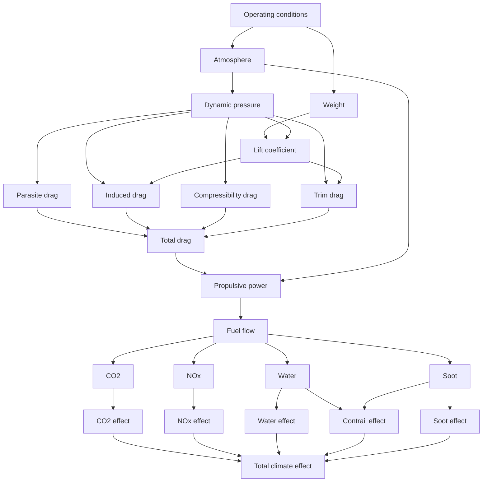

# Compiling a Bilt model with JAX

This example evaluates the same Bilt model with the Python and JAX backends and
compares their performance on a large array calculation.

The model represents a simplified cruise-impact calculation. Cruise conditions
feed atmosphere, aerodynamic, propulsion, emissions, and illustrative
climate-effect calculations before combining into a final output.

The climate-effect relationships are deliberately illustrative rather than a
validated aircraft climate model. The point of the example is the shape and
size of the numerical calculation.



## The model

The full model contains a number of small transforms. For example:

```python
from typing import Annotated

from bilt import Quantity, transform
from bilt.units.dimensions import DIMENSIONLESS, FORCE, LENGTH, MASS, TIME


Density = Annotated[Quantity, MASS / LENGTH**3]
Speed = Annotated[Quantity, LENGTH / TIME]
Pressure = Annotated[Quantity, FORCE / LENGTH**2]
Area = Annotated[Quantity, LENGTH**2]
Force = Annotated[Quantity, FORCE]
Ratio = Annotated[Quantity, DIMENSIONLESS]


@transform
def dynamic_pressure(density: Density, true_airspeed: Speed) -> Pressure:
    return 0.5 * density * true_airspeed**2


@transform
def induced_drag(
    dynamic_pressure: Pressure,
    wing_area: Area,
    lift_coefficient: Ratio,
    induced_drag_factor: Ratio,
) -> Force:
    return dynamic_pressure * wing_area * induced_drag_factor * lift_coefficient**2
```

The system and transforms use scalar quantity declarations. They accept scalar
quantities or compatible unit-carrying tensors, so the model does not prescribe
the shape of the ensemble. Efficiencies, Mach number, aerodynamic coefficients,
and emission indices are dimensionless quantities supplied with `UNITLESS`.

The atmosphere uses absolute temperatures and relative temperature offsets.
Gravity, lapse rate, gas constant, reference pressure, and fuel heating value
carry units in the full model. Absolute temperatures are explicitly expressed
in kelvin before their numerical values enter the empirical correlations.

Emission rates and the illustrative weighted-emission score have units of kg/s.
The score uses arbitrary weights; it is not a validated climate metric or a
CO2-equivalent emission rate. The soot-dependent factor uses an explicit
inverse mass-rate coefficient so its correction is dimensionless.

The complete model is executed as part of this page, but its remaining
definitions are hidden to keep the worked example focused.

```python exec="on" session="jax-backend" source="above"
# Example model setup is executed here but hidden from the rendered page.
import importlib.util  # markdown-exec: hide
import sys  # markdown-exec: hide
import tempfile  # markdown-exec: hide
from pathlib import Path  # markdown-exec: hide

# markdown-exec: hide
_example_dir = Path(tempfile.mkdtemp(prefix="bilt_jax_example_"))  # markdown-exec: hide
_example_module = _example_dir / "jax_backend_cruise.py"  # markdown-exec: hide
_model_source = (  # markdown-exec: hide
    "\n".join(  # markdown-exec: hide
        [  # markdown-exec: hide
            '"""Models for the Bilt JAX worked example."""',  # markdown-exec: hide
            "",  # markdown-exec: hide
            "from __future__ import annotations",  # markdown-exec: hide
            "",  # markdown-exec: hide
            "from bilt import (",  # markdown-exec: hide
            "    Implementation,",  # markdown-exec: hide
            "    Interface,",  # markdown-exec: hide
            "    Quantity,",  # markdown-exec: hide
            "    field,",  # markdown-exec: hide
            "    system,",  # markdown-exec: hide
            "    transform,",  # markdown-exec: hide
            ")",  # markdown-exec: hide
            "",  # markdown-exec: hide
            "",  # markdown-exec: hide
            "from typing import Annotated",  # markdown-exec: hide
            "",  # markdown-exec: hide
            "from bilt.units import UNITLESS, absolute_kelvin, joule, kelvin, kilogram, meter, pascal, second",  # markdown-exec: hide
            "from bilt.units.dimensions import ABSOLUTE, DIMENSIONLESS, ENERGY, FORCE, LENGTH, MASS, TEMPERATURE, TIME",  # markdown-exec: hide
            "",  # markdown-exec: hide
            "",  # markdown-exec: hide
            "Length = Annotated[Quantity, LENGTH]",  # markdown-exec: hide
            "Mass = Annotated[Quantity, MASS]",  # markdown-exec: hide
            "Area = Annotated[Quantity, LENGTH**2]",  # markdown-exec: hide
            "TemperatureChange = Annotated[Quantity, TEMPERATURE]",  # markdown-exec: hide
            "AbsoluteTemperature = Annotated[Quantity, TEMPERATURE, ABSOLUTE]",  # markdown-exec: hide
            "Pressure = Annotated[Quantity, FORCE / LENGTH**2]",  # markdown-exec: hide
            "Density = Annotated[Quantity, MASS / LENGTH**3]",  # markdown-exec: hide
            "Speed = Annotated[Quantity, LENGTH / TIME]",  # markdown-exec: hide
            "Force = Annotated[Quantity, FORCE]",  # markdown-exec: hide
            "Power = Annotated[Quantity, ENERGY / TIME]",  # markdown-exec: hide
            "MassRate = Annotated[Quantity, MASS / TIME]",  # markdown-exec: hide
            "Ratio = Annotated[Quantity, DIMENSIONLESS]",  # markdown-exec: hide
            "",  # markdown-exec: hide
            "",  # markdown-exec: hide
            "@system",  # markdown-exec: hide
            "class CruiseImpact(metaclass=Interface):",  # markdown-exec: hide
            "    # Inputs",  # markdown-exec: hide
            "    altitude: Length = field()",  # markdown-exec: hide
            "    mach: Ratio = field()",  # markdown-exec: hide
            "    mass: Mass = field()",  # markdown-exec: hide
            "    temperature_offset: TemperatureChange = field()",  # markdown-exec: hide
            "    wing_area: Area = field()",  # markdown-exec: hide
            "    zero_lift_drag_coefficient: Ratio = field()",  # markdown-exec: hide
            "    induced_drag_factor: Ratio = field()",  # markdown-exec: hide
            "    propulsive_efficiency: Ratio = field()",  # markdown-exec: hide
            "    nox_emission_index: Ratio = field()",  # markdown-exec: hide
            "    soot_emission_index: Ratio = field()",  # markdown-exec: hide
            "",  # markdown-exec: hide
            "    # Atmosphere",  # markdown-exec: hide
            "    temperature: AbsoluteTemperature = field()",  # markdown-exec: hide
            "    pressure: Pressure = field()",  # markdown-exec: hide
            "    density: Density = field()",  # markdown-exec: hide
            "    speed_of_sound: Speed = field()",  # markdown-exec: hide
            "    true_airspeed: Speed = field()",  # markdown-exec: hide
            "",  # markdown-exec: hide
            "    # Aerodynamics",  # markdown-exec: hide
            "    weight: Force = field()",  # markdown-exec: hide
            "    dynamic_pressure: Pressure = field()",  # markdown-exec: hide
            "    lift_coefficient: Ratio = field()",  # markdown-exec: hide
            "    parasite_drag: Force = field()",  # markdown-exec: hide
            "    induced_drag: Force = field()",  # markdown-exec: hide
            "    compressibility_drag: Force = field()",  # markdown-exec: hide
            "    trim_drag: Force = field()",  # markdown-exec: hide
            "    total_drag: Force = field()",  # markdown-exec: hide
            "",  # markdown-exec: hide
            "    # Propulsion",  # markdown-exec: hide
            "    propulsive_power: Power = field()",  # markdown-exec: hide
            "    fuel_power: Power = field()",  # markdown-exec: hide
            "    fuel_flow: MassRate = field()",  # markdown-exec: hide
            "",  # markdown-exec: hide
            "    # Emissions",  # markdown-exec: hide
            "    co2_rate: MassRate = field()",  # markdown-exec: hide
            "    water_rate: MassRate = field()",  # markdown-exec: hide
            "    nox_rate: MassRate = field()",  # markdown-exec: hide
            "    soot_rate: MassRate = field()",  # markdown-exec: hide
            "",  # markdown-exec: hide
            "    # Illustrative climate-effect outputs",  # markdown-exec: hide
            "    co2_effect: MassRate = field()",  # markdown-exec: hide
            "    water_effect: MassRate = field()",  # markdown-exec: hide
            "    nox_effect: MassRate = field()",  # markdown-exec: hide
            "    soot_effect: MassRate = field()",  # markdown-exec: hide
            "    contrail_effect: MassRate = field()",  # markdown-exec: hide
            "    total_climate_effect: MassRate = field()",  # markdown-exec: hide
            "",  # markdown-exec: hide
            "",  # markdown-exec: hide
            "# Atmosphere -----------------------------------------------------------------",  # markdown-exec: hide
            "",  # markdown-exec: hide
            "",  # markdown-exec: hide
            "@transform",  # markdown-exec: hide
            "def temperature(altitude: Length, temperature_offset: TemperatureChange) -> AbsoluteTemperature:",  # markdown-exec: hide
            "    return Quantity(288.15, absolute_kelvin) - (0.0065 * kelvin / meter) * altitude + temperature_offset",  # markdown-exec: hide
            "",  # markdown-exec: hide
            "",  # markdown-exec: hide
            "@transform",  # markdown-exec: hide
            "def pressure(temperature: AbsoluteTemperature) -> Pressure:",  # markdown-exec: hide
            "    # The empirical reference temperature is 288.15 kelvin.",  # markdown-exec: hide
            "    return (101325.0 * pascal) * (temperature.convert_to(absolute_kelvin).value / 288.15) ** 5.2561",  # markdown-exec: hide
            "",  # markdown-exec: hide
            "",  # markdown-exec: hide
            "@transform",  # markdown-exec: hide
            "def density(pressure: Pressure, temperature: AbsoluteTemperature) -> Density:",  # markdown-exec: hide
            "    temperature_scale = temperature.convert_to(absolute_kelvin).value * kelvin",  # markdown-exec: hide
            "    return pressure / ((287.05 * joule / (kilogram * kelvin)) * temperature_scale)",  # markdown-exec: hide
            "",  # markdown-exec: hide
            "",  # markdown-exec: hide
            "@transform",  # markdown-exec: hide
            "def speed_of_sound(temperature: AbsoluteTemperature) -> Speed:",  # markdown-exec: hide
            "    temperature_scale = temperature.convert_to(absolute_kelvin).value * kelvin",  # markdown-exec: hide
            "    speed_squared = 1.4 * (287.05 * joule / (kilogram * kelvin)) * temperature_scale",  # markdown-exec: hide
            "    return speed_squared.convert_to(meter**2 / second**2).value**0.5 * meter / second",  # markdown-exec: hide
            "",  # markdown-exec: hide
            "",  # markdown-exec: hide
            "@transform",  # markdown-exec: hide
            "def true_airspeed(mach: Ratio, speed_of_sound: Speed) -> Speed:",  # markdown-exec: hide
            "    return mach * speed_of_sound",  # markdown-exec: hide
            "",  # markdown-exec: hide
            "",  # markdown-exec: hide
            "# Aerodynamics ---------------------------------------------------------------",  # markdown-exec: hide
            "",  # markdown-exec: hide
            "",  # markdown-exec: hide
            "@transform",  # markdown-exec: hide
            "def weight(mass: Mass) -> Force:",  # markdown-exec: hide
            "    return mass * (9.80665 * meter / second**2)",  # markdown-exec: hide
            "",  # markdown-exec: hide
            "",  # markdown-exec: hide
            "@transform",  # markdown-exec: hide
            "def dynamic_pressure(density: Density, true_airspeed: Speed) -> Pressure:",  # markdown-exec: hide
            "    return 0.5 * density * true_airspeed**2",  # markdown-exec: hide
            "",  # markdown-exec: hide
            "",  # markdown-exec: hide
            "@transform",  # markdown-exec: hide
            "def lift_coefficient(",  # markdown-exec: hide
            "    weight: Force,",  # markdown-exec: hide
            "    dynamic_pressure: Pressure,",  # markdown-exec: hide
            "    wing_area: Area,",  # markdown-exec: hide
            ") -> Ratio:",  # markdown-exec: hide
            "    return weight / (dynamic_pressure * wing_area)",  # markdown-exec: hide
            "",  # markdown-exec: hide
            "",  # markdown-exec: hide
            "@transform",  # markdown-exec: hide
            "def parasite_drag(",  # markdown-exec: hide
            "    dynamic_pressure: Pressure,",  # markdown-exec: hide
            "    wing_area: Area,",  # markdown-exec: hide
            "    zero_lift_drag_coefficient: Ratio,",  # markdown-exec: hide
            ") -> Force:",  # markdown-exec: hide
            "    return dynamic_pressure * wing_area * zero_lift_drag_coefficient",  # markdown-exec: hide
            "",  # markdown-exec: hide
            "",  # markdown-exec: hide
            "@transform",  # markdown-exec: hide
            "def induced_drag(",  # markdown-exec: hide
            "    dynamic_pressure: Pressure,",  # markdown-exec: hide
            "    wing_area: Area,",  # markdown-exec: hide
            "    lift_coefficient: Ratio,",  # markdown-exec: hide
            "    induced_drag_factor: Ratio,",  # markdown-exec: hide
            ") -> Force:",  # markdown-exec: hide
            "    return (",  # markdown-exec: hide
            "        dynamic_pressure",  # markdown-exec: hide
            "        * wing_area",  # markdown-exec: hide
            "        * induced_drag_factor",  # markdown-exec: hide
            "        * lift_coefficient**2",  # markdown-exec: hide
            "    )",  # markdown-exec: hide
            "",  # markdown-exec: hide
            "",  # markdown-exec: hide
            "@transform",  # markdown-exec: hide
            "def compressibility_drag(",  # markdown-exec: hide
            "    dynamic_pressure: Pressure,",  # markdown-exec: hide
            "    wing_area: Area,",  # markdown-exec: hide
            "    mach: Ratio,",  # markdown-exec: hide
            ") -> Force:",  # markdown-exec: hide
            "    correction = 0.002 * mach**2 + 0.004 * mach**4",  # markdown-exec: hide
            "    return dynamic_pressure * wing_area * correction",  # markdown-exec: hide
            "",  # markdown-exec: hide
            "",  # markdown-exec: hide
            "@transform",  # markdown-exec: hide
            "def trim_drag(",  # markdown-exec: hide
            "    dynamic_pressure: Pressure,",  # markdown-exec: hide
            "    wing_area: Area,",  # markdown-exec: hide
            "    lift_coefficient: Ratio,",  # markdown-exec: hide
            ") -> Force:",  # markdown-exec: hide
            "    return dynamic_pressure * wing_area * 0.0015 * lift_coefficient**2",  # markdown-exec: hide
            "",  # markdown-exec: hide
            "",  # markdown-exec: hide
            "@transform",  # markdown-exec: hide
            "def total_drag(",  # markdown-exec: hide
            "    parasite_drag: Force,",  # markdown-exec: hide
            "    induced_drag: Force,",  # markdown-exec: hide
            "    compressibility_drag: Force,",  # markdown-exec: hide
            "    trim_drag: Force,",  # markdown-exec: hide
            ") -> Force:",  # markdown-exec: hide
            "    return parasite_drag + induced_drag + compressibility_drag + trim_drag",  # markdown-exec: hide
            "",  # markdown-exec: hide
            "",  # markdown-exec: hide
            "# Propulsion -----------------------------------------------------------------",  # markdown-exec: hide
            "",  # markdown-exec: hide
            "",  # markdown-exec: hide
            "@transform",  # markdown-exec: hide
            "def propulsive_power(total_drag: Force, true_airspeed: Speed) -> Power:",  # markdown-exec: hide
            "    return total_drag * true_airspeed",  # markdown-exec: hide
            "",  # markdown-exec: hide
            "",  # markdown-exec: hide
            "@transform",  # markdown-exec: hide
            "def fuel_power(",  # markdown-exec: hide
            "    propulsive_power: Power,",  # markdown-exec: hide
            "    propulsive_efficiency: Ratio,",  # markdown-exec: hide
            ") -> Power:",  # markdown-exec: hide
            "    return propulsive_power / propulsive_efficiency",  # markdown-exec: hide
            "",  # markdown-exec: hide
            "",  # markdown-exec: hide
            "@transform",  # markdown-exec: hide
            "def fuel_flow(fuel_power: Power) -> MassRate:",  # markdown-exec: hide
            "    # Approximate kerosene lower heating value, J/kg.",  # markdown-exec: hide
            "    return fuel_power / (43_000_000.0 * joule / kilogram)",  # markdown-exec: hide
            "",  # markdown-exec: hide
            "",  # markdown-exec: hide
            "# Emissions ------------------------------------------------------------------",  # markdown-exec: hide
            "#",  # markdown-exec: hide
            "# These four transforms form independent branches from fuel_flow.",  # markdown-exec: hide
            "",  # markdown-exec: hide
            "",  # markdown-exec: hide
            "@transform",  # markdown-exec: hide
            "def co2_rate(fuel_flow: MassRate) -> MassRate:",  # markdown-exec: hide
            "    return 3.16 * fuel_flow",  # markdown-exec: hide
            "",  # markdown-exec: hide
            "",  # markdown-exec: hide
            "@transform",  # markdown-exec: hide
            "def water_rate(fuel_flow: MassRate) -> MassRate:",  # markdown-exec: hide
            "    return 1.23 * fuel_flow",  # markdown-exec: hide
            "",  # markdown-exec: hide
            "",  # markdown-exec: hide
            "@transform",  # markdown-exec: hide
            "def nox_rate(fuel_flow: MassRate, nox_emission_index: Ratio) -> MassRate:",  # markdown-exec: hide
            "    return fuel_flow * nox_emission_index",  # markdown-exec: hide
            "",  # markdown-exec: hide
            "",  # markdown-exec: hide
            "@transform",  # markdown-exec: hide
            "def soot_rate(fuel_flow: MassRate, soot_emission_index: Ratio) -> MassRate:",  # markdown-exec: hide
            "    return fuel_flow * soot_emission_index",  # markdown-exec: hide
            "",  # markdown-exec: hide
            "",  # markdown-exec: hide
            "# Illustrative climate effects -----------------------------------------------",  # markdown-exec: hide
            "#",  # markdown-exec: hide
            "# These are deliberately simple surrogate relationships. They are not intended",  # markdown-exec: hide
            "# to be scientifically defensible climate metrics.",  # markdown-exec: hide
            "",  # markdown-exec: hide
            "",  # markdown-exec: hide
            "@transform",  # markdown-exec: hide
            "def co2_effect(co2_rate: MassRate) -> MassRate:",  # markdown-exec: hide
            "    return co2_rate",  # markdown-exec: hide
            "",  # markdown-exec: hide
            "",  # markdown-exec: hide
            "@transform",  # markdown-exec: hide
            "def water_effect(water_rate: MassRate, altitude: Length) -> MassRate:",  # markdown-exec: hide
            "    altitude_factor = Quantity(0.8, UNITLESS) + altitude / (50_000.0 * meter)",  # markdown-exec: hide
            "    return 0.15 * water_rate * altitude_factor",  # markdown-exec: hide
            "",  # markdown-exec: hide
            "",  # markdown-exec: hide
            "@transform",  # markdown-exec: hide
            "def nox_effect(",  # markdown-exec: hide
            "    nox_rate: MassRate,",  # markdown-exec: hide
            "    altitude: Length,",  # markdown-exec: hide
            "    temperature: AbsoluteTemperature,",  # markdown-exec: hide
            ") -> MassRate:",  # markdown-exec: hide
            "    altitude_factor = Quantity(0.5, UNITLESS) + altitude / (20_000.0 * meter)",  # markdown-exec: hide
            "    temperature_factor = 288.15 / temperature.convert_to(absolute_kelvin).value",  # markdown-exec: hide
            "    return 40.0 * nox_rate * altitude_factor * temperature_factor",  # markdown-exec: hide
            "",  # markdown-exec: hide
            "",  # markdown-exec: hide
            "@transform",  # markdown-exec: hide
            "def soot_effect(soot_rate: MassRate, altitude: Length) -> MassRate:",  # markdown-exec: hide
            "    altitude_factor = Quantity(0.5, UNITLESS) + altitude / (15_000.0 * meter)",  # markdown-exec: hide
            "    return 1000.0 * soot_rate * altitude_factor",  # markdown-exec: hide
            "",  # markdown-exec: hide
            "",  # markdown-exec: hide
            "@transform",  # markdown-exec: hide
            "def contrail_effect(",  # markdown-exec: hide
            "    water_rate: MassRate,",  # markdown-exec: hide
            "    soot_rate: MassRate,",  # markdown-exec: hide
            "    altitude: Length,",  # markdown-exec: hide
            "    temperature: AbsoluteTemperature,",  # markdown-exec: hide
            ") -> MassRate:",  # markdown-exec: hide
            "    altitude_factor = (altitude / (12_000.0 * meter)) ** 2",  # markdown-exec: hide
            "    temperature_factor = (288.15 / temperature.convert_to(absolute_kelvin).value) ** 2",  # markdown-exec: hide
            "    return (",  # markdown-exec: hide
            "        0.08",  # markdown-exec: hide
            "        * water_rate",  # markdown-exec: hide
            "        * (Quantity(1.0, UNITLESS) + (100.0 * second / kilogram) * soot_rate)",  # markdown-exec: hide
            "        * altitude_factor",  # markdown-exec: hide
            "        * temperature_factor",  # markdown-exec: hide
            "    )",  # markdown-exec: hide
            "",  # markdown-exec: hide
            "",  # markdown-exec: hide
            "@transform",  # markdown-exec: hide
            "def total_climate_effect(",  # markdown-exec: hide
            "    co2_effect: MassRate,",  # markdown-exec: hide
            "    water_effect: MassRate,",  # markdown-exec: hide
            "    nox_effect: MassRate,",  # markdown-exec: hide
            "    soot_effect: MassRate,",  # markdown-exec: hide
            "    contrail_effect: MassRate,",  # markdown-exec: hide
            ") -> MassRate:",  # markdown-exec: hide
            "    return (",  # markdown-exec: hide
            "        co2_effect",  # markdown-exec: hide
            "        + water_effect",  # markdown-exec: hide
            "        + nox_effect",  # markdown-exec: hide
            "        + soot_effect",  # markdown-exec: hide
            "        + contrail_effect",  # markdown-exec: hide
            "    )",  # markdown-exec: hide
            "",  # markdown-exec: hide
            "",  # markdown-exec: hide
            "cruise_impact = Implementation(",  # markdown-exec: hide
            "    CruiseImpact,",  # markdown-exec: hide
            "    [",  # markdown-exec: hide
            "        temperature,",  # markdown-exec: hide
            "        pressure,",  # markdown-exec: hide
            "        density,",  # markdown-exec: hide
            "        speed_of_sound,",  # markdown-exec: hide
            "        true_airspeed,",  # markdown-exec: hide
            "        weight,",  # markdown-exec: hide
            "        dynamic_pressure,",  # markdown-exec: hide
            "        lift_coefficient,",  # markdown-exec: hide
            "        parasite_drag,",  # markdown-exec: hide
            "        induced_drag,",  # markdown-exec: hide
            "        compressibility_drag,",  # markdown-exec: hide
            "        trim_drag,",  # markdown-exec: hide
            "        total_drag,",  # markdown-exec: hide
            "        propulsive_power,",  # markdown-exec: hide
            "        fuel_power,",  # markdown-exec: hide
            "        fuel_flow,",  # markdown-exec: hide
            "        co2_rate,",  # markdown-exec: hide
            "        water_rate,",  # markdown-exec: hide
            "        nox_rate,",  # markdown-exec: hide
            "        soot_rate,",  # markdown-exec: hide
            "        co2_effect,",  # markdown-exec: hide
            "        water_effect,",  # markdown-exec: hide
            "        nox_effect,",  # markdown-exec: hide
            "        soot_effect,",  # markdown-exec: hide
            "        contrail_effect,",  # markdown-exec: hide
            "        total_climate_effect,",  # markdown-exec: hide
            "    ],",  # markdown-exec: hide
            ")",  # markdown-exec: hide
            "",  # markdown-exec: hide
            "",  # markdown-exec: hide
            "@system",  # markdown-exec: hide
            "class JaxSubproblem(metaclass=Interface):",  # markdown-exec: hide
            "    value: float = field()",  # markdown-exec: hide
            "    result: float = field()",  # markdown-exec: hide
            "",  # markdown-exec: hide
            "",  # markdown-exec: hide
            "@transform",  # markdown-exec: hide
            "def result(value: float) -> float:",  # markdown-exec: hide
            "    return value**2 + 2.0 * value + 1.0",  # markdown-exec: hide
            "",  # markdown-exec: hide
            "",  # markdown-exec: hide
            "jax_subproblem = Implementation(",  # markdown-exec: hide
            "    JaxSubproblem,",  # markdown-exec: hide
            "    [result],",  # markdown-exec: hide
            ")",  # markdown-exec: hide
            "",  # markdown-exec: hide
            "",  # markdown-exec: hide
            "@system",  # markdown-exec: hide
            "class HybridModel(metaclass=Interface):",  # markdown-exec: hide
            "    input_value: float = field()",  # markdown-exec: hide
            "    output_value: float = field()",  # markdown-exec: hide
            "",  # markdown-exec: hide
            "",  # markdown-exec: hide
            "@transform",  # markdown-exec: hide
            "def output_value(input_value: float) -> float:",  # markdown-exec: hide
            "    from bilt import JAX_BACKEND",  # markdown-exec: hide
            "    from jax_backend_cruise import JaxSubproblem, jax_subproblem",  # markdown-exec: hide
            "",  # markdown-exec: hide
            "    value = abs(input_value)",  # markdown-exec: hide
            "",  # markdown-exec: hide
            "    with JAX_BACKEND, jax_subproblem:",  # markdown-exec: hide
            "        return JaxSubproblem(value=value).result",  # markdown-exec: hide
            "",  # markdown-exec: hide
            "",  # markdown-exec: hide
            "hybrid_model = Implementation(",  # markdown-exec: hide
            "    HybridModel,",  # markdown-exec: hide
            "    [output_value],",  # markdown-exec: hide
            ")",  # markdown-exec: hide
        ]  # markdown-exec: hide
    )  # markdown-exec: hide
    + "\n"  # markdown-exec: hide
)  # markdown-exec: hide
_example_module.write_text(_model_source)  # markdown-exec: hide
# markdown-exec: hide
_spec = importlib.util.spec_from_file_location(  # markdown-exec: hide
    "jax_backend_cruise",  # markdown-exec: hide
    _example_module,  # markdown-exec: hide
)  # markdown-exec: hide
assert _spec is not None and _spec.loader is not None  # markdown-exec: hide
_module = importlib.util.module_from_spec(_spec)  # markdown-exec: hide
sys.modules[_spec.name] = _module  # markdown-exec: hide
_spec.loader.exec_module(_module)  # markdown-exec: hide
# markdown-exec: hide
CruiseImpact = _module.CruiseImpact  # markdown-exec: hide
cruise_impact = _module.cruise_impact  # markdown-exec: hide
HybridModel = _module.HybridModel  # markdown-exec: hide
hybrid_model = _module.hybrid_model  # markdown-exec: hide
```

## Build a large ensemble

We evaluate the model over 262,144 (`2**18`) cruise conditions.

The inputs use Bilt tensors over a named `scenario` dimension:

```python exec="on" session="jax-backend" source="above"
import numpy as np

from bilt import Quantity, dim, tensor
from bilt.units import UNITLESS, kelvin, kilogram, meter, second

scenario = dim("scenario")
scenario_count = 2**18
rng = np.random.default_rng(42)

inputs = {
    "altitude": tensor(
        rng.uniform(8_000.0, 12_000.0, scenario_count).astype(np.float32),
        over=scenario,
        unit=meter,
    ),
    "mach": tensor(
        rng.uniform(0.70, 0.88, scenario_count).astype(np.float32),
        over=scenario,
        unit=UNITLESS,
    ),
    "mass": tensor(
        rng.uniform(50_000.0, 80_000.0, scenario_count).astype(np.float32),
        over=scenario,
        unit=kilogram,
    ),
    "temperature_offset": tensor(
        rng.normal(0.0, 8.0, scenario_count).astype(np.float32),
        over=scenario,
        unit=kelvin,
    ),
    "wing_area": Quantity(float(np.float32(122.6)), meter**2),
    "zero_lift_drag_coefficient": Quantity(float(np.float32(0.021)), UNITLESS),
    "induced_drag_factor": Quantity(float(np.float32(0.045)), UNITLESS),
    "propulsive_efficiency": Quantity(float(np.float32(0.38)), UNITLESS),
    "nox_emission_index": Quantity(float(np.float32(0.015)), UNITLESS),
    "soot_emission_index": Quantity(float(np.float32(0.00003)), UNITLESS),
}

print(f"Scenarios: **{scenario_count:,}**")
```

The scalar aircraft parameters are broadcast across the `scenario` dimension.

## Run with the Python backend

Python is Bilt's default backend, so it does not need to be selected explicitly:

```python exec="on" session="jax-backend" source="above"
python_model = CruiseImpact(**inputs)

with cruise_impact:
    python_result = python_model.total_climate_effect

print(f"Output shape: `{python_result.values.shape}`")
print(f"Output unit: `{python_result.unit}`")
```

## Run with the JAX backend

The model and inputs do not change. Only the backend selection changes:

```python exec="on" session="jax-backend" source="above"
from bilt import JAX_BACKEND

jax_model = CruiseImpact(**inputs)

with JAX_BACKEND, cruise_impact:
    jax_result = jax_model.total_climate_effect

print(f"Output shape: `{jax_result.values.shape}`")
print(f"Output unit: `{jax_result.unit}`")
```

Both backends return a unit-carrying tensor. Before comparing performance,
express both results in kg/s and check their numerical values:

```python exec="on" session="jax-backend" source="above"
np.testing.assert_allclose(
    np.asarray(python_result.convert_to(kilogram / second).values),
    np.asarray(jax_result.convert_to(kilogram / second).values),
    rtol=1e-4,
    atol=1e-5,
)

print("Python and JAX results agree.")
```

Small floating-point differences are expected because the two backends may
evaluate equivalent numerical expressions differently.

## Compare Python, cold JAX, and warm JAX

A fair JAX comparison should separate compilation from reuse.

For the cold measurement below, the persistent JAX compilation cache is
disabled and JAX's in-memory caches are cleared immediately before evaluation.
The following warm measurements then reuse the compiled calculation.

The benchmark materialises `result.values` as a NumPy array before stopping
the clock. This ensures the returned result is complete without assuming that
`Tensor.values` exposes a JAX array. The timed evaluation includes Bilt input
validation, unit conversion, and output wrapping as well as backend execution.

```python exec="on" session="jax-backend" source="above"
import statistics
import time

import jax

from bilt import PYTHON_BACKEND

repeats = 5

python_times = []
for _ in range(repeats):
    model = CruiseImpact(**inputs)

    start = time.perf_counter()
    with PYTHON_BACKEND, cruise_impact:
        result = model.total_climate_effect
    np.asarray(result.values)
    python_times.append(time.perf_counter() - start)

python_seconds = statistics.median(python_times)

persistent_cache_enabled = jax.config.jax_enable_compilation_cache
jax.config.update("jax_enable_compilation_cache", False)

try:
    jax.clear_caches()

    model = CruiseImpact(**inputs)

    start = time.perf_counter()
    with JAX_BACKEND, cruise_impact:
        result = model.total_climate_effect
    np.asarray(result.values)
    jax_cold_seconds = time.perf_counter() - start

    jax_warm_times = []
    for _ in range(repeats):
        model = CruiseImpact(**inputs)

        start = time.perf_counter()
        with JAX_BACKEND, cruise_impact:
            result = model.total_climate_effect
        np.asarray(result.values)
        jax_warm_times.append(time.perf_counter() - start)

    jax_warm_seconds = statistics.median(jax_warm_times)
finally:
    jax.config.update(
        "jax_enable_compilation_cache",
        persistent_cache_enabled,
    )

print("| Execution | Time |")
print("| --- | ---: |")
print(f"| Python | {python_seconds * 1e3:.2f} ms |")
print(f"| JAX cold | {jax_cold_seconds * 1e3:.2f} ms |")
print(f"| JAX warm | {jax_warm_seconds * 1e3:.2f} ms |")
print()
print(f"**Warm JAX speed-up: {python_seconds / jax_warm_seconds:.2f}×**")
```

The exact numbers depend on the machine, JAX version, array size, and available
hardware. The useful comparison is between the initial cost of compiling the
calculation and the cost of running it again once compiled.

## Try different ensemble sizes

The point at which JAX becomes worthwhile depends on the size of the
calculation. The following compares several ensemble sizes.

```python exec="on" session="jax-backend" source="above"
print("| Scenarios | Python | JAX warm | Speed-up |")
print("| ---: | ---: | ---: | ---: |")

for exponent in (12, 14, 16, 18):
    scenario_count = 2**exponent
    rng = np.random.default_rng(42)

    size_inputs = {
        "altitude": tensor(
            rng.uniform(8_000.0, 12_000.0, scenario_count).astype(np.float32),
            over=scenario,
            unit=meter,
        ),
        "mach": tensor(
            rng.uniform(0.70, 0.88, scenario_count).astype(np.float32),
            over=scenario,
            unit=UNITLESS,
        ),
        "mass": tensor(
            rng.uniform(50_000.0, 80_000.0, scenario_count).astype(np.float32),
            over=scenario,
            unit=kilogram,
        ),
        "temperature_offset": tensor(
            rng.normal(0.0, 8.0, scenario_count).astype(np.float32),
            over=scenario,
            unit=kelvin,
        ),
        "wing_area": Quantity(float(np.float32(122.6)), meter**2),
        "zero_lift_drag_coefficient": Quantity(float(np.float32(0.021)), UNITLESS),
        "induced_drag_factor": Quantity(float(np.float32(0.045)), UNITLESS),
        "propulsive_efficiency": Quantity(float(np.float32(0.38)), UNITLESS),
        "nox_emission_index": Quantity(float(np.float32(0.015)), UNITLESS),
        "soot_emission_index": Quantity(float(np.float32(0.00003)), UNITLESS),
    }

    python_times = []
    for _ in range(3):
        model = CruiseImpact(**size_inputs)

        start = time.perf_counter()
        with PYTHON_BACKEND, cruise_impact:
            result = model.total_climate_effect
        python_times.append(time.perf_counter() - start)

    python_seconds = statistics.median(python_times)

    jax.clear_caches()

    model = CruiseImpact(**size_inputs)
    with JAX_BACKEND, cruise_impact:
        result = model.total_climate_effect
    np.asarray(result.values)

    jax_times = []
    for _ in range(3):
        model = CruiseImpact(**size_inputs)

        start = time.perf_counter()
        with JAX_BACKEND, cruise_impact:
            result = model.total_climate_effect
        np.asarray(result.values)
        jax_times.append(time.perf_counter() - start)

    jax_seconds = statistics.median(jax_times)

    print(
        f"| {scenario_count:,} "
        f"| {python_seconds * 1e3:.2f} ms "
        f"| {jax_seconds * 1e3:.2f} ms "
        f"| {python_seconds / jax_seconds:.2f}× |"
    )
```

For small arrays, the Python backend may be entirely adequate. As the numerical
work grows, reusing a compiled JAX calculation can become increasingly useful.

## Current workaround: a nested JAX subproblem

The preferred approach is the one used above: run the complete compatible Bilt
model with the JAX backend. That keeps the full calculation visible to Bilt.

There are cases where part of a model cannot currently run under JAX. As a
workaround, a Python-backed transform can explicitly evaluate a separate Bilt
implementation using the JAX backend.

The following handoff demonstration uses plain mathematical values rather
than physical quantities. Its plain values are separate from the
unit-aware cruise model above. The JAX-compatible subproblem is an ordinary
Bilt model:

```python
@system
class JaxSubproblem(metaclass=Interface):
    value: float = field()
    result: float = field()


@transform
def result(value: float) -> float:
    return value**2 + 2.0 * value + 1.0


jax_subproblem = Implementation(
    JaxSubproblem,
    [result],
)
```

A Python transform can delegate to it:

```python
@transform
def output_value(input_value: float) -> float:
    from bilt import JAX_BACKEND
    from jax_backend_cruise import JaxSubproblem, jax_subproblem

    value = abs(input_value)

    with JAX_BACKEND, jax_subproblem:
        return JaxSubproblem(value=value).result
```

The caller still evaluates only the outer model:

```python exec="on" session="jax-backend" source="above"
from bilt import PYTHON_BACKEND

model = HybridModel(input_value=-3.0)

with PYTHON_BACKEND, hybrid_model:
    result = model.output_value

print(f"Hybrid result: {result}")
```

For `-3.0`, the Python part produces `3.0`, and the nested JAX calculation
returns `16.0`.

This proves that the handoff is possible, but it comes with an important
trade-off: the outer Bilt evaluation cannot inspect how the nested JAX result
was produced. The nested calculation is therefore an opaque boundary in the
otherwise transparent chain from inputs to outputs.

Use this pattern judiciously. It is best treated as an escape hatch for an
unavoidable Python/JAX boundary, not as the preferred way to structure a Bilt
model. Future Bilt support may provide a way to cross backend boundaries while
preserving transparency across the complete calculation.

## What this example shows

The same Bilt model can be evaluated with Python or JAX without rewriting the
model.

For small or one-off calculations, Python may be the better choice. For larger
calculations that are evaluated repeatedly, the cost of JAX compilation can be
recovered through faster warm execution.

Where possible, select one backend around the complete Bilt model so that the
full calculation remains visible and explainable. Nested backend evaluation can
bridge an unavoidable compatibility boundary, but should currently be treated
as a workaround.
