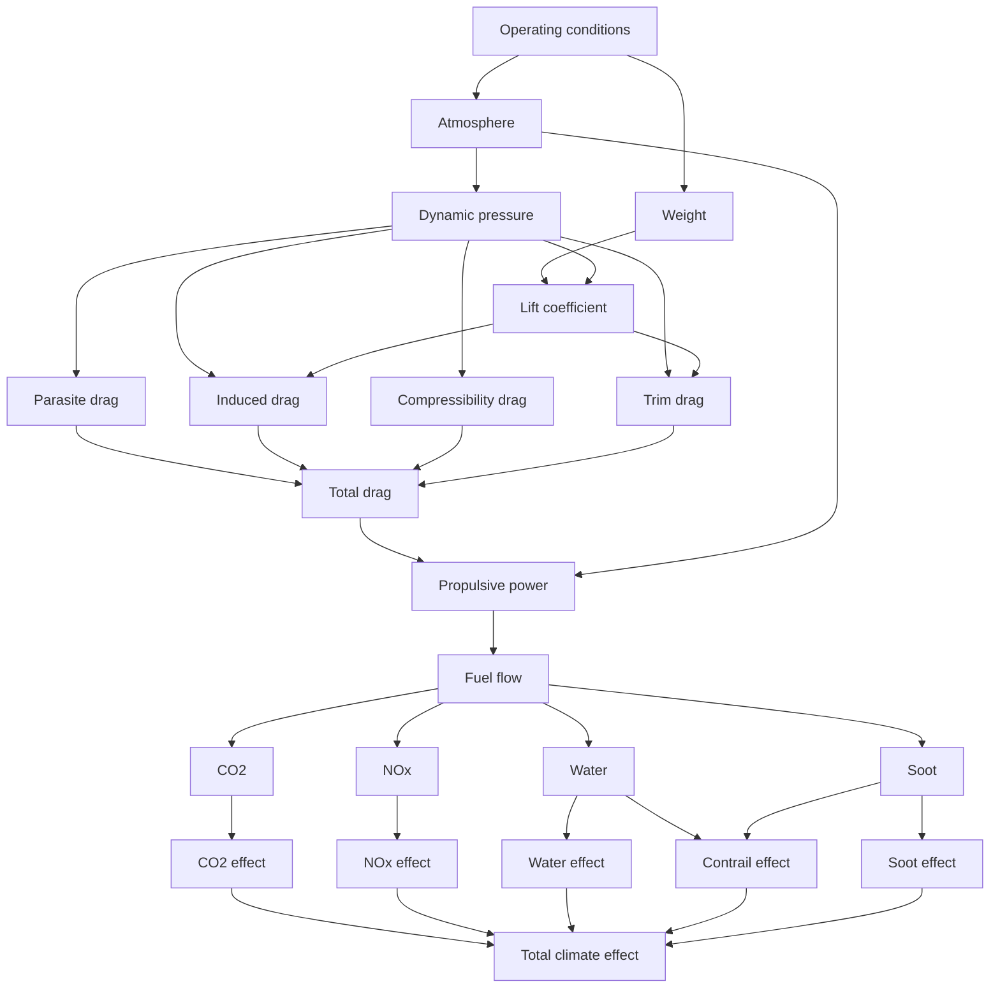

# Compiling a Bilt model with JAX

Bilt models describe **what is related**, separately from **how the resulting
computation is executed**. This example uses that separation to evaluate the
same model with Bilt's normal Python backend and its JAX backend.

The example is deliberately designed as a wide numerical graph. A set of cruise
conditions fans out through atmosphere, aerodynamic, propulsion, emissions and
climate-effect calculations before the branches reconverge into a single
output.

The climate-effect relationships are illustrative rather than a validated
aircraft climate model. The purpose of the example is to make the execution
structure easy to see and computationally substantial.



## A compositional model

The model source is embedded in this page so that the worked example is
self-contained. During the documentation build it is written to a temporary
Python module and imported. This gives Bilt a real source file to inspect while
keeping the transform implementations out of the rendered narrative.

The hidden setup block creates the model, the Bilt implementation, and the small
helpers used by the later benchmark blocks.

```python exec="on" session="jax-backend" source="above"
# Model setup is executed here but hidden from the rendered page.
import importlib.util  # markdown-exec: hide
import sys  # markdown-exec: hide
import tempfile  # markdown-exec: hide
from pathlib import Path  # markdown-exec: hide
# markdown-exec: hide
_example_dir = Path(tempfile.mkdtemp(prefix='bilt_jax_example_'))  # markdown-exec: hide
_example_module = _example_dir / 'jax_backend_cruise.py'  # markdown-exec: hide
_model_source = '\n'.join([  # markdown-exec: hide
    '"""Model and benchmark helpers for the Bilt JAX backend worked example.',  # markdown-exec: hide
    '',  # markdown-exec: hide
    'The climate-effect relationships in this example are intentionally illustrative.',  # markdown-exec: hide
    'The purpose of the model is to create a realistic, highly branched numerical DAG',  # markdown-exec: hide
    "for comparing Bilt's Python and JAX execution backends.",  # markdown-exec: hide
    '"""',  # markdown-exec: hide
    '',  # markdown-exec: hide
    'from __future__ import annotations',  # markdown-exec: hide
    '',  # markdown-exec: hide
    'import dataclasses',  # markdown-exec: hide
    'import statistics',  # markdown-exec: hide
    'import time',  # markdown-exec: hide
    'from collections.abc import Mapping',  # markdown-exec: hide
    'from typing import Any',  # markdown-exec: hide
    '',  # markdown-exec: hide
    'import jax',  # markdown-exec: hide
    'import numpy as np',  # markdown-exec: hide
    '',  # markdown-exec: hide
    'from bilt import (',  # markdown-exec: hide
    '    JAX_BACKEND,',  # markdown-exec: hide
    '    PYTHON_BACKEND,',  # markdown-exec: hide
    '    Implementation,',  # markdown-exec: hide
    '    Interface,',  # markdown-exec: hide
    '    dim,',  # markdown-exec: hide
    '    field,',  # markdown-exec: hide
    '    system,',  # markdown-exec: hide
    '    tensor,',  # markdown-exec: hide
    '    transform,',  # markdown-exec: hide
    ')',  # markdown-exec: hide
    '',  # markdown-exec: hide
    '',  # markdown-exec: hide
    '@system',  # markdown-exec: hide
    'class CruiseImpact(metaclass=Interface):',  # markdown-exec: hide
    '    # Inputs',  # markdown-exec: hide
    '    altitude: float = field()',  # markdown-exec: hide
    '    mach: float = field()',  # markdown-exec: hide
    '    mass: float = field()',  # markdown-exec: hide
    '    temperature_offset: float = field()',  # markdown-exec: hide
    '    wing_area: float = field()',  # markdown-exec: hide
    '    zero_lift_drag_coefficient: float = field()',  # markdown-exec: hide
    '    induced_drag_factor: float = field()',  # markdown-exec: hide
    '    propulsive_efficiency: float = field()',  # markdown-exec: hide
    '    nox_emission_index: float = field()',  # markdown-exec: hide
    '    soot_emission_index: float = field()',  # markdown-exec: hide
    '',  # markdown-exec: hide
    '    # Atmosphere',  # markdown-exec: hide
    '    temperature: float = field()',  # markdown-exec: hide
    '    pressure: float = field()',  # markdown-exec: hide
    '    density: float = field()',  # markdown-exec: hide
    '    speed_of_sound: float = field()',  # markdown-exec: hide
    '    true_airspeed: float = field()',  # markdown-exec: hide
    '',  # markdown-exec: hide
    '    # Aerodynamics',  # markdown-exec: hide
    '    weight: float = field()',  # markdown-exec: hide
    '    dynamic_pressure: float = field()',  # markdown-exec: hide
    '    lift_coefficient: float = field()',  # markdown-exec: hide
    '    parasite_drag: float = field()',  # markdown-exec: hide
    '    induced_drag: float = field()',  # markdown-exec: hide
    '    compressibility_drag: float = field()',  # markdown-exec: hide
    '    trim_drag: float = field()',  # markdown-exec: hide
    '    total_drag: float = field()',  # markdown-exec: hide
    '',  # markdown-exec: hide
    '    # Propulsion',  # markdown-exec: hide
    '    propulsive_power: float = field()',  # markdown-exec: hide
    '    fuel_power: float = field()',  # markdown-exec: hide
    '    fuel_flow: float = field()',  # markdown-exec: hide
    '',  # markdown-exec: hide
    '    # Emissions',  # markdown-exec: hide
    '    co2_rate: float = field()',  # markdown-exec: hide
    '    water_rate: float = field()',  # markdown-exec: hide
    '    nox_rate: float = field()',  # markdown-exec: hide
    '    soot_rate: float = field()',  # markdown-exec: hide
    '',  # markdown-exec: hide
    '    # Illustrative climate-effect outputs',  # markdown-exec: hide
    '    co2_effect: float = field()',  # markdown-exec: hide
    '    water_effect: float = field()',  # markdown-exec: hide
    '    nox_effect: float = field()',  # markdown-exec: hide
    '    soot_effect: float = field()',  # markdown-exec: hide
    '    contrail_effect: float = field()',  # markdown-exec: hide
    '    total_climate_effect: float = field()',  # markdown-exec: hide
    '',  # markdown-exec: hide
    '',  # markdown-exec: hide
    '# Atmosphere -----------------------------------------------------------------',  # markdown-exec: hide
    '',  # markdown-exec: hide
    '',  # markdown-exec: hide
    '@transform',  # markdown-exec: hide
    'def temperature(altitude: float, temperature_offset: float) -> float:',  # markdown-exec: hide
    '    return 288.15 - 0.0065 * altitude + temperature_offset',  # markdown-exec: hide
    '',  # markdown-exec: hide
    '',  # markdown-exec: hide
    '@transform',  # markdown-exec: hide
    'def pressure(temperature: float) -> float:',  # markdown-exec: hide
    '    return 101325.0 * (temperature / 288.15) ** 5.2561',  # markdown-exec: hide
    '',  # markdown-exec: hide
    '',  # markdown-exec: hide
    '@transform',  # markdown-exec: hide
    'def density(pressure: float, temperature: float) -> float:',  # markdown-exec: hide
    '    return pressure / (287.05 * temperature)',  # markdown-exec: hide
    '',  # markdown-exec: hide
    '',  # markdown-exec: hide
    '@transform',  # markdown-exec: hide
    'def speed_of_sound(temperature: float) -> float:',  # markdown-exec: hide
    '    return (1.4 * 287.05 * temperature) ** 0.5',  # markdown-exec: hide
    '',  # markdown-exec: hide
    '',  # markdown-exec: hide
    '@transform',  # markdown-exec: hide
    'def true_airspeed(mach: float, speed_of_sound: float) -> float:',  # markdown-exec: hide
    '    return mach * speed_of_sound',  # markdown-exec: hide
    '',  # markdown-exec: hide
    '',  # markdown-exec: hide
    '# Aerodynamics ---------------------------------------------------------------',  # markdown-exec: hide
    '',  # markdown-exec: hide
    '',  # markdown-exec: hide
    '@transform',  # markdown-exec: hide
    'def weight(mass: float) -> float:',  # markdown-exec: hide
    '    return mass * 9.80665',  # markdown-exec: hide
    '',  # markdown-exec: hide
    '',  # markdown-exec: hide
    '@transform',  # markdown-exec: hide
    'def dynamic_pressure(density: float, true_airspeed: float) -> float:',  # markdown-exec: hide
    '    return 0.5 * density * true_airspeed**2',  # markdown-exec: hide
    '',  # markdown-exec: hide
    '',  # markdown-exec: hide
    '@transform',  # markdown-exec: hide
    'def lift_coefficient(',  # markdown-exec: hide
    '    weight: float,',  # markdown-exec: hide
    '    dynamic_pressure: float,',  # markdown-exec: hide
    '    wing_area: float,',  # markdown-exec: hide
    ') -> float:',  # markdown-exec: hide
    '    return weight / (dynamic_pressure * wing_area)',  # markdown-exec: hide
    '',  # markdown-exec: hide
    '',  # markdown-exec: hide
    '@transform',  # markdown-exec: hide
    'def parasite_drag(',  # markdown-exec: hide
    '    dynamic_pressure: float,',  # markdown-exec: hide
    '    wing_area: float,',  # markdown-exec: hide
    '    zero_lift_drag_coefficient: float,',  # markdown-exec: hide
    ') -> float:',  # markdown-exec: hide
    '    return dynamic_pressure * wing_area * zero_lift_drag_coefficient',  # markdown-exec: hide
    '',  # markdown-exec: hide
    '',  # markdown-exec: hide
    '@transform',  # markdown-exec: hide
    'def induced_drag(',  # markdown-exec: hide
    '    dynamic_pressure: float,',  # markdown-exec: hide
    '    wing_area: float,',  # markdown-exec: hide
    '    lift_coefficient: float,',  # markdown-exec: hide
    '    induced_drag_factor: float,',  # markdown-exec: hide
    ') -> float:',  # markdown-exec: hide
    '    return (',  # markdown-exec: hide
    '        dynamic_pressure',  # markdown-exec: hide
    '        * wing_area',  # markdown-exec: hide
    '        * induced_drag_factor',  # markdown-exec: hide
    '        * lift_coefficient**2',  # markdown-exec: hide
    '    )',  # markdown-exec: hide
    '',  # markdown-exec: hide
    '',  # markdown-exec: hide
    '@transform',  # markdown-exec: hide
    'def compressibility_drag(',  # markdown-exec: hide
    '    dynamic_pressure: float,',  # markdown-exec: hide
    '    wing_area: float,',  # markdown-exec: hide
    '    mach: float,',  # markdown-exec: hide
    ') -> float:',  # markdown-exec: hide
    '    correction = 0.002 * mach**2 + 0.004 * mach**4',  # markdown-exec: hide
    '    return dynamic_pressure * wing_area * correction',  # markdown-exec: hide
    '',  # markdown-exec: hide
    '',  # markdown-exec: hide
    '@transform',  # markdown-exec: hide
    'def trim_drag(',  # markdown-exec: hide
    '    dynamic_pressure: float,',  # markdown-exec: hide
    '    wing_area: float,',  # markdown-exec: hide
    '    lift_coefficient: float,',  # markdown-exec: hide
    ') -> float:',  # markdown-exec: hide
    '    return dynamic_pressure * wing_area * 0.0015 * lift_coefficient**2',  # markdown-exec: hide
    '',  # markdown-exec: hide
    '',  # markdown-exec: hide
    '@transform',  # markdown-exec: hide
    'def total_drag(',  # markdown-exec: hide
    '    parasite_drag: float,',  # markdown-exec: hide
    '    induced_drag: float,',  # markdown-exec: hide
    '    compressibility_drag: float,',  # markdown-exec: hide
    '    trim_drag: float,',  # markdown-exec: hide
    ') -> float:',  # markdown-exec: hide
    '    return parasite_drag + induced_drag + compressibility_drag + trim_drag',  # markdown-exec: hide
    '',  # markdown-exec: hide
    '',  # markdown-exec: hide
    '# Propulsion -----------------------------------------------------------------',  # markdown-exec: hide
    '',  # markdown-exec: hide
    '',  # markdown-exec: hide
    '@transform',  # markdown-exec: hide
    'def propulsive_power(total_drag: float, true_airspeed: float) -> float:',  # markdown-exec: hide
    '    return total_drag * true_airspeed',  # markdown-exec: hide
    '',  # markdown-exec: hide
    '',  # markdown-exec: hide
    '@transform',  # markdown-exec: hide
    'def fuel_power(',  # markdown-exec: hide
    '    propulsive_power: float,',  # markdown-exec: hide
    '    propulsive_efficiency: float,',  # markdown-exec: hide
    ') -> float:',  # markdown-exec: hide
    '    return propulsive_power / propulsive_efficiency',  # markdown-exec: hide
    '',  # markdown-exec: hide
    '',  # markdown-exec: hide
    '@transform',  # markdown-exec: hide
    'def fuel_flow(fuel_power: float) -> float:',  # markdown-exec: hide
    '    # Approximate kerosene lower heating value, J/kg.',  # markdown-exec: hide
    '    return fuel_power / 43_000_000.0',  # markdown-exec: hide
    '',  # markdown-exec: hide
    '',  # markdown-exec: hide
    '# Emissions ------------------------------------------------------------------',  # markdown-exec: hide
    '#',  # markdown-exec: hide
    '# These four transforms form independent branches from fuel_flow.',  # markdown-exec: hide
    '',  # markdown-exec: hide
    '',  # markdown-exec: hide
    '@transform',  # markdown-exec: hide
    'def co2_rate(fuel_flow: float) -> float:',  # markdown-exec: hide
    '    return 3.16 * fuel_flow',  # markdown-exec: hide
    '',  # markdown-exec: hide
    '',  # markdown-exec: hide
    '@transform',  # markdown-exec: hide
    'def water_rate(fuel_flow: float) -> float:',  # markdown-exec: hide
    '    return 1.23 * fuel_flow',  # markdown-exec: hide
    '',  # markdown-exec: hide
    '',  # markdown-exec: hide
    '@transform',  # markdown-exec: hide
    'def nox_rate(fuel_flow: float, nox_emission_index: float) -> float:',  # markdown-exec: hide
    '    return fuel_flow * nox_emission_index',  # markdown-exec: hide
    '',  # markdown-exec: hide
    '',  # markdown-exec: hide
    '@transform',  # markdown-exec: hide
    'def soot_rate(fuel_flow: float, soot_emission_index: float) -> float:',  # markdown-exec: hide
    '    return fuel_flow * soot_emission_index',  # markdown-exec: hide
    '',  # markdown-exec: hide
    '',  # markdown-exec: hide
    '# Illustrative climate effects -----------------------------------------------',  # markdown-exec: hide
    '#',  # markdown-exec: hide
    '# These are deliberately simple surrogate relationships. They are not intended',  # markdown-exec: hide
    '# to be scientifically defensible climate metrics.',  # markdown-exec: hide
    '',  # markdown-exec: hide
    '',  # markdown-exec: hide
    '@transform',  # markdown-exec: hide
    'def co2_effect(co2_rate: float) -> float:',  # markdown-exec: hide
    '    return co2_rate',  # markdown-exec: hide
    '',  # markdown-exec: hide
    '',  # markdown-exec: hide
    '@transform',  # markdown-exec: hide
    'def water_effect(water_rate: float, altitude: float) -> float:',  # markdown-exec: hide
    '    altitude_factor = 0.8 + altitude / 50_000.0',  # markdown-exec: hide
    '    return 0.15 * water_rate * altitude_factor',  # markdown-exec: hide
    '',  # markdown-exec: hide
    '',  # markdown-exec: hide
    '@transform',  # markdown-exec: hide
    'def nox_effect(',  # markdown-exec: hide
    '    nox_rate: float,',  # markdown-exec: hide
    '    altitude: float,',  # markdown-exec: hide
    '    temperature: float,',  # markdown-exec: hide
    ') -> float:',  # markdown-exec: hide
    '    altitude_factor = 0.5 + altitude / 20_000.0',  # markdown-exec: hide
    '    temperature_factor = 288.15 / temperature',  # markdown-exec: hide
    '    return 40.0 * nox_rate * altitude_factor * temperature_factor',  # markdown-exec: hide
    '',  # markdown-exec: hide
    '',  # markdown-exec: hide
    '@transform',  # markdown-exec: hide
    'def soot_effect(soot_rate: float, altitude: float) -> float:',  # markdown-exec: hide
    '    altitude_factor = 0.5 + altitude / 15_000.0',  # markdown-exec: hide
    '    return 1000.0 * soot_rate * altitude_factor',  # markdown-exec: hide
    '',  # markdown-exec: hide
    '',  # markdown-exec: hide
    '@transform',  # markdown-exec: hide
    'def contrail_effect(',  # markdown-exec: hide
    '    water_rate: float,',  # markdown-exec: hide
    '    soot_rate: float,',  # markdown-exec: hide
    '    altitude: float,',  # markdown-exec: hide
    '    temperature: float,',  # markdown-exec: hide
    ') -> float:',  # markdown-exec: hide
    '    altitude_factor = (altitude / 12_000.0) ** 2',  # markdown-exec: hide
    '    temperature_factor = (288.15 / temperature) ** 2',  # markdown-exec: hide
    '    return (',  # markdown-exec: hide
    '        0.08',  # markdown-exec: hide
    '        * water_rate',  # markdown-exec: hide
    '        * (1.0 + 100.0 * soot_rate)',  # markdown-exec: hide
    '        * altitude_factor',  # markdown-exec: hide
    '        * temperature_factor',  # markdown-exec: hide
    '    )',  # markdown-exec: hide
    '',  # markdown-exec: hide
    '',  # markdown-exec: hide
    '@transform',  # markdown-exec: hide
    'def total_climate_effect(',  # markdown-exec: hide
    '    co2_effect: float,',  # markdown-exec: hide
    '    water_effect: float,',  # markdown-exec: hide
    '    nox_effect: float,',  # markdown-exec: hide
    '    soot_effect: float,',  # markdown-exec: hide
    '    contrail_effect: float,',  # markdown-exec: hide
    ') -> float:',  # markdown-exec: hide
    '    return (',  # markdown-exec: hide
    '        co2_effect',  # markdown-exec: hide
    '        + water_effect',  # markdown-exec: hide
    '        + nox_effect',  # markdown-exec: hide
    '        + soot_effect',  # markdown-exec: hide
    '        + contrail_effect',  # markdown-exec: hide
    '    )',  # markdown-exec: hide
    '',  # markdown-exec: hide
    '',  # markdown-exec: hide
    'cruise_impact = Implementation(',  # markdown-exec: hide
    '    CruiseImpact,',  # markdown-exec: hide
    '    [',  # markdown-exec: hide
    '        temperature,',  # markdown-exec: hide
    '        pressure,',  # markdown-exec: hide
    '        density,',  # markdown-exec: hide
    '        speed_of_sound,',  # markdown-exec: hide
    '        true_airspeed,',  # markdown-exec: hide
    '        weight,',  # markdown-exec: hide
    '        dynamic_pressure,',  # markdown-exec: hide
    '        lift_coefficient,',  # markdown-exec: hide
    '        parasite_drag,',  # markdown-exec: hide
    '        induced_drag,',  # markdown-exec: hide
    '        compressibility_drag,',  # markdown-exec: hide
    '        trim_drag,',  # markdown-exec: hide
    '        total_drag,',  # markdown-exec: hide
    '        propulsive_power,',  # markdown-exec: hide
    '        fuel_power,',  # markdown-exec: hide
    '        fuel_flow,',  # markdown-exec: hide
    '        co2_rate,',  # markdown-exec: hide
    '        water_rate,',  # markdown-exec: hide
    '        nox_rate,',  # markdown-exec: hide
    '        soot_rate,',  # markdown-exec: hide
    '        co2_effect,',  # markdown-exec: hide
    '        water_effect,',  # markdown-exec: hide
    '        nox_effect,',  # markdown-exec: hide
    '        soot_effect,',  # markdown-exec: hide
    '        contrail_effect,',  # markdown-exec: hide
    '        total_climate_effect,',  # markdown-exec: hide
    '    ],',  # markdown-exec: hide
    ')',  # markdown-exec: hide
    '',  # markdown-exec: hide
    '',  # markdown-exec: hide
    '',  # markdown-exec: hide
    '# Nested Python -> JAX example ------------------------------------------------',  # markdown-exec: hide
    '',  # markdown-exec: hide
    '',  # markdown-exec: hide
    '@system',  # markdown-exec: hide
    'class JaxSubproblem(metaclass=Interface):',  # markdown-exec: hide
    '    value: float = field()',  # markdown-exec: hide
    '    result: float = field()',  # markdown-exec: hide
    '',  # markdown-exec: hide
    '',  # markdown-exec: hide
    '@transform',  # markdown-exec: hide
    'def result(value: float) -> float:',  # markdown-exec: hide
    '    return value**2 + 2.0 * value + 1.0',  # markdown-exec: hide
    '',  # markdown-exec: hide
    '',  # markdown-exec: hide
    'jax_subproblem = Implementation(JaxSubproblem, [result])',  # markdown-exec: hide
    '',  # markdown-exec: hide
    '',  # markdown-exec: hide
    '@system',  # markdown-exec: hide
    'class HybridModel(metaclass=Interface):',  # markdown-exec: hide
    '    input_value: float = field()',  # markdown-exec: hide
    '    output_value: float = field()',  # markdown-exec: hide
    '',  # markdown-exec: hide
    '',  # markdown-exec: hide
    '@transform',  # markdown-exec: hide
    'def output_value(input_value: float) -> float:',  # markdown-exec: hide
    '    # The Python backend recompiles transform source, so dependencies used by',  # markdown-exec: hide
    '    # the transform are imported inside the function body.',  # markdown-exec: hide
    '    from bilt import JAX_BACKEND',  # markdown-exec: hide
    '    from jax_backend_cruise import JaxSubproblem, jax_subproblem',  # markdown-exec: hide
    '',  # markdown-exec: hide
    '    model = JaxSubproblem(value=abs(input_value))',  # markdown-exec: hide
    '',  # markdown-exec: hide
    '    with JAX_BACKEND, jax_subproblem:',  # markdown-exec: hide
    '        return model.result',  # markdown-exec: hide
    '',  # markdown-exec: hide
    '',  # markdown-exec: hide
    'hybrid_model = Implementation(HybridModel, [output_value])',  # markdown-exec: hide
    '',  # markdown-exec: hide
    '',  # markdown-exec: hide
    'scenario = dim("scenario")',  # markdown-exec: hide
    '',  # markdown-exec: hide
    '',  # markdown-exec: hide
    'def make_inputs(',  # markdown-exec: hide
    '    scenario_count: int = 2**18,',  # markdown-exec: hide
    '    *,',  # markdown-exec: hide
    '    seed: int = 42,',  # markdown-exec: hide
    ') -> dict[str, Any]:',  # markdown-exec: hide
    '    """Create a repeatable ensemble of cruise operating conditions."""',  # markdown-exec: hide
    '    rng = np.random.default_rng(seed)',  # markdown-exec: hide
    '',  # markdown-exec: hide
    '    def samples(values: np.ndarray) -> Any:',  # markdown-exec: hide
    '        return tensor(np.asarray(values, dtype=np.float32), over=scenario)',  # markdown-exec: hide
    '',  # markdown-exec: hide
    '    return {',  # markdown-exec: hide
    '        "altitude": samples(rng.uniform(8_000.0, 12_000.0, scenario_count)),',  # markdown-exec: hide
    '        "mach": samples(rng.uniform(0.70, 0.88, scenario_count)),',  # markdown-exec: hide
    '        "mass": samples(rng.uniform(50_000.0, 80_000.0, scenario_count)),',  # markdown-exec: hide
    '        "temperature_offset": samples(rng.normal(0.0, 8.0, scenario_count)),',  # markdown-exec: hide
    '        "wing_area": np.float32(122.6),',  # markdown-exec: hide
    '        "zero_lift_drag_coefficient": np.float32(0.021),',  # markdown-exec: hide
    '        "induced_drag_factor": np.float32(0.045),',  # markdown-exec: hide
    '        "propulsive_efficiency": np.float32(0.38),',  # markdown-exec: hide
    '        "nox_emission_index": np.float32(0.015),',  # markdown-exec: hide
    '        "soot_emission_index": np.float32(0.00003),',  # markdown-exec: hide
    '    }',  # markdown-exec: hide
    '',  # markdown-exec: hide
    '',  # markdown-exec: hide
    'def evaluate(inputs: Mapping[str, Any], backend: Any) -> Any:',  # markdown-exec: hide
    '    """Evaluate total climate effect using the requested Bilt backend."""',  # markdown-exec: hide
    '    model = CruiseImpact(**inputs)',  # markdown-exec: hide
    '',  # markdown-exec: hide
    '    with backend, cruise_impact:',  # markdown-exec: hide
    '        result = model.total_climate_effect',  # markdown-exec: hide
    '',  # markdown-exec: hide
    '    return result',  # markdown-exec: hide
    '',  # markdown-exec: hide
    '',  # markdown-exec: hide
    'def evaluate_default_python(inputs: Mapping[str, Any]) -> Any:',  # markdown-exec: hide
    '    """Evaluate using Bilt\'s normal default Python backend."""',  # markdown-exec: hide
    '    model = CruiseImpact(**inputs)',  # markdown-exec: hide
    '',  # markdown-exec: hide
    '    with cruise_impact:',  # markdown-exec: hide
    '        result = model.total_climate_effect',  # markdown-exec: hide
    '',  # markdown-exec: hide
    '    return result',  # markdown-exec: hide
    '',  # markdown-exec: hide
    '',  # markdown-exec: hide
    'def _values(result: Any) -> Any:',  # markdown-exec: hide
    '    return getattr(result, "values", result)',  # markdown-exec: hide
    '',  # markdown-exec: hide
    '',  # markdown-exec: hide
    'def block_until_ready(result: Any) -> Any:',  # markdown-exec: hide
    '    """Wait for asynchronous device work without forcing a host transfer."""',  # markdown-exec: hide
    '    values = _values(result)',  # markdown-exec: hide
    '    block = getattr(values, "block_until_ready", None)',  # markdown-exec: hide
    '    if block is not None:',  # markdown-exec: hide
    '        block()',  # markdown-exec: hide
    '    return result',  # markdown-exec: hide
    '',  # markdown-exec: hide
    '',  # markdown-exec: hide
    'def as_numpy(result: Any) -> np.ndarray:',  # markdown-exec: hide
    '    """Materialise a result on the host for validation or inspection."""',  # markdown-exec: hide
    '    return np.asarray(_values(result))',  # markdown-exec: hide
    '',  # markdown-exec: hide
    '',  # markdown-exec: hide
    '@dataclasses.dataclass(frozen=True, slots=True)',  # markdown-exec: hide
    'class Benchmark:',  # markdown-exec: hide
    '    python_seconds: float',  # markdown-exec: hide
    '    jax_cold_seconds: float',  # markdown-exec: hide
    '    jax_warm_seconds: float',  # markdown-exec: hide
    '',  # markdown-exec: hide
    '    @property',  # markdown-exec: hide
    '    def warm_speedup(self) -> float:',  # markdown-exec: hide
    '        return self.python_seconds / self.jax_warm_seconds',  # markdown-exec: hide
    '',  # markdown-exec: hide
    '',  # markdown-exec: hide
    'def _time_once(inputs: Mapping[str, Any], backend: Any) -> float:',  # markdown-exec: hide
    '    start = time.perf_counter()',  # markdown-exec: hide
    '    result = evaluate(inputs, backend)',  # markdown-exec: hide
    '    block_until_ready(result)',  # markdown-exec: hide
    '    return time.perf_counter() - start',  # markdown-exec: hide
    '',  # markdown-exec: hide
    '',  # markdown-exec: hide
    'def _median_time(',  # markdown-exec: hide
    '    inputs: Mapping[str, Any],',  # markdown-exec: hide
    '    backend: Any,',  # markdown-exec: hide
    '    *,',  # markdown-exec: hide
    '    repeats: int,',  # markdown-exec: hide
    ') -> float:',  # markdown-exec: hide
    '    return statistics.median(_time_once(inputs, backend) for _ in range(repeats))',  # markdown-exec: hide
    '',  # markdown-exec: hide
    '',  # markdown-exec: hide
    'def benchmark(',  # markdown-exec: hide
    '    inputs: Mapping[str, Any],',  # markdown-exec: hide
    '    *,',  # markdown-exec: hide
    '    repeats: int = 5,',  # markdown-exec: hide
    ') -> Benchmark:',  # markdown-exec: hide
    '    """Benchmark eager Python against cold and warm JAX execution.',  # markdown-exec: hide
    '',  # markdown-exec: hide
    "    Cold JAX is measured after clearing JAX's in-memory staging/compilation",  # markdown-exec: hide
    '    caches, with the persistent compilation cache disabled. The following warm',  # markdown-exec: hide
    '    calls reuse the executable compiled by that cold call.',  # markdown-exec: hide
    '    """',  # markdown-exec: hide
    '    python_seconds = _median_time(inputs, PYTHON_BACKEND, repeats=repeats)',  # markdown-exec: hide
    '',  # markdown-exec: hide
    '    persistent_cache_enabled = jax.config.jax_enable_compilation_cache',  # markdown-exec: hide
    '    jax.config.update("jax_enable_compilation_cache", False)',  # markdown-exec: hide
    '',  # markdown-exec: hide
    '    try:',  # markdown-exec: hide
    '        # Remove any compilation/staging state created by earlier examples in',  # markdown-exec: hide
    '        # this documentation build, so the next call must trace and compile.',  # markdown-exec: hide
    '        jax.clear_caches()',  # markdown-exec: hide
    '',  # markdown-exec: hide
    '        jax_cold_seconds = _time_once(inputs, JAX_BACKEND)',  # markdown-exec: hide
    '',  # markdown-exec: hide
    '        # Do not clear caches here: these runs deliberately reuse the executable',  # markdown-exec: hide
    '        # compiled by the cold call.',  # markdown-exec: hide
    '        jax_warm_seconds = _median_time(inputs, JAX_BACKEND, repeats=repeats)',  # markdown-exec: hide
    '    finally:',  # markdown-exec: hide
    '        jax.config.update(',  # markdown-exec: hide
    '            "jax_enable_compilation_cache",',  # markdown-exec: hide
    '            persistent_cache_enabled,',  # markdown-exec: hide
    '        )',  # markdown-exec: hide
    '',  # markdown-exec: hide
    '    return Benchmark(',  # markdown-exec: hide
    '        python_seconds=python_seconds,',  # markdown-exec: hide
    '        jax_cold_seconds=jax_cold_seconds,',  # markdown-exec: hide
    '        jax_warm_seconds=jax_warm_seconds,',  # markdown-exec: hide
    '    )',  # markdown-exec: hide
]) + '\n'  # markdown-exec: hide
_example_module.write_text(_model_source)  # markdown-exec: hide
# markdown-exec: hide
_spec = importlib.util.spec_from_file_location(  # markdown-exec: hide
    'jax_backend_cruise',  # markdown-exec: hide
    _example_module,  # markdown-exec: hide
)  # markdown-exec: hide
assert _spec is not None and _spec.loader is not None  # markdown-exec: hide
_module = importlib.util.module_from_spec(_spec)  # markdown-exec: hide
sys.modules[_spec.name] = _module  # markdown-exec: hide
_spec.loader.exec_module(_module)  # markdown-exec: hide
# markdown-exec: hide
make_inputs = _module.make_inputs  # markdown-exec: hide
evaluate = _module.evaluate  # markdown-exec: hide
evaluate_default_python = _module.evaluate_default_python  # markdown-exec: hide
as_numpy = _module.as_numpy  # markdown-exec: hide
benchmark = _module.benchmark  # markdown-exec: hide
HybridModel = _module.HybridModel  # markdown-exec: hide
hybrid_model = _module.hybrid_model  # markdown-exec: hide
CruiseImpact = _module.CruiseImpact  # markdown-exec: hide
cruise_impact = _module.cruise_impact  # markdown-exec: hide
```

The important modelling point is that we have **not** written one large
`calculate_everything` function. The calculation remains decomposed into
individually meaningful transforms. Later in the graph, `fuel_flow` fans out
into several independent emissions branches before those branches reconverge.

## Build an ensemble

We evaluate the model over many operating conditions simultaneously. The input
arrays use `float32` so that the NumPy and JAX comparison uses the same
precision.

The default below uses \(2^{18}\), or 262,144, scenarios. Increase
`scenario_count` if the calculation is too small to make the difference clear
on your machine.

```python exec="on" session="jax-backend" source="above"
scenario_count = 2**18
inputs = make_inputs(scenario_count)

print(f"Scenarios: **{scenario_count:,}**")
```

Bilt's named `scenario` dimension means that the same model can operate over the
entire ensemble without changing any of the transforms.

## The Python backend

Python is Bilt's normal backend, so it does not have to be selected explicitly:

```python exec="on" session="jax-backend" source="above"
inputs = make_inputs(2**18)
result = evaluate_default_python(inputs)

print(f"Output shape: `{result.values.shape}`")
```

It can also be selected explicitly with `PYTHON_BACKEND`:

```python
from bilt import PYTHON_BACKEND

with PYTHON_BACKEND, cruise_impact:
    result = model.total_climate_effect
```

Conceptually, the Python backend executes the analysis plan eagerly:

```text
Bilt transform
      ↓
NumPy operation
      ↓
materialised array
      ↓
Bilt transform
      ↓
NumPy operation
      ↓
materialised array
      ↓
...
```

NumPy's array primitives are implemented in compiled code and can be extremely
fast. The important limitation here is not that NumPy itself is interpreted
Python. It is that a long model is still orchestrated as a sequence of separate
array operations. Intermediate arrays may be written to memory and then read
again by later operations.

A wide graph also contains independent branches, but the ordinary Bilt/Python
executor visits the planned computations one after another.

## The JAX backend

The model itself does not change. Only the backend does:

```python
from bilt import JAX_BACKEND

with JAX_BACKEND, cruise_impact:
    result = model.total_climate_effect
```

The important difference is that the JAX backend can lower the complete
calculation before executing it:

```text
Bilt analysis plan
        ↓
    JAX program
        ↓
      jax.jit
        ↓
 XLA compilation
        ↓
optimised executable
```

That gives the compiler visibility across boundaries that remain important in
the Bilt model. It can, where profitable, fuse chains of elementwise
operations, avoid some intermediate arrays, specialise the executable for the
input shapes and dtypes, and schedule operations subject to their data
dependencies.

The branching itself does **not** mean that JAX assigns one CPU thread to every
branch. Rather, independent branches expose the absence of data dependencies,
giving the compiler more freedom to optimise and schedule the computation.

## Check that the backends agree

Before comparing performance, check that both backends calculate the same
thing.

```python exec="on" session="jax-backend" source="above"
import numpy as np

from bilt import JAX_BACKEND, PYTHON_BACKEND
inputs = make_inputs(2**18)

python_result = evaluate(inputs, PYTHON_BACKEND)
jax_result = evaluate(inputs, JAX_BACKEND)

np.testing.assert_allclose(
    as_numpy(python_result),
    as_numpy(jax_result),
    rtol=1e-4,
    atol=1e-5,
)

print("Python and JAX results agree.")
```

The tolerances are intentional: floating-point compilers are free to evaluate
equivalent arithmetic in slightly different ways, and JAX may fuse operations
that NumPy executes separately.

## Compilation changes the performance model

A fair comparison needs to distinguish two JAX cases.

A **cold** JAX call has to trace and compile a new computation for the supplied
shapes and dtypes. That can make it considerably slower than Python.

Once compiled, later calls with compatible inputs can reuse that executable.
Those **warm** calls are the interesting comparison for models that are
evaluated repeatedly: parameter sweeps, optimisation, uncertainty propagation,
design-space exploration, calibration, and interactive analysis.

JAX can also dispatch work asynchronously. A benchmark that stops its timer as
soon as the Python call returns can therefore measure dispatch rather than
execution. The helper used below waits for the returned array to be ready before
stopping the clock. It also disables JAX's persistent compilation cache and
calls `jax.clear_caches()` immediately before the cold measurement, so an
earlier example on this page cannot turn the cold run into a cache hit.

```python exec="on" session="jax-backend" source="above"
inputs = make_inputs(2**18)
timing = benchmark(inputs, repeats=5)

print("| Execution | Median / elapsed time |")
print("| --- | ---: |")
print(f"| Python | {timing.python_seconds * 1e3:.2f} ms |")
print(f"| JAX cold | {timing.jax_cold_seconds * 1e3:.2f} ms |")
print(f"| JAX warm | {timing.jax_warm_seconds * 1e3:.2f} ms |")
print()
print(f"**Warm JAX speed-up: {timing.warm_speedup:.2f}×**")
```

Do not expect exactly the same numbers on another machine. CPU architecture,
JAX/XLA version, thread configuration, array size and available accelerators all
affect the result.

## What is actually being compared?

The useful distinction is not "Python versus compiled code". NumPy already
performs its numerical primitives in compiled native code.

The comparison is between two execution strategies:

| Python backend | JAX backend |
| --- | --- |
| Executes the Bilt plan eagerly | Compiles the Bilt plan as a larger computation |
| Calls NumPy operations one by one | Gives XLA visibility across operations |
| Intermediate arrays are normally materialised | Operations may be fused and intermediates eliminated |
| Little or no compilation cost | First call pays tracing and compilation cost |
| Good for one-off or small calculations | Particularly attractive for repeated, substantial calculations |
| CPU NumPy execution | Can target JAX-supported CPU/GPU/TPU devices |

This is why the structure of the example matters. A single large multiplication
would mostly compare one NumPy primitive with one JAX primitive. A decomposed
Bilt graph asks a more relevant question:

> Can we keep the model modular for humans while compiling away some of that
> modularity for execution?

## What can JAX compile?

JAX is most effective when a calculation can be expressed as a **pure numerical
function over arrays**. In practice, that includes a large fraction of the work
performed by engineering models:

- elementwise arithmetic and array expressions;
- reductions and aggregations;
- matrix and tensor operations;
- many functions provided by `jax.numpy` and other JAX numerical libraries;
- vectorised calculations;
- fixed-shape numerical algorithms; and
- control flow expressed using JAX operations such as `cond`, `scan` and
  `while_loop`.

These operations can be traced into the compiled computation, allowing JAX and
XLA to optimise them together.

Not every Python calculation fits that model. Code inside a compiled JAX region
generally cannot rely on arbitrary Python behaviour at runtime. Examples
include:

- reading files, databases or network services;
- logging or other side effects using ordinary Python code;
- mutating global Python state;
- calling NumPy or third-party functions that do not have a JAX-compatible
  implementation;
- branching in ordinary Python based on the runtime value of a traced array;
  and
- creating intermediate arrays whose shapes depend on runtime array values.

Some of these cases can be rewritten using JAX primitives, and JAX also
provides host callbacks for situations where host-side Python execution is
unavoidable. A callback, however, introduces a boundary in the compiled
calculation and restricts the optimisations JAX can perform. It is therefore
usually better not to force an entire model into one JAX-compiled region.

### Mixing Python and JAX in a Bilt model

A Bilt model does **not** need to be completely JAX-compatible in order to
benefit from JAX.

A transform evaluated by the Python backend can itself delegate a numerical
subproblem to another Bilt implementation running under the JAX backend. This
lets a single outer evaluation cross a backend boundary internally.

For example, suppose the outer transform needs ordinary Python behaviour, but
the expensive downstream calculation is JAX-compatible:

```python
@system
class JaxSubproblem(metaclass=Interface):
    value: float = field()
    result: float = field()


@transform
def result(value: float) -> float:
    return value**2 + 2.0 * value + 1.0


jax_subproblem = Implementation(JaxSubproblem, [result])
```

The outer model can remain a normal Python-backed Bilt implementation. Because Bilt recompiles transform source for the Python backend, dependencies used by this transform are imported inside the function body:

```python
@system
class HybridModel(metaclass=Interface):
    input_value: float = field()
    output_value: float = field()


@transform
def output_value(input_value: float) -> float:
    from bilt import JAX_BACKEND
    from jax_backend_cruise import JaxSubproblem, jax_subproblem

    model = JaxSubproblem(value=abs(input_value))

    with JAX_BACKEND, jax_subproblem:
        return model.result


hybrid_model = Implementation(HybridModel, [output_value])
```

Now the user evaluates only the outer model. The outer evaluation uses the
Python backend; the switch to JAX happens entirely inside `output_value`:

```python exec="on" session="jax-backend" source="above"
from bilt import PYTHON_BACKEND

with PYTHON_BACKEND, hybrid_model:
    result = HybridModel(input_value=-3.0).output_value

print(f"Hybrid result: {result}")
```

Conceptually, one Bilt evaluation now looks like:

```text
outer Bilt evaluation
    Python backend
         │
         ▼
  output_value transform
         │
         │ ordinary Python work
         ▼
  concrete numerical input
         │
         │ nested Bilt evaluation
         ▼
    JAX backend
         │
         ▼
      result
         │
         ▼
return to outer Python transform
```

For the toy input `-3.0`, the Python transform first applies `abs`, producing
`3.0`. It then delegates the polynomial to JAX:

```text
3² + 2×3 + 1 = 16
```

This is the pattern to use when an upstream part of a model needs operations
that JAX cannot trace — for example file access, a Python-only library, or
dynamic Python logic — but a substantial downstream numerical calculation can
still benefit from JAX compilation.

The important point is that backend choice can happen **inside the model
evaluation**. The caller does not need to manually evaluate one model with
Python and then start a second evaluation with JAX.

There is still a cost when values cross between Python/NumPy and JAX,
particularly if data must move between host memory and an accelerator. The
nested JAX region should therefore normally contain enough numerical work to
justify that boundary.

## Try different problem sizes

JAX is not automatically faster for every array calculation. For small problems
the compilation and dispatch overheads can dominate.

The following executable block measures the same model at several ensemble
sizes. It keeps the range modest enough for a documentation build; increase it
for a more serious benchmark.

```python exec="on" session="jax-backend" source="above"
print("| Scenarios | Python | JAX warm | Speed-up |")
print("| ---: | ---: | ---: | ---: |")

for exponent in (12, 14, 16, 18):
    scenario_count = 2**exponent
    timing = benchmark(make_inputs(scenario_count), repeats=3)

    print(
        f"| {scenario_count:,} "
        f"| {timing.python_seconds * 1e3:.2f} ms "
        f"| {timing.jax_warm_seconds * 1e3:.2f} ms "
        f"| {timing.warm_speedup:.2f}× |"
    )
```

There will usually be a region where the Python backend is entirely adequate,
and another where the larger compiled computation starts to justify JAX's
additional machinery.

## What the example demonstrates

The main result is not a particular speed-up number. It is that the **same Bilt
model** supports two quite different execution strategies.

With the Python backend, the compositional graph remains visible at runtime as a
sequence of array operations. With JAX, Bilt can preserve that compositional
model for the author while handing a larger numerical program to a compiler.

That is the useful property for larger Bilt models: **modularity in the model
does not have to imply the same degree of fragmentation in the executable**.
