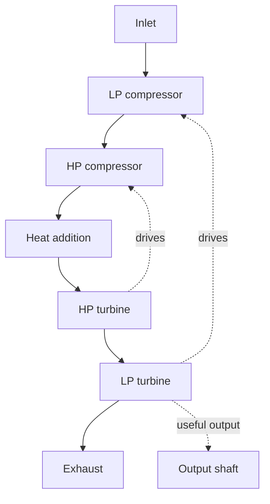
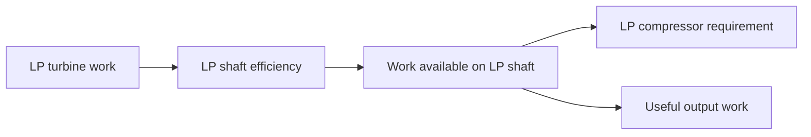
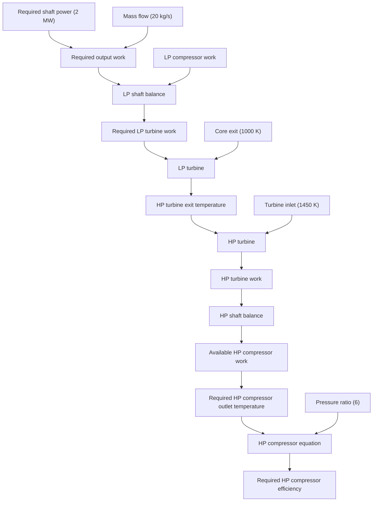
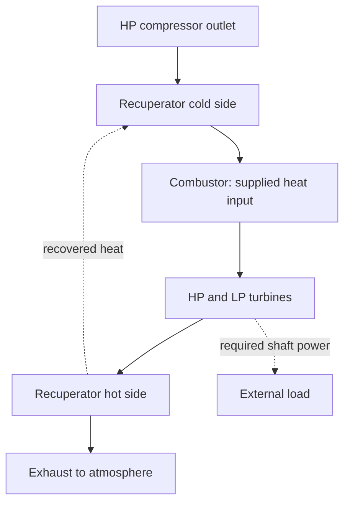

# A two-shaft gas turbine with useful shaft power: a more complex acausal system of systems

This worked example takes the same compositional idea as the two-spring example and applies it to a more recognisable engineering system: a small two-shaft gas turbine.

You do not need to know gas-turbine design to follow the example.

At a high level, the engine contains two kinds of component:

- a **compressor** squeezes the incoming air and therefore requires mechanical work;
- a **turbine** extracts energy from the hot gas and turns it into mechanical work.

The engine uses two shafts to transfer that work.



**Click a diagram to expand, zoom and pan.**

The **HP turbine** drives the HP compressor.

The **LP turbine** must do two jobs:

```text
LP turbine work
      =
LP compressor work
      +
useful output work
```

That useful output is the quantity we ultimately care about.

If the engine drives a generator, propeller, pump, or another mechanical load, this is the work available to that load.

## Why there are two kinds of work quantity

The component equations use **specific work**, measured here in `kJ/kg`.

That means:

> how much mechanical work is transferred for each kilogram of gas flowing through the engine?

To turn that into ordinary shaft power we also need the mass flow rate:

```text
shaft power
    =
specific output work × mass flow
```

Because:

```text
kJ/kg × kg/s = kJ/s = kW
```

So a specific output work of `100 kJ/kg` at a mass flow of `20 kg/s` corresponds to:

```text
2000 kW = 2 MW
```

## A simplifying exhaust assumption

This model only describes component temperatures and work; it does not yet include a nozzle or turbine pressure model.

To determine how much work the LP turbine extracts, we therefore specify the **core exit temperature** as an operating boundary condition.

For the baseline example we use:

```text
core exit temperature = Quantity(1000, absolute_kelvin) K
```

A real engine model would usually determine the turbine expansion from pressures and component efficiencies. Here the fixed exit temperature keeps the physics intentionally low-order while giving the shaft-power calculation a well-defined endpoint.

## How this example is evaluated

The forward and inverse requests in sections 1–13 can be decomposed into ordinary calculations. They work without a simultaneous solve across subsystem boundaries.

[Section 14](#14-close-the-loop-with-recuperation) adds an exhaust heat recuperator. That creates a genuine feedback loop between child systems and uses the feature branch's SCC analyser to solve the resulting linear block. The section shows its temporary development setup explicitly; the default analyser remains exhaustive.

The gas path still runs physically from compressor to turbine, but those physical arrows do **not** prescribe the direction in which Bilt must use the equations.

```python exec="on" session="turbomachinery"
from io import StringIO
import importlib.util
from pathlib import Path
import tempfile

import matplotlib

# markdown-exec runs code in a worker thread.
matplotlib.use("Agg")

import matplotlib.pyplot as plt
import numpy as np

from bilt import Quantity
from bilt.units import UNITLESS, absolute_kelvin, kelvin, kilogram, kilojoule, kilowatt, megawatt, second


def render_plot() -> None:
    buffer = StringIO()
    plt.savefig(buffer, format="svg", bbox_inches="tight")
    plt.close()
    print(buffer.getvalue())
```

## 1. Define reusable component systems

We start with a compressor. The system and its equations use scalar quantity
declarations, so their physical dimensions are explicit without prescribing
array shapes. Compatible unit-carrying tensors can also be supplied.

Temperatures are absolute readings; subtracting two readings gives a relative
temperature change. Specific heat multiplies that change to produce specific
work. Pressure ratios, efficiencies, and the heat-capacity ratio `gamma` are
dimensionless quantities, supplied using `UNITLESS`.

Port names describe physical quantities. Units are carried by values rather
than encoded in names such as `_k` or `_kj_per_kg`.

```python
from typing import Annotated

from bilt import Implementation, Interface, Quantity, equation, field, system
from bilt.units import UNITLESS, absolute_kelvin, kelvin, kilogram, kilojoule, kilowatt, megawatt, second
from bilt.units.dimensions import ABSOLUTE, DIMENSIONLESS, ENERGY, MASS, TEMPERATURE, TIME


AbsoluteTemperature = Annotated[Quantity, TEMPERATURE, ABSOLUTE]
SpecificHeat = Annotated[Quantity, ENERGY / (MASS * TEMPERATURE)]
SpecificWork = Annotated[Quantity, ENERGY / MASS]
MassFlow = Annotated[Quantity, MASS / TIME]
Power = Annotated[Quantity, ENERGY / TIME]
Ratio = Annotated[Quantity, DIMENSIONLESS]


@system
class Compressor(metaclass=Interface):
    inlet_temperature: AbsoluteTemperature = field()
    outlet_temperature: AbsoluteTemperature = field()
    pressure_ratio: Ratio = field()
    isentropic_efficiency: Ratio = field()
    gamma: Ratio = field()
    specific_heat: SpecificHeat = field()
    specific_work: SpecificWork = field()


@equation
def compressor_temperature_relation(
    inlet_temperature: AbsoluteTemperature,
    outlet_temperature: AbsoluteTemperature,
    pressure_ratio: Ratio,
    isentropic_efficiency: Ratio,
    gamma: Ratio,
) -> bool:
    return (outlet_temperature - inlet_temperature) * isentropic_efficiency == (
        inlet_temperature - Quantity(0.0, absolute_kelvin)
    ) * (pressure_ratio ** ((gamma - 1.0) / gamma) - 1.0)


@equation
def compressor_work_relation(
    specific_work: SpecificWork,
    specific_heat: SpecificHeat,
    inlet_temperature: AbsoluteTemperature,
    outlet_temperature: AbsoluteTemperature,
) -> bool:
    return specific_work == specific_heat * (outlet_temperature - inlet_temperature)


compressor_model = Implementation(
    Compressor,
    [
        compressor_temperature_relation,
        compressor_work_relation,
    ],
)
```

The compressor temperature relation uses
`inlet_temperature - Quantity(0.0, absolute_kelvin)` to express the inlet
temperature relative to absolute zero before multiplying it by a dimensionless
factor. This preserves the original kelvin-based formula while distinguishing
absolute readings from relative changes.

These are equations, not transforms.

For example:

```text
specific work = cp × (outlet temperature - inlet temperature)
```

does not permanently designate specific work as the output. With a different set of known values, Bilt can use the same relationship in another direction.

The turbine is similarly small:

```python
@system
class Turbine(metaclass=Interface):
    inlet_temperature: AbsoluteTemperature = field()
    outlet_temperature: AbsoluteTemperature = field()
    specific_heat: SpecificHeat = field()
    specific_work: SpecificWork = field()


@equation
def turbine_work_relation(
    specific_work: SpecificWork,
    specific_heat: SpecificHeat,
    inlet_temperature: AbsoluteTemperature,
    outlet_temperature: AbsoluteTemperature,
) -> bool:
    return specific_work == specific_heat * (inlet_temperature - outlet_temperature)


turbine_model = Implementation(
    Turbine,
    [turbine_work_relation],
)
```

## 2. Define the two-shaft core

The parent system contains the values needed to connect the four child systems.

```python
@system
class TwoShaftCore(metaclass=Interface):
    # Gas-path temperatures.
    inlet_temperature: AbsoluteTemperature = field()
    low_pressure_compressor_exit_temperature: AbsoluteTemperature = field()
    high_pressure_compressor_exit_temperature: AbsoluteTemperature = field()
    turbine_inlet_temperature: AbsoluteTemperature = field()
    high_pressure_turbine_exit_temperature: AbsoluteTemperature = field()
    exit_temperature: AbsoluteTemperature = field()

    # Compressor design assumptions.
    low_pressure_compressor_pressure_ratio: Ratio = field()
    high_pressure_compressor_pressure_ratio: Ratio = field()
    low_pressure_compressor_efficiency: Ratio = field()
    high_pressure_compressor_efficiency: Ratio = field()

    # Shared fluid properties.
    gamma: Ratio = field()
    specific_heat: SpecificHeat = field()

    # Shaft efficiencies.
    low_pressure_shaft_efficiency: Ratio = field()
    high_pressure_shaft_efficiency: Ratio = field()

    # Coupling values used by the two shaft balances.
    low_pressure_compressor_work: SpecificWork = field()
    high_pressure_compressor_work: SpecificWork = field()
    high_pressure_turbine_work: SpecificWork = field()
    low_pressure_turbine_work: SpecificWork = field()

    # Useful LP-shaft output.
    shaft_output_work: SpecificWork = field()
    mass_flow: MassFlow = field()
    shaft_power: Power = field()
```

Some of these values exist mainly to provide an explicit hand-off between child systems.

For example:

```text
LP compressor.outlet
        ↕
low_pressure_compressor_exit_temperature
        ↕
HP compressor.inlet
```

The two equations on either side each touch only one child.

## 3. Connect the LP compressor

The parent inlet is connected to the LP compressor inlet:

```python
@equation
def low_pressure_compressor_inlet_connection(
    inlet_temperature: AbsoluteTemperature,
    low_pressure_compressor: Compressor,
) -> bool:
    return inlet_temperature == low_pressure_compressor.inlet_temperature
```

The compressor exit is exposed on the parent:

```python
@equation
def low_pressure_compressor_exit_connection(
    low_pressure_compressor_exit_temperature: AbsoluteTemperature,
    low_pressure_compressor: Compressor,
) -> bool:
    return low_pressure_compressor_exit_temperature == low_pressure_compressor.outlet_temperature
```

and the parent supplies its pressure ratio, efficiency, and fluid properties:

```python
@equation
def low_pressure_compressor_pressure_ratio_connection(
    low_pressure_compressor_pressure_ratio: Ratio,
    low_pressure_compressor: Compressor,
) -> bool:
    return low_pressure_compressor_pressure_ratio == low_pressure_compressor.pressure_ratio


@equation
def low_pressure_compressor_efficiency_connection(
    low_pressure_compressor_efficiency: Ratio,
    low_pressure_compressor: Compressor,
) -> bool:
    return low_pressure_compressor_efficiency == low_pressure_compressor.isentropic_efficiency


@equation
def low_pressure_compressor_gamma_connection(
    gamma: Ratio,
    low_pressure_compressor: Compressor,
) -> bool:
    return gamma == low_pressure_compressor.gamma


@equation
def low_pressure_compressor_specific_heat_connection(
    specific_heat: SpecificHeat,
    low_pressure_compressor: Compressor,
) -> bool:
    return specific_heat == low_pressure_compressor.specific_heat
```

Finally, its specific work is copied onto the parent:

```python
@equation
def low_pressure_compressor_work_connection(
    low_pressure_compressor_work: SpecificWork,
    low_pressure_compressor: Compressor,
) -> bool:
    return low_pressure_compressor_work == low_pressure_compressor.specific_work
```

## 4. Connect the HP compressor

The LP compressor exit temperature now acts as the HP compressor inlet temperature:

```python
@equation
def high_pressure_compressor_inlet_connection(
    low_pressure_compressor_exit_temperature: AbsoluteTemperature,
    high_pressure_compressor: Compressor,
) -> bool:
    return low_pressure_compressor_exit_temperature == high_pressure_compressor.inlet_temperature
```

The HP compressor is otherwise connected in the same way:

```python
@equation
def high_pressure_compressor_exit_connection(
    high_pressure_compressor_exit_temperature: AbsoluteTemperature,
    high_pressure_compressor: Compressor,
) -> bool:
    return high_pressure_compressor_exit_temperature == high_pressure_compressor.outlet_temperature


@equation
def high_pressure_compressor_pressure_ratio_connection(
    high_pressure_compressor_pressure_ratio: Ratio,
    high_pressure_compressor: Compressor,
) -> bool:
    return high_pressure_compressor_pressure_ratio == high_pressure_compressor.pressure_ratio


@equation
def high_pressure_compressor_efficiency_connection(
    high_pressure_compressor_efficiency: Ratio,
    high_pressure_compressor: Compressor,
) -> bool:
    return high_pressure_compressor_efficiency == high_pressure_compressor.isentropic_efficiency


@equation
def high_pressure_compressor_gamma_connection(
    gamma: Ratio,
    high_pressure_compressor: Compressor,
) -> bool:
    return gamma == high_pressure_compressor.gamma


@equation
def high_pressure_compressor_specific_heat_connection(
    specific_heat: SpecificHeat,
    high_pressure_compressor: Compressor,
) -> bool:
    return specific_heat == high_pressure_compressor.specific_heat


@equation
def high_pressure_compressor_work_connection(
    high_pressure_compressor_work: SpecificWork,
    high_pressure_compressor: Compressor,
) -> bool:
    return high_pressure_compressor_work == high_pressure_compressor.specific_work
```

Again, no equation directly mentions both compressors.

The shared parent temperature is the hand-off point.

## 5. Connect the turbines

The turbine inlet temperature is connected to the HP turbine:

```python
@equation
def high_pressure_turbine_inlet_connection(
    turbine_inlet_temperature: AbsoluteTemperature,
    high_pressure_turbine: Turbine,
) -> bool:
    return turbine_inlet_temperature == high_pressure_turbine.inlet_temperature
```

The HP turbine exit is exposed on the parent:

```python
@equation
def high_pressure_turbine_exit_connection(
    high_pressure_turbine_exit_temperature: AbsoluteTemperature,
    high_pressure_turbine: Turbine,
) -> bool:
    return high_pressure_turbine_exit_temperature == high_pressure_turbine.outlet_temperature
```

and the same parent value independently feeds the LP turbine:

```python
@equation
def low_pressure_turbine_inlet_connection(
    high_pressure_turbine_exit_temperature: AbsoluteTemperature,
    low_pressure_turbine: Turbine,
) -> bool:
    return high_pressure_turbine_exit_temperature == low_pressure_turbine.inlet_temperature
```

The remaining turbine connections are:

```python
@equation
def core_exit_connection(
    exit_temperature: AbsoluteTemperature,
    low_pressure_turbine: Turbine,
) -> bool:
    return exit_temperature == low_pressure_turbine.outlet_temperature


@equation
def high_pressure_turbine_specific_heat_connection(
    specific_heat: SpecificHeat,
    high_pressure_turbine: Turbine,
) -> bool:
    return specific_heat == high_pressure_turbine.specific_heat


@equation
def low_pressure_turbine_specific_heat_connection(
    specific_heat: SpecificHeat,
    low_pressure_turbine: Turbine,
) -> bool:
    return specific_heat == low_pressure_turbine.specific_heat


@equation
def high_pressure_turbine_work_connection(
    high_pressure_turbine_work: SpecificWork,
    high_pressure_turbine: Turbine,
) -> bool:
    return high_pressure_turbine_work == high_pressure_turbine.specific_work


@equation
def low_pressure_turbine_work_connection(
    low_pressure_turbine_work: SpecificWork,
    low_pressure_turbine: Turbine,
) -> bool:
    return low_pressure_turbine_work == low_pressure_turbine.specific_work
```

## 6. Balance the shafts and expose useful output work

Once component work has been exposed as ordinary parent values, the shaft balances themselves contain no child-system parameters.

### The HP shaft

The HP turbine exists to drive the HP compressor.

After allowing for shaft efficiency:

```text
HP compressor work
    =
HP shaft efficiency × HP turbine work
```

In Bilt:

```python
@equation
def high_pressure_shaft_balance(
    high_pressure_compressor_work: SpecificWork,
    high_pressure_turbine_work: SpecificWork,
    high_pressure_shaft_efficiency: Ratio,
) -> bool:
    return high_pressure_compressor_work == high_pressure_shaft_efficiency * high_pressure_turbine_work
```

### The LP shaft

The LP turbine has an additional job: after driving the LP compressor, any remaining work can leave the engine through the output shaft.



The balance is:

```text
usable LP turbine work
    =
LP compressor work
    +
useful output work
```

or:

```python
@equation
def low_pressure_shaft_balance(
    low_pressure_compressor_work: SpecificWork,
    low_pressure_turbine_work: SpecificWork,
    low_pressure_shaft_efficiency: Ratio,
    shaft_output_work: SpecificWork,
) -> bool:
    return low_pressure_shaft_efficiency * low_pressure_turbine_work == low_pressure_compressor_work + shaft_output_work
```

Finally, mass flow converts specific output work into shaft power:

```python
@equation
def shaft_power_relation(
    shaft_output_work: SpecificWork,
    mass_flow: MassFlow,
    shaft_power: Power,
) -> bool:
    return shaft_power == shaft_output_work * mass_flow
```

These are all acausal equations.

For example, the last equation can be used either as:

```text
specific work + mass flow → shaft power
```

or:

```text
required shaft power + mass flow → required specific work
```

That second direction will be useful in the inverse-design example.

## 7. Put the implementation together

The four component occurrences are internal implementations:

```python
core_model = Implementation(
    TwoShaftCore,
    [
        low_pressure_compressor_inlet_connection,
        low_pressure_compressor_exit_connection,
        low_pressure_compressor_pressure_ratio_connection,
        low_pressure_compressor_efficiency_connection,
        low_pressure_compressor_gamma_connection,
        low_pressure_compressor_specific_heat_connection,
        low_pressure_compressor_work_connection,
        high_pressure_compressor_inlet_connection,
        high_pressure_compressor_exit_connection,
        high_pressure_compressor_pressure_ratio_connection,
        high_pressure_compressor_efficiency_connection,
        high_pressure_compressor_gamma_connection,
        high_pressure_compressor_specific_heat_connection,
        high_pressure_compressor_work_connection,
        high_pressure_turbine_inlet_connection,
        high_pressure_turbine_exit_connection,
        high_pressure_turbine_specific_heat_connection,
        high_pressure_turbine_work_connection,
        low_pressure_turbine_inlet_connection,
        core_exit_connection,
        low_pressure_turbine_specific_heat_connection,
        low_pressure_turbine_work_connection,
        high_pressure_shaft_balance,
        low_pressure_shaft_balance,
        shaft_power_relation,
    ],
    internal_implementations={
        "low_pressure_compressor": compressor_model,
        "high_pressure_compressor": compressor_model,
        "high_pressure_turbine": turbine_model,
        "low_pressure_turbine": turbine_model,
    },
)
```

The hierarchy organises the model. It does not prescribe an execution order.

A child system can also have more than one valid internal route to the same port. Which route Bilt uses depends on the values available in the surrounding model, so nesting a subsystem does not turn it into a fixed one-way calculation.

For the forward and inverse requests below, Bilt can evaluate each child from values already established by the surrounding model. We will keep this implementation unchanged when we add recuperation later.

For the executable documentation below, the same model is loaded from a temporary Python module. This gives Bilt a real source file for `inspect.getsource()` during the `markdown-exec` build.

```python exec="on" session="turbomachinery"
model_source = """
from typing import Annotated

from bilt import Implementation, Interface, Quantity, equation, field, system
from bilt.units import UNITLESS, absolute_kelvin, kelvin, kilogram, kilojoule, kilowatt, megawatt, second
from bilt.units.dimensions import ABSOLUTE, DIMENSIONLESS, ENERGY, MASS, TEMPERATURE, TIME


AbsoluteTemperature = Annotated[Quantity, TEMPERATURE, ABSOLUTE]
SpecificHeat = Annotated[Quantity, ENERGY / (MASS * TEMPERATURE)]
SpecificWork = Annotated[Quantity, ENERGY / MASS]
MassFlow = Annotated[Quantity, MASS / TIME]
Power = Annotated[Quantity, ENERGY / TIME]
Ratio = Annotated[Quantity, DIMENSIONLESS]

@system
class Compressor(metaclass=Interface):
    inlet_temperature: AbsoluteTemperature = field()
    outlet_temperature: AbsoluteTemperature = field()
    pressure_ratio: Ratio = field()
    isentropic_efficiency: Ratio = field()
    gamma: Ratio = field()
    specific_heat: SpecificHeat = field()
    specific_work: SpecificWork = field()

@equation
def compressor_temperature_relation(
    inlet_temperature: AbsoluteTemperature,
    outlet_temperature: AbsoluteTemperature,
    pressure_ratio: Ratio,
    isentropic_efficiency: Ratio,
    gamma: Ratio,
) -> bool:
    return (
        (outlet_temperature - inlet_temperature)
        * isentropic_efficiency
        == (inlet_temperature - Quantity(0.0, absolute_kelvin))
        * (
            pressure_ratio ** ((gamma - 1.0) / gamma)
            - 1.0
        )
    )

@equation
def compressor_work_relation(
    specific_work: SpecificWork,
    specific_heat: SpecificHeat,
    inlet_temperature: AbsoluteTemperature,
    outlet_temperature: AbsoluteTemperature,
) -> bool:
    return (
        specific_work
        == specific_heat
        * (outlet_temperature - inlet_temperature)
    )

compressor_model = Implementation(
    Compressor,
    [
        compressor_temperature_relation,
        compressor_work_relation,
    ],
)

@system
class Turbine(metaclass=Interface):
    inlet_temperature: AbsoluteTemperature = field()
    outlet_temperature: AbsoluteTemperature = field()
    specific_heat: SpecificHeat = field()
    specific_work: SpecificWork = field()

@equation
def turbine_work_relation(
    specific_work: SpecificWork,
    specific_heat: SpecificHeat,
    inlet_temperature: AbsoluteTemperature,
    outlet_temperature: AbsoluteTemperature,
) -> bool:
    return (
        specific_work
        == specific_heat
        * (inlet_temperature - outlet_temperature)
    )

turbine_model = Implementation(
    Turbine,
    [turbine_work_relation],
)

@system
class TwoShaftCore(metaclass=Interface):
    inlet_temperature: AbsoluteTemperature = field()
    low_pressure_compressor_exit_temperature: AbsoluteTemperature = field()
    high_pressure_compressor_exit_temperature: AbsoluteTemperature = field()
    turbine_inlet_temperature: AbsoluteTemperature = field()
    high_pressure_turbine_exit_temperature: AbsoluteTemperature = field()
    exit_temperature: AbsoluteTemperature = field()

    low_pressure_compressor_pressure_ratio: Ratio = field()
    high_pressure_compressor_pressure_ratio: Ratio = field()
    low_pressure_compressor_efficiency: Ratio = field()
    high_pressure_compressor_efficiency: Ratio = field()

    gamma: Ratio = field()
    specific_heat: SpecificHeat = field()

    low_pressure_shaft_efficiency: Ratio = field()
    high_pressure_shaft_efficiency: Ratio = field()

    low_pressure_compressor_work: SpecificWork = field()
    high_pressure_compressor_work: SpecificWork = field()
    high_pressure_turbine_work: SpecificWork = field()
    low_pressure_turbine_work: SpecificWork = field()

    # Useful LP-shaft output.
    shaft_output_work: SpecificWork = field()
    mass_flow: MassFlow = field()
    shaft_power: Power = field()

@equation
def low_pressure_compressor_inlet_connection(
    inlet_temperature: AbsoluteTemperature,
    low_pressure_compressor: Compressor,
) -> bool:
    return inlet_temperature == low_pressure_compressor.inlet_temperature

@equation
def low_pressure_compressor_exit_connection(
    low_pressure_compressor_exit_temperature: AbsoluteTemperature,
    low_pressure_compressor: Compressor,
) -> bool:
    return (
        low_pressure_compressor_exit_temperature
        == low_pressure_compressor.outlet_temperature
    )

@equation
def low_pressure_compressor_pressure_ratio_connection(
    low_pressure_compressor_pressure_ratio: Ratio,
    low_pressure_compressor: Compressor,
) -> bool:
    return low_pressure_compressor_pressure_ratio == low_pressure_compressor.pressure_ratio

@equation
def low_pressure_compressor_efficiency_connection(
    low_pressure_compressor_efficiency: Ratio,
    low_pressure_compressor: Compressor,
) -> bool:
    return (
        low_pressure_compressor_efficiency
        == low_pressure_compressor.isentropic_efficiency
    )

@equation
def low_pressure_compressor_gamma_connection(
    gamma: Ratio,
    low_pressure_compressor: Compressor,
) -> bool:
    return gamma == low_pressure_compressor.gamma

@equation
def low_pressure_compressor_specific_heat_connection(
    specific_heat: SpecificHeat,
    low_pressure_compressor: Compressor,
) -> bool:
    return (
        specific_heat
        == low_pressure_compressor.specific_heat
    )

@equation
def low_pressure_compressor_work_connection(
    low_pressure_compressor_work: SpecificWork,
    low_pressure_compressor: Compressor,
) -> bool:
    return (
        low_pressure_compressor_work
        == low_pressure_compressor.specific_work
    )

@equation
def high_pressure_compressor_inlet_connection(
    low_pressure_compressor_exit_temperature: AbsoluteTemperature,
    high_pressure_compressor: Compressor,
) -> bool:
    return (
        low_pressure_compressor_exit_temperature
        == high_pressure_compressor.inlet_temperature
    )

@equation
def high_pressure_compressor_exit_connection(
    high_pressure_compressor_exit_temperature: AbsoluteTemperature,
    high_pressure_compressor: Compressor,
) -> bool:
    return (
        high_pressure_compressor_exit_temperature
        == high_pressure_compressor.outlet_temperature
    )

@equation
def high_pressure_compressor_pressure_ratio_connection(
    high_pressure_compressor_pressure_ratio: Ratio,
    high_pressure_compressor: Compressor,
) -> bool:
    return (
        high_pressure_compressor_pressure_ratio
        == high_pressure_compressor.pressure_ratio
    )

@equation
def high_pressure_compressor_efficiency_connection(
    high_pressure_compressor_efficiency: Ratio,
    high_pressure_compressor: Compressor,
) -> bool:
    return (
        high_pressure_compressor_efficiency
        == high_pressure_compressor.isentropic_efficiency
    )

@equation
def high_pressure_compressor_gamma_connection(
    gamma: Ratio,
    high_pressure_compressor: Compressor,
) -> bool:
    return gamma == high_pressure_compressor.gamma

@equation
def high_pressure_compressor_specific_heat_connection(
    specific_heat: SpecificHeat,
    high_pressure_compressor: Compressor,
) -> bool:
    return (
        specific_heat
        == high_pressure_compressor.specific_heat
    )

@equation
def high_pressure_compressor_work_connection(
    high_pressure_compressor_work: SpecificWork,
    high_pressure_compressor: Compressor,
) -> bool:
    return (
        high_pressure_compressor_work
        == high_pressure_compressor.specific_work
    )

@equation
def high_pressure_turbine_inlet_connection(
    turbine_inlet_temperature: AbsoluteTemperature,
    high_pressure_turbine: Turbine,
) -> bool:
    return turbine_inlet_temperature == high_pressure_turbine.inlet_temperature

@equation
def high_pressure_turbine_exit_connection(
    high_pressure_turbine_exit_temperature: AbsoluteTemperature,
    high_pressure_turbine: Turbine,
) -> bool:
    return (
        high_pressure_turbine_exit_temperature
        == high_pressure_turbine.outlet_temperature
    )

@equation
def high_pressure_turbine_specific_heat_connection(
    specific_heat: SpecificHeat,
    high_pressure_turbine: Turbine,
) -> bool:
    return (
        specific_heat
        == high_pressure_turbine.specific_heat
    )

@equation
def high_pressure_turbine_work_connection(
    high_pressure_turbine_work: SpecificWork,
    high_pressure_turbine: Turbine,
) -> bool:
    return (
        high_pressure_turbine_work
        == high_pressure_turbine.specific_work
    )

@equation
def low_pressure_turbine_inlet_connection(
    high_pressure_turbine_exit_temperature: AbsoluteTemperature,
    low_pressure_turbine: Turbine,
) -> bool:
    return (
        high_pressure_turbine_exit_temperature
        == low_pressure_turbine.inlet_temperature
    )

@equation
def core_exit_connection(
    exit_temperature: AbsoluteTemperature,
    low_pressure_turbine: Turbine,
) -> bool:
    return exit_temperature == low_pressure_turbine.outlet_temperature

@equation
def low_pressure_turbine_specific_heat_connection(
    specific_heat: SpecificHeat,
    low_pressure_turbine: Turbine,
) -> bool:
    return (
        specific_heat
        == low_pressure_turbine.specific_heat
    )

@equation
def low_pressure_turbine_work_connection(
    low_pressure_turbine_work: SpecificWork,
    low_pressure_turbine: Turbine,
) -> bool:
    return (
        low_pressure_turbine_work
        == low_pressure_turbine.specific_work
    )

@equation
def high_pressure_shaft_balance(
    high_pressure_compressor_work: SpecificWork,
    high_pressure_turbine_work: SpecificWork,
    high_pressure_shaft_efficiency: Ratio,
) -> bool:
    return (
        high_pressure_compressor_work
        == high_pressure_shaft_efficiency
        * high_pressure_turbine_work
    )

@equation
def low_pressure_shaft_balance(
    low_pressure_compressor_work: SpecificWork,
    low_pressure_turbine_work: SpecificWork,
    low_pressure_shaft_efficiency: Ratio,
    shaft_output_work: SpecificWork,
) -> bool:
    return (
        low_pressure_shaft_efficiency
        * low_pressure_turbine_work
        == low_pressure_compressor_work
        + shaft_output_work
    )

@equation
def shaft_power_relation(
    shaft_output_work: SpecificWork,
    mass_flow: MassFlow,
    shaft_power: Power,
) -> bool:
    return (
        shaft_power
        == shaft_output_work * mass_flow
    )

core_model = Implementation(
    TwoShaftCore,
    [
        low_pressure_compressor_inlet_connection,
        low_pressure_compressor_exit_connection,
        low_pressure_compressor_pressure_ratio_connection,
        low_pressure_compressor_efficiency_connection,
        low_pressure_compressor_gamma_connection,
        low_pressure_compressor_specific_heat_connection,
        low_pressure_compressor_work_connection,
        high_pressure_compressor_inlet_connection,
        high_pressure_compressor_exit_connection,
        high_pressure_compressor_pressure_ratio_connection,
        high_pressure_compressor_efficiency_connection,
        high_pressure_compressor_gamma_connection,
        high_pressure_compressor_specific_heat_connection,
        high_pressure_compressor_work_connection,
        high_pressure_turbine_inlet_connection,
        high_pressure_turbine_exit_connection,
        high_pressure_turbine_specific_heat_connection,
        high_pressure_turbine_work_connection,
        low_pressure_turbine_inlet_connection,
        core_exit_connection,
        low_pressure_turbine_specific_heat_connection,
        low_pressure_turbine_work_connection,
        high_pressure_shaft_balance,
        low_pressure_shaft_balance,
        shaft_power_relation,
    ],
    internal_implementations={
        "low_pressure_compressor": compressor_model,
        "high_pressure_compressor": compressor_model,
        "high_pressure_turbine": turbine_model,
        "low_pressure_turbine": turbine_model,
    },
)
"""

model_path = Path(tempfile.gettempdir()) / "bilt_two_shaft_acausal_uncoupled.py"
model_path.write_text(model_source)

spec = importlib.util.spec_from_file_location(
    "_bilt_two_shaft_acausal_uncoupled",
    model_path,
)
assert spec is not None
assert spec.loader is not None

model_module = importlib.util.module_from_spec(spec)
spec.loader.exec_module(model_module)

TwoShaftCore = model_module.TwoShaftCore
core_model = model_module.core_model
```

## 8. Calculate useful shaft power

For the baseline operating point we specify:

```text
inlet temperature             288 K
turbine inlet temperature    1450 K
core exit temperature        1000 K
mass flow                      20 kg/s
```

The compressor pressure ratios and efficiencies are also supplied as design assumptions.

Inputs use convenient engineering units. Bilt computes in coherent SI units,
so calculated specific work is returned in J/kg and shaft power in W. We
explicitly convert to kJ/kg and MW for the printed results and plots.

```python exec="on" source="above" session="turbomachinery"
baseline = TwoShaftCore(
    inlet_temperature=Quantity(288.0, absolute_kelvin),
    low_pressure_compressor_pressure_ratio=Quantity(2.0, UNITLESS),
    high_pressure_compressor_pressure_ratio=Quantity(6.0, UNITLESS),
    low_pressure_compressor_efficiency=Quantity(0.88, UNITLESS),
    high_pressure_compressor_efficiency=Quantity(0.86, UNITLESS),
    turbine_inlet_temperature=Quantity(1450.0, absolute_kelvin),
    exit_temperature=Quantity(1000.0, absolute_kelvin),
    low_pressure_shaft_efficiency=Quantity(0.99, UNITLESS),
    high_pressure_shaft_efficiency=Quantity(0.99, UNITLESS),
    gamma=Quantity(1.4, UNITLESS),
    specific_heat=1.005 * kilojoule / (kilogram * kelvin),
    mass_flow=20.0 * kilogram / second,
)

with core_model:
    low_pressure_compressor_exit = baseline.low_pressure_compressor_exit_temperature
    high_pressure_compressor_exit = baseline.high_pressure_compressor_exit_temperature
    high_pressure_turbine_exit = baseline.high_pressure_turbine_exit_temperature

    low_pressure_compressor_work = baseline.low_pressure_compressor_work
    low_pressure_turbine_work = baseline.low_pressure_turbine_work
    shaft_output_work = baseline.shaft_output_work
    shaft_power = baseline.shaft_power

print(f"LP compressor exit: {low_pressure_compressor_exit.convert_to(absolute_kelvin).value:.1f} K")
print(f"HP compressor exit: {high_pressure_compressor_exit.convert_to(absolute_kelvin).value:.1f} K")
print(f"HP turbine exit:    {high_pressure_turbine_exit.convert_to(absolute_kelvin).value:.1f} K")
print(f"Core exit:          {baseline.exit_temperature.convert_to(absolute_kelvin).value:.1f} K")
print()
print(f"Useful shaft work:  {shaft_output_work.convert_to(kilojoule / kilogram).value:.1f} kJ/kg")
print(f"Useful shaft power: {shaft_power.convert_to(megawatt).value:.2f} MW")
```

For this deliberately simple model, the useful output is approximately:

```text
94.7 kJ/kg

1.89 MW at 20 kg/s
```

### Follow the energy through the engine

The station temperatures show where the gas gains and loses energy:

```python exec="on" html="on" source="above" session="turbomachinery"
station_names = [
    "Inlet",
    "LP compressor",
    "HP compressor",
    "Turbine inlet",
    "HP turbine",
    "Core exit",
]

station_temperature_readings = [
    baseline.inlet_temperature,
    low_pressure_compressor_exit,
    high_pressure_compressor_exit,
    baseline.turbine_inlet_temperature,
    high_pressure_turbine_exit,
    baseline.exit_temperature,
]

station_temperatures = [reading.convert_to(absolute_kelvin).value for reading in station_temperature_readings]

plt.plot(
    np.arange(len(station_names)),
    station_temperatures,
    marker="o",
)
plt.xticks(
    np.arange(len(station_names)),
    station_names,
    rotation=25,
    ha="right",
)
plt.ylabel("Temperature (K)")
plt.title("Temperature through the two-shaft core")
render_plot()
```

The compressors raise the air temperature because mechanical work is being put **into** the gas.

The turbines lower the temperature because energy is being taken **out** of the gas and converted into shaft work.

### Where does the LP turbine work go?

The LP turbine's usable shaft work is divided between the LP compressor and the external load:

```python exec="on" html="on" source="above" session="turbomachinery"
usable_low_pressure_turbine_work = baseline.low_pressure_shaft_efficiency * low_pressure_turbine_work

plt.bar(
    ["LP shaft"],
    [low_pressure_compressor_work.convert_to(kilojoule / kilogram).value],
    label="LP compressor",
)
plt.bar(
    ["LP shaft"],
    [shaft_output_work.convert_to(kilojoule / kilogram).value],
    bottom=[low_pressure_compressor_work.convert_to(kilojoule / kilogram).value],
    label="Useful output",
)
plt.axhline(
    usable_low_pressure_turbine_work.convert_to(kilojoule / kilogram).value,
    linestyle="--",
    label="Usable turbine work",
)
plt.ylabel("Specific work (kJ/kg)")
plt.title("How LP turbine work is used")
plt.legend()
render_plot()
```

The stacked bar represents:

```text
LP compressor requirement
        +
useful shaft output
        =
usable LP turbine work
```

This is more informative than simply reporting the final exhaust temperature: it gives the model a useful engineering output.

## 9. Ask a more interesting inverse-design question

The forward calculation answered:

```text
given component design + operating point
                ↓
        useful shaft power
```

We can now ask a less obvious question in the other direction.

Suppose:

```text
required shaft power       2.0 MW
turbine inlet temperature 1450 K
core exit temperature      1000 K
HP compressor pressure ratio   6
mass flow                    20 kg/s
```

and ask:

> **What HP compressor efficiency is required to make that operating point possible?**

This is a useful preliminary-design question.

The HP compressor pressure ratio tells us how much the compressor must raise the air pressure. Its efficiency determines how much temperature rise — and therefore shaft work — is required to achieve that pressure ratio.

A more efficient compressor needs less shaft work for the same pressure ratio.

### Why this is a better acausal example

The compressor equation is:

```text
(T_out - T_in) × efficiency
    =
T_in × (pressure_ratio^((gamma - 1) / gamma) - 1)
```

In the forward calculation, Bilt knows:

```text
pressure ratio
efficiency
inlet temperature
```

and uses the equation to find:

```text
outlet temperature
```

In the inverse calculation, the surrounding engine model determines how much HP compressor work is available. That determines the required compressor outlet temperature, and Bilt then uses the **same compressor equation** to solve for:

```text
efficiency
```

We are not writing a second, manually rearranged compressor model.

Importantly, the pressure-ratio exponent remains evaluated in its normal direction. The current Bilt isolator does not need to invert the power operation for this query.

## 10. Solve for required HP compressor efficiency

The inverse operating point is:

```python exec="on" source="above" session="turbomachinery"
inverse_case = TwoShaftCore(
    inlet_temperature=Quantity(288.0, absolute_kelvin),
    low_pressure_compressor_pressure_ratio=Quantity(2.0, UNITLESS),
    high_pressure_compressor_pressure_ratio=Quantity(6.0, UNITLESS),
    low_pressure_compressor_efficiency=Quantity(0.88, UNITLESS),
    # high_pressure_compressor_efficiency is deliberately omitted
    turbine_inlet_temperature=Quantity(1450.0, absolute_kelvin),
    exit_temperature=Quantity(1000.0, absolute_kelvin),
    low_pressure_shaft_efficiency=Quantity(0.99, UNITLESS),
    high_pressure_shaft_efficiency=Quantity(0.99, UNITLESS),
    gamma=Quantity(1.4, UNITLESS),
    specific_heat=1.005 * kilojoule / (kilogram * kelvin),
    mass_flow=20.0 * kilogram / second,
    shaft_power=2000.0 * kilowatt,
)

with core_model:
    required_high_pressure_compressor_efficiency = inverse_case.high_pressure_compressor_efficiency

print(
    f"Required HP compressor efficiency: {required_high_pressure_compressor_efficiency.convert_to(UNITLESS).value:.3f}"
)
```

The result is approximately:

```text
0.877
```

or about:

```text
87.7%
```

The baseline case used an HP compressor efficiency of `86%` and produced about `1.89 MW`.

To reach `2 MW` without changing turbine inlet temperature, mass flow, pressure ratio, or exhaust condition, the HP compressor must therefore be slightly more efficient.

### Follow the reverse computation

The requested shaft power first determines how much specific output work is needed:

```text
shaft power
    ↓
specific output work
```

The LP shaft balance then determines how much work the LP turbine must provide:

```text
specific output work
        +
LP compressor work
        ↓
required LP turbine work
```

Because the core exit temperature is known, the LP turbine equation determines the temperature entering the LP turbine — which is also the HP turbine exit temperature.

The HP turbine equation then determines how much work the HP turbine provides.

That fixes how much work is available to the HP compressor.

Finally, the HP compressor equations determine the efficiency required to achieve the fixed pressure ratio with that amount of work.



The route crosses most of the engine model, but every step is still decomposable. A long inverse route does not by itself require a simultaneous solve.

## 11. Explore the nonlinear design trade-off

Now repeat the inverse query for several shaft-power requirements while keeping the same pressure ratio and turbine inlet temperature.

```python exec="on" source="above" session="turbomachinery"
required_powers_mw = np.linspace(0.5, 2.8, 24)
required_high_pressure_compressor_efficiencies = []

for required_power_mw in required_powers_mw:
    core = TwoShaftCore(
        inlet_temperature=Quantity(288.0, absolute_kelvin),
        low_pressure_compressor_pressure_ratio=Quantity(2.0, UNITLESS),
        high_pressure_compressor_pressure_ratio=Quantity(6.0, UNITLESS),
        low_pressure_compressor_efficiency=Quantity(0.88, UNITLESS),
        turbine_inlet_temperature=Quantity(1450.0, absolute_kelvin),
        exit_temperature=Quantity(1000.0, absolute_kelvin),
        low_pressure_shaft_efficiency=Quantity(0.99, UNITLESS),
        high_pressure_shaft_efficiency=Quantity(0.99, UNITLESS),
        gamma=Quantity(1.4, UNITLESS),
        specific_heat=1.005 * kilojoule / (kilogram * kelvin),
        mass_flow=20.0 * kilogram / second,
        shaft_power=Quantity(float(required_power_mw), megawatt),
    )

    with core_model:
        required_high_pressure_compressor_efficiencies.append(
            core.high_pressure_compressor_efficiency.convert_to(UNITLESS).value
        )
```

```python exec="on" html="on" source="above" session="turbomachinery"
plt.plot(
    required_powers_mw,
    required_high_pressure_compressor_efficiencies,
    marker="o",
)
plt.axhline(
    1.0,
    linestyle="--",
    label="100% efficiency",
)
plt.xlabel("Required shaft power (MW)")
plt.ylabel("Required HP compressor efficiency")
plt.title("Inverse design: compressor efficiency required for shaft power")
plt.legend()
render_plot()
```

Unlike the previous turbine-temperature example, this relationship is not a straight line.

As shaft-power demand increases, less turbine work is available to drive the HP compressor. The compressor must therefore achieve the same pressure ratio using progressively less work, which requires progressively higher efficiency.

The curve also exposes a useful physical limit.

Once the required efficiency exceeds:

```text
1.0
```

the requested operating point is impossible in this model: a compressor cannot be more than 100% efficient.

For these assumptions, that limit occurs at roughly:

```text
2.68 MW
```

So the plot is doing more than showing that Bilt can run equations backwards. It turns the same model into a simple **feasibility study**.

## 12. Explore the model yourself

The easiest experiments are changes to the operating assumptions.

For example, change mass flow:

```python
mass_flow = 25.0 * kilogram / second
```

or change the maximum turbine inlet temperature:

```python
turbine_inlet_temperature = Quantity(1500.0, absolute_kelvin)
```

You can also change the compressor pressure-ratio target:

```python
high_pressure_compressor_pressure_ratio = Quantity(7.0, UNITLESS)
```

and ask again what compressor efficiency is required for a specified shaft power.

Another useful experiment is to change the core exit boundary:

```python
exit_temperature = Quantity(950.0, absolute_kelvin)
```

To explore locally, edit these values while `zensical serve` is running and save the Markdown file. Zensical will rebuild the page and rerun the executable blocks.

The two main forms of the example are now:

```text
known HP compressor efficiency
        ↓
ask for useful shaft power
```

and:

```text
known required shaft power
        ↓
ask for required HP compressor efficiency
```

The component equations remain unchanged.

## 13. What this example demonstrates

### Reusable component physics

The compressor and turbine models describe local physical relationships:

```text
Compressor
    temperature rise
    pressure ratio
    efficiency
    specific work

Turbine
    temperature drop
    specific work
```

The same compressor implementation is reused for the LP and HP compressors, and the same turbine implementation is reused for both turbines.

### A physical system made from smaller systems

The enclosing implementation describes the engine architecture:

```text
gas path:
inlet → LPC → HPC → HPT → LPT → exhaust

HP shaft:
HPT → HPC

LP shaft:
LPT → LPC + useful output
```

The child systems do not need to know what they are connected to.

### A useful engineering output

The forward model ends in:

```text
shaft power
```

rather than only an intermediate station temperature.

That makes the systems-of-systems calculation easier to interpret:

> the component relationships collectively determine how much useful mechanical power the engine can deliver.

### A more interesting inverse-design problem

The reverse query is now:

> **What HP compressor efficiency is required to deliver this shaft power while holding pressure ratio and turbine inlet temperature fixed?**

This is more informative than simply asking for turbine inlet temperature because the resulting design relationship is nonlinear and exposes a physical feasibility boundary.

### Acausal evaluation

The forward and inverse calculations use the same compressor equation.

In one direction:

```text
pressure ratio + efficiency
        ↓
compressor temperature rise
```

In the other:

```text
available compressor work + pressure ratio
        ↓
required compressor efficiency
```

No manually inverted model is required.

> **Acausal modelling means describing the relationships once, then asking for the quantity you need.**

These forward and inverse requests are decomposable. The next section uses the same core inside a model that does require a coupled solve.


## 14. Close the loop with recuperation

The original example supplies both turbine inlet and core exit temperature.

Now suppose we know the fuel heat added per kilogram and the required shaft power instead. An exhaust recuperator uses some of the heat leaving the LP turbine to preheat air entering the combustor.

That gives us a different question:

> What turbine inlet and exhaust temperatures satisfy the power demand and heat input when exhaust heat is recovered?

The component models remain the same. We add a recuperator and connect it to the existing two-shaft core.



### Why this needs a simultaneous solve

The recuperator's cold-side outlet temperature is:

\[
T_{preheat}=T_{compressor}+\varepsilon(T_{exhaust}-T_{compressor})
\]

The combustor adds a supplied amount of specific heat input:

\[
q_{in}=c_p(T_{turbine}-T_{preheat})
\]

The turbine and shaft balances determine the temperature drop needed to produce the required power.

But exhaust temperature now affects preheating. Preheating affects turbine inlet temperature. Turbine inlet temperature affects the exhaust again.

We cannot start by evaluating either child independently from supplied temperatures. Bilt must solve the relationships together.

With specific heat, mass flow, pressure ratios, compressor efficiencies, shaft efficiencies and recuperator effectiveness supplied, these remaining temperature and work relationships are linear. Asking for those coefficients as additional unknowns could make the block nonlinear.

### Keep the engineering assumptions explicit

This remains a low-order steady-state model. We assume:

- constant specific heat and the same heat-capacity rate on both recuperator streams;
- supplied recuperator effectiveness of 0.6;
- negligible fuel mass addition and pressure losses;
- a net combustor heat input of 600 kJ/kg of core flow;
- a required shaft output of 2 MW at 20 kg/s.

Here `core.exit_temperature` is the turbine exit **before** exhaust heat recovery. It is not the exhaust temperature after the recuperator. The heat-input value is net heat delivered to the gas, not a model of fuel chemistry or combustion efficiency.

The recuperator equation describes the cold-side temperature rise. Equal stream heat-capacity rates let us recover the hot-side outlet temperature from the same heat transfer; no turbine pressure or nozzle model is added.

### Add the recuperator and its connections

The following code continues the executable session above. `model_module` supplies the component types and unchanged `core_model` already defined in this article.

The scoped analyser substitution is the same temporary feature-branch setup described in [Coupled linear systems](../guide/coupled-linear-systems.md#availability-on-the-feature-branch). It is not a new public API and does not change the default analyser.

```python exec="on" source="above" session="turbomachinery"
from unittest.mock import patch

from bilt import Implementation, Interface, PYTHON_BACKEND, equation, field, system
from bilt.core._structural_analysis._causalization_block_solver._backend import CausalizationStructuralAnalyzer
from bilt.core._system import _implementation as implementation_module

TwoShaftCore = model_module.TwoShaftCore
AbsoluteTemperature = model_module.AbsoluteTemperature
Ratio = model_module.Ratio
SpecificWork = model_module.SpecificWork
Power = model_module.Power


@system
class Recuperator(metaclass=Interface):
    hot_in: AbsoluteTemperature = field()
    cold_in: AbsoluteTemperature = field()
    cold_out: AbsoluteTemperature = field()
    effectiveness: Ratio = field()


@equation
def recovery(
    hot_in: AbsoluteTemperature, cold_in: AbsoluteTemperature, cold_out: AbsoluteTemperature, effectiveness: Ratio
) -> bool:
    return cold_out == cold_in + effectiveness * (hot_in - cold_in)


@system
class RecuperatedCore(metaclass=Interface):
    heat_input: SpecificWork = field()
    effectiveness: Ratio = field()
    shaft_power: Power = field()
    turbine_inlet_temperature: AbsoluteTemperature = field()
    exit_temperature: AbsoluteTemperature = field()


@equation
def cold_supply(core: TwoShaftCore, recuperator: Recuperator) -> bool:
    return recuperator.cold_in == core.high_pressure_compressor_exit_temperature


@equation
def hot_supply(core: TwoShaftCore, recuperator: Recuperator) -> bool:
    return recuperator.hot_in == core.exit_temperature


@equation
def effectiveness_supply(effectiveness: Ratio, recuperator: Recuperator) -> bool:
    return recuperator.effectiveness == effectiveness


@equation
def combustion(heat_input: SpecificWork, core: TwoShaftCore, recuperator: Recuperator) -> bool:
    return heat_input == core.specific_heat * (core.turbine_inlet_temperature - recuperator.cold_out)


@equation
def power_supply(shaft_power: Power, core: TwoShaftCore) -> bool:
    return shaft_power == core.shaft_power


@equation
def inlet_output(turbine_inlet_temperature: AbsoluteTemperature, core: TwoShaftCore) -> bool:
    return turbine_inlet_temperature == core.turbine_inlet_temperature


@equation
def exit_output(exit_temperature: AbsoluteTemperature, core: TwoShaftCore) -> bool:
    return exit_temperature == core.exit_temperature


recuperated_model = Implementation(
    RecuperatedCore,
    [cold_supply, hot_supply, effectiveness_supply, combustion, power_supply, inlet_output, exit_output],
    internal_implementations={"core": model_module.core_model, "recuperator": Implementation(Recuperator, [recovery])},
)
inputs = {
    "core.inlet_temperature": Quantity(288, absolute_kelvin),
    "core.low_pressure_compressor_pressure_ratio": Quantity(2, UNITLESS),
    "core.high_pressure_compressor_pressure_ratio": Quantity(6, UNITLESS),
    "core.low_pressure_compressor_efficiency": Quantity(0.88, UNITLESS),
    "core.high_pressure_compressor_efficiency": Quantity(0.86, UNITLESS),
    "core.low_pressure_shaft_efficiency": Quantity(0.99, UNITLESS),
    "core.high_pressure_shaft_efficiency": Quantity(0.99, UNITLESS),
    "core.gamma": Quantity(1.4, UNITLESS),
    "core.specific_heat": 1.005 * kilojoule / (kilogram * kelvin),
    "core.mass_flow": 20.0 * kilogram / second,
    "heat_input": 600.0 * kilojoule / kilogram,
    "effectiveness": Quantity(0.6, UNITLESS),
    "shaft_power": 2.0 * megawatt,
}
with patch.object(implementation_module, "ExhaustiveStructuralAnalyser", CausalizationStructuralAnalyzer):
    recuperated_results = {
        name: recuperated_model.evaluate(inputs, name, PYTHON_BACKEND)
        for name in ("turbine_inlet_temperature", "exit_temperature", "recuperator.cold_out")
    }

for name, value in recuperated_results.items():
    print(f"{name}: {value.convert_to(absolute_kelvin).value:.1f} K")
```

The calculated temperatures are approximately:

| Value | Temperature |
| --- | ---: |
| Turbine inlet | 1448.8 K |
| Turbine exit, before recovery | 993.5 K |
| Preheated air entering the combustor | 851.8 K |

Neither turbine temperature was supplied. The core and recuperator constraints determine them together.

### Check the result independently

The supplied compressor assumptions determine the compressor temperature rises first.

Let `drop` be the total turbine temperature drop required by the two shaft balances. The remaining equations can then be reduced by hand to:

\[
T_{turbine}=T_{compressor}+\frac{q_{in}/c_p-\varepsilon\,drop}{1-\varepsilon}
\]

and:

\[
T_{exhaust}=T_{turbine}-drop
\]

We can use that as a numerical check without calling a linear solver:

```python exec="on" source="above" session="turbomachinery"
cp = 1005.0  # J/(kg K)
exponent = (1.4 - 1.0) / 1.4
lp_rise = 288.0 * (2.0**exponent - 1.0) / 0.88
hp_inlet = 288.0 + lp_rise
hp_rise = hp_inlet * (6.0**exponent - 1.0) / 0.86
compressor_exit = hp_inlet + hp_rise

drop = hp_rise / 0.99 + lp_rise / 0.99 + 2_000_000.0 / (20.0 * cp * 0.99)
expected_inlet = compressor_exit + (600_000.0 / cp - 0.6 * drop) / (1.0 - 0.6)
expected_exit = expected_inlet - drop
expected_preheat = compressor_exit + 0.6 * (expected_exit - compressor_exit)

np.testing.assert_allclose(
    [recuperated_results[name].convert_to(absolute_kelvin).value for name in
     ("turbine_inlet_temperature", "exit_temperature", "recuperator.cold_out")],
    [expected_inlet, expected_exit, expected_preheat],
    rtol=2e-5,
    atol=2e-3,
)

# The supplied heat and turbine work balances must close.
assert np.isclose(cp * (expected_inlet - expected_preheat), 600_000.0)
assert compressor_exit < expected_preheat < expected_exit < expected_inlet
hot_side_exit = expected_exit - (expected_preheat - compressor_exit)
assert hot_side_exit > compressor_exit
```

This check also confirms that the exhaust is hot enough to preheat the compressed air for this operating point. A numerical solution outside those temperature relationships would need a different physical interpretation or a revised model.

At effectiveness one, this simplified feedback problem loses its temperature anchor: the reduced equation's denominator vanishes. The model therefore needs a sensible effectiveness and boundary assumptions as well as a structurally valid plan. The linear solver is not a substitute for checking them.

The useful change is in how the model can be used. The original core still supports decomposable forward and inverse questions. The recuperated assembly adds a request whose valid computation contains a simultaneous linear block spanning its children.
