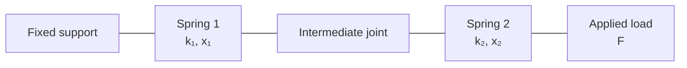
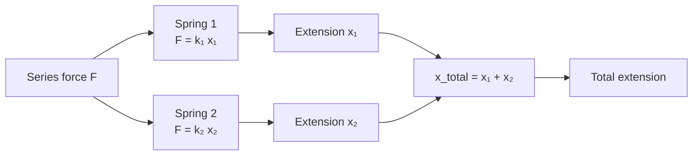
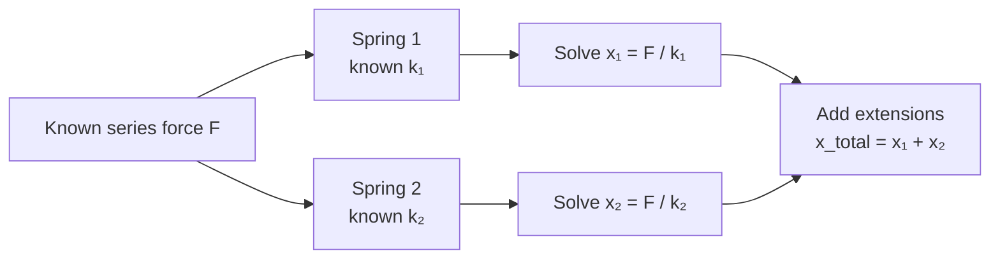

# Two springs in series: a small acausal system of systems

This worked example uses **two linear springs connected in series** to introduce acausal systems-of-systems modelling in Bilt.

The physical arrangement is:

```text
fixed support
    │
    ├── spring 1 ── joint ── spring 2 ── applied load
    │
```

More schematically:



Because the springs are in **series**:

- the same force passes through both springs;
- each spring can extend by a different amount;
- the total extension is the sum of the two spring extensions.

So:

```text
F₁ = F₂ = F

x_total = x₁ + x₂
```

and each spring obeys Hooke's law:

```text
F = k × x
```

The useful part of the example is how Bilt composes those relationships.

We will:

- define one reusable `Spring` model;
- use it twice inside a larger `DoubleSpring` implementation;
- connect each child to ordinary values on the parent;
- ask the same equations for different quantities.

There is one important limitation to keep in mind:

> Bilt does not yet solve equations that require a simultaneous coupled solve across sibling subsystems.

So we will only use computation paths that can be decomposed into independent child-system evaluations and ordinary parent equations.

```python exec="on" session="springs"
from io import StringIO
import importlib.util
from pathlib import Path
import tempfile

import matplotlib

# markdown-exec runs code in a worker thread.
matplotlib.use("Agg")

import matplotlib.pyplot as plt
import numpy as np


def render_plot() -> None:
    buffer = StringIO()
    plt.savefig(buffer, format="svg", bbox_inches="tight")
    plt.close()
    print(buffer.getvalue())
```

## 1. Start with one spring

A spring has three boundary values:

```python
from bilt import Implementation, Interface, equation, field, system


@system
class Spring(metaclass=Interface):
    stiffness: float = field()
    extension: float = field()
    force: float = field()
```

Hooke's law is an equation:

```python
@equation
def hookes_law(
    stiffness: float,
    extension: float,
    force: float,
) -> bool:
    return force == stiffness * extension


linear_spring = Implementation(
    Spring,
    [hookes_law],
)
```

Because this is an equation, none of the three values is permanently designated as the output.

Given stiffness and extension, Bilt can find force:

```text
k + x → F
```

Given force and stiffness, the same equation can find extension:

```text
F + k → x
```

That is the acausal part of the component model.

## 2. Build a larger system

The parent system exposes the values we want to use when working with two springs:

```python
@system
class DoubleSpring(metaclass=Interface):
    first_stiffness: float = field()
    second_stiffness: float = field()

    first_extension: float = field()
    second_extension: float = field()
    total_extension: float = field()

    force: float = field()
```

The two `Spring` occurrences are not public fields. They belong to this implementation of `DoubleSpring`.

## 3. Connect the first spring

Parent values are connected to the first child independently:

```python
@equation
def first_stiffness_connection(
    first_stiffness: float,
    first: Spring,
) -> bool:
    return first_stiffness == first.stiffness


@equation
def first_extension_connection(
    first_extension: float,
    first: Spring,
) -> bool:
    return first_extension == first.extension


@equation
def first_force_connection(
    force: float,
    first: Spring,
) -> bool:
    return force == first.force
```

Conceptually:

```text
parent stiffness  ↔  first.stiffness
parent extension  ↔  first.extension
parent force      ↔  first.force
```

Each equation touches only one child system.

## 4. Connect the second spring

The second spring uses the same pattern:

```python
@equation
def second_stiffness_connection(
    second_stiffness: float,
    second: Spring,
) -> bool:
    return second_stiffness == second.stiffness


@equation
def second_extension_connection(
    second_extension: float,
    second: Spring,
) -> bool:
    return second_extension == second.extension


@equation
def second_force_connection(
    force: float,
    second: Spring,
) -> bool:
    return force == second.force
```

The same parent `force` value is connected independently to each spring.



This diagram mirrors the mechanics: one common series force acts through both springs, while the two extensions are added on the parent system.

No equation directly contains both spring subsystems.

## 5. Add the extensions on the parent

The total extension is an ordinary parent equation:

```python
@equation
def total_extension_relation(
    first_extension: float,
    second_extension: float,
    total_extension: float,
) -> bool:
    return total_extension == first_extension + second_extension
```

This equation is also acausal.

For example:

```text
first extension + second extension → total extension
```

but also:

```text
total extension + first extension → second extension
```

## 6. Put the implementation together

```python
double_spring = Implementation(
    DoubleSpring,
    [
        first_stiffness_connection,
        first_extension_connection,
        first_force_connection,
        second_stiffness_connection,
        second_extension_connection,
        second_force_connection,
        total_extension_relation,
    ],
    internal_implementations={
        "first": linear_spring,
        "second": linear_spring,
    },
)
```

The hierarchy is therefore:

```text
DoubleSpring
│
├── parent equations
│   └── total extension relation
│
└── internal implementations
    ├── first  → Spring
    └── second → Spring
```

For the executable documentation below, the same model is loaded from a temporary Python module. This gives Bilt a real source file for `inspect.getsource()` during the `markdown-exec` build.

```python exec="on" session="springs"
model_source = """
from bilt import Implementation, Interface, equation, field, system


@system
class Spring(metaclass=Interface):
    stiffness: float = field()
    extension: float = field()
    force: float = field()


@equation
def hookes_law(
    stiffness: float,
    extension: float,
    force: float,
) -> bool:
    return force == stiffness * extension


linear_spring = Implementation(
    Spring,
    [hookes_law],
)


@system
class DoubleSpring(metaclass=Interface):
    first_stiffness: float = field()
    second_stiffness: float = field()

    first_extension: float = field()
    second_extension: float = field()
    total_extension: float = field()

    force: float = field()


@equation
def first_stiffness_connection(
    first_stiffness: float,
    first: Spring,
) -> bool:
    return first_stiffness == first.stiffness


@equation
def first_extension_connection(
    first_extension: float,
    first: Spring,
) -> bool:
    return first_extension == first.extension


@equation
def first_force_connection(
    force: float,
    first: Spring,
) -> bool:
    return force == first.force


@equation
def second_stiffness_connection(
    second_stiffness: float,
    second: Spring,
) -> bool:
    return second_stiffness == second.stiffness


@equation
def second_extension_connection(
    second_extension: float,
    second: Spring,
) -> bool:
    return second_extension == second.extension


@equation
def second_force_connection(
    force: float,
    second: Spring,
) -> bool:
    return force == second.force


@equation
def total_extension_relation(
    first_extension: float,
    second_extension: float,
    total_extension: float,
) -> bool:
    return total_extension == first_extension + second_extension


double_spring = Implementation(
    DoubleSpring,
    [
        first_stiffness_connection,
        first_extension_connection,
        first_force_connection,
        second_stiffness_connection,
        second_extension_connection,
        second_force_connection,
        total_extension_relation,
    ],
    internal_implementations={
        "first": linear_spring,
        "second": linear_spring,
    },
)
"""

model_path = Path(tempfile.gettempdir()) / "bilt_two_springs.py"
model_path.write_text(model_source)

spec = importlib.util.spec_from_file_location(
    "_bilt_two_springs",
    model_path,
)
assert spec is not None
assert spec.loader is not None

model_module = importlib.util.module_from_spec(spec)
spec.loader.exec_module(model_module)

DoubleSpring = model_module.DoubleSpring
double_spring = model_module.double_spring
```

## 7. Evaluate a compatible spring state

Start by supplying the individual spring extensions and stiffnesses.

We deliberately choose compatible values:

```text
Spring 1: 100 × 0.075 = 7.5
Spring 2: 300 × 0.025 = 7.5
```

so both springs carry the same series force.

```python exec="on" source="above" session="springs"
forward_case = DoubleSpring(
    first_stiffness=100.0,
    second_stiffness=300.0,
    first_extension=0.075,
    second_extension=0.025,
)

with double_spring:
    force = forward_case.force
    total_extension = forward_case.total_extension

print(f"Force:           {force:.3f}")
print(f"Total extension: {total_extension:.3f}")
```

The result is:

```text
Force:           7.500
Total extension: 0.100
```

The force comes from a child spring equation, while total extension comes from the parent equation.

### Visualise the operating point

```python exec="on" html="on" source="above" session="springs"
extension = np.linspace(0.0, 0.10, 100)

plt.plot(
    extension,
    100.0 * extension,
    label="Spring 1: k = 100",
)
plt.plot(
    extension,
    300.0 * extension,
    label="Spring 2: k = 300",
)

plt.scatter([0.075], [7.5])
plt.scatter([0.025], [7.5])

plt.xlabel("Extension")
plt.ylabel("Force")
plt.title("Two spring force-extension relationships")
plt.legend()
render_plot()
```

The same force intersects the two spring curves at different extensions because their stiffnesses differ.

## 8. Use the same model in another direction

Now supply the common force and the two stiffnesses, but **do not** supply either spring extension:

```python exec="on" source="above" session="springs"
reverse_case = DoubleSpring(
    first_stiffness=100.0,
    second_stiffness=300.0,
    force=7.5,
)

with double_spring:
    first_extension = reverse_case.first_extension
    second_extension = reverse_case.second_extension
    total_extension = reverse_case.total_extension

print(f"First extension:  {first_extension:.3f}")
print(f"Second extension: {second_extension:.3f}")
print(f"Total extension:  {total_extension:.3f}")
```

Bilt can use Hooke's law in the opposite direction inside each child:

```text
known force + stiffness
        ↓
solve spring extension
```

The parent can then add the two extensions:

```text
first extension + second extension
                ↓
          total extension
```

So the complete route is:



The model is still describing the same two springs in series. Bilt is simply using Hooke's law in the opposite direction inside each spring.

The component equations have not changed. Only the known values and requested values have.

## 9. What we cannot ask yet

A tempting query is:

```text
known:
    total extension
    first stiffness
    second stiffness

requested:
    common force
```

For two springs in series, that requires Bilt to determine the shared force and both unknown spring extensions together.

That is a genuinely coupled solve across the two child systems.

This example deliberately does **not** rely on that capability.

Instead, it demonstrates the acausal behaviour Bilt already supports when the computation can be decomposed into independent subsystem routes.

## 10. Explore the model yourself

Try changing the common force:

```python
force=10.0
```

or either stiffness:

```python
first_stiffness=150.0
second_stiffness=250.0
```

Then ask again for:

```python
with double_spring:
    total_extension = spring_system.total_extension
```

You can also go back to the forward form and provide the individual extensions instead of the force.

To explore locally, edit the values while `zensical serve` is running and save the Markdown file. Zensical will rebuild the page and rerun the executable blocks.

## 11. What this example demonstrates

The spring example separates three ideas clearly.

### Reusable component physics

```text
Spring
    force = stiffness × extension
```

One implementation is reused twice.

### Systems-of-systems composition

Each child connects independently to parent values:

```text
parent value
    ↕
child boundary
```

and the parent owns the relationship between the two extensions:

```text
total extension = first extension + second extension
```

### Acausal evaluation

The same Hooke's-law equation supports both:

```text
stiffness + extension → force
```

and:

```text
force + stiffness → extension
```

No transforms or manually inverted equations are needed.

This is a small example of the same pattern used by the larger two-shaft turbomachinery model.
