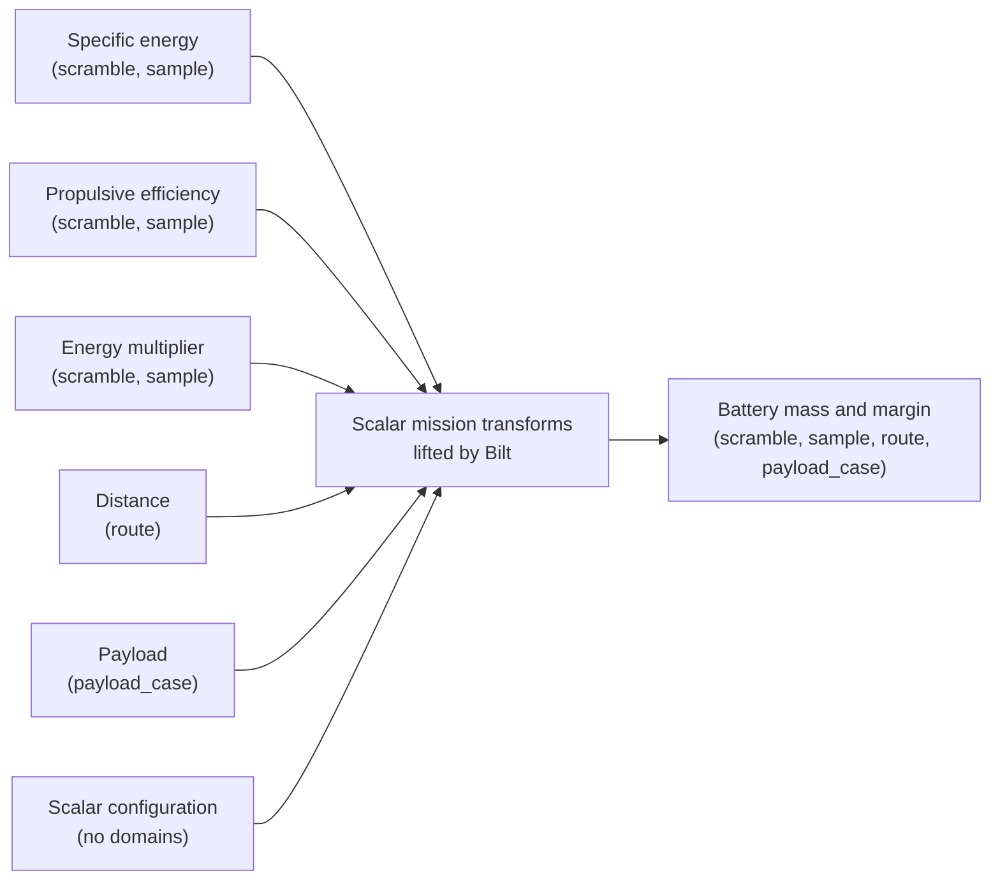
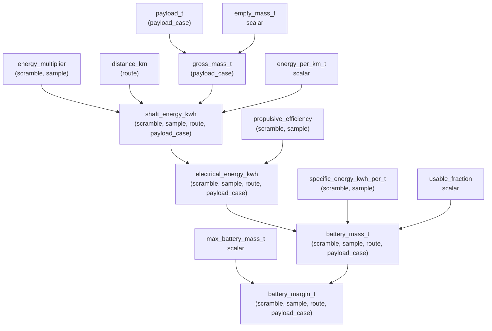
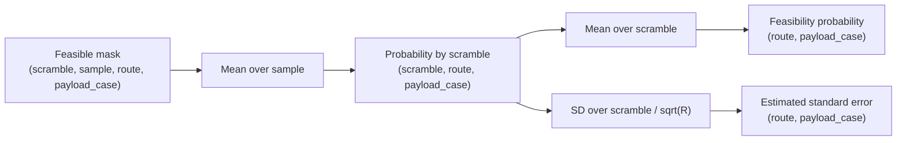

# Quasi-Monte Carlo broadcasting with Bilt tensors

This tutorial uses independently scrambled Sobol designs to evaluate a small
battery-electric mission model over many uncertain samples, routes, and payload
cases.

The model transforms are scalar functions. Bilt lifts them over the named tensor
domains, so the model code contains no loops over samples, routes, or payloads.

> **Current comparison limitation**
>
> Arithmetic operations are lifted over `BiltTensor`, but comparison operators
> such as `<=` are not currently implemented. The model therefore returns a
> numeric battery-mass margin. The Boolean feasibility mask is formed after
> evaluation using NumPy.

The complete example is in
[`sobol_broadcasting_bilt.py`](./sobol_broadcasting_bilt.py). Its numerical
behaviour is checked independently in
[`test_quasi_mc_broadcasting.py`](./test_quasi_mc_broadcasting.py).

## 1. Why this problem suits named-domain broadcasting

A randomized quasi-Monte Carlo calculation has several conceptually distinct
axes:

| Domain | Meaning | Example size |
|---|---|---:|
| `scramble` | Independent Sobol randomizations | 8 |
| `sample` | Points within each scrambled Sobol design | 1024 |
| `route` | Mission distances | 6 |
| `payload_case` | Payload alternatives | 4 |

The uncertain quantities share the domains

```text
(scramble, sample)
```

while the deterministic design sweeps use

```text
(route)
(payload_case)
```

Bilt combines those domains when a transform depends on all of the corresponding
values. The final battery result therefore has domains

```text
(scramble, sample, route, payload_case)
```

and shape

```text
(8, 1024, 6, 4)
```

This represents 196,608 mission evaluations without writing model loops.



## 2. Generate independent scrambled Sobol designs

One scrambled Sobol design gives a randomized QMC estimate, but it does not by
itself provide independent replicate estimates for uncertainty calculation.
The example therefore creates eight independently seeded scrambles.

```python
def scrambled_sobol_inputs(
    *,
    scrambles: int = 8,
    power: int = 10,
    seed: int = 1_000,
) -> QMCInputs:
    samples = 2**power
    uniforms = np.empty((scrambles, samples, 3), dtype=float)

    for scramble_index in range(scrambles):
        engine = qmc.Sobol(
            d=3,
            scramble=True,
            seed=seed + scramble_index,
        )
        uniforms[scramble_index] = engine.random_base2(power)
```

The loop is concerned only with constructing independent randomizations. It is
not a loop over model evaluations.

Each of the three unit-cube coordinates is transformed into a physical input:

- battery specific energy,
- propulsive efficiency,
- mission energy multiplier.

The resulting arrays all have shape

```text
(scramble, sample)
```

## 3. Describe the model as scalar transforms

The transforms are written as ordinary scalar arithmetic:

```python
@transform
def gross_mass_t(
    payload_t: float,
    empty_mass_t: float,
) -> float:
    return empty_mass_t + payload_t
```

```python
@transform
def shaft_energy_kwh(
    energy_multiplier: float,
    distance_km: float,
    gross_mass_t: float,
    energy_per_km_t: float,
) -> float:
    return (
        energy_multiplier
        * distance_km
        * gross_mass_t
        * energy_per_km_t
    )
```

```python
@transform
def battery_mass_t(
    electrical_energy_kwh: float,
    specific_energy_kwh_per_t: float,
    usable_fraction: float,
) -> float:
    return electrical_energy_kwh / (
        specific_energy_kwh_per_t * usable_fraction
    )
```

No transform knows about Sobol sampling, routes, payload cases, or array axis
positions. The dimensions enter only when values are supplied to the system.

## 4. Attach explicit domains to the inputs

Dimension identity is represented by `Dim`, not merely by an integer array axis:

```python
scramble = Dim("scramble")
sample = Dim("sample")
route = Dim("route")
payload_case = Dim("payload_case")
```

The QMC values share the same two dimensions:

```python
specific_energy_kwh_per_t=tensor(
    draws.specific_energy_kwh_per_t,
    over=(scramble, sample),
)
```

The route and payload sweeps each introduce another dimension:

```python
distance_km=tensor(
    [150.0, 250.0, 350.0, 450.0, 550.0, 650.0],
    over=route,
)

payload_t=tensor(
    [2.0, 4.0, 6.0, 8.0],
    over=payload_case,
)
```

Scalar configuration values have an empty domain and broadcast over every
domain inherited by downstream transforms:

```python
empty_mass_t=20.0
energy_per_km_t=0.18
usable_fraction=0.85
max_battery_mass_t=7.5
```

## 5. How domains accumulate through the transform graph



The final numeric criterion is

```python
@transform
def battery_margin_t(
    battery_mass_t: float,
    max_battery_mass_t: float,
) -> float:
    return max_battery_mass_t - battery_mass_t
```

Positive values are feasible; negative values exceed the battery-mass limit.

## 6. Evaluate once over the complete domain product

```python
with PythonBackend(), mission_model:
    battery_mass_values = as_array(mission.battery_mass_t)
    battery_margin_values = as_array(mission.battery_margin_t)
```

Both outputs have shape

```text
(scramble, sample, route, payload_case)
```

The feasibility mask is then formed outside the Bilt model:

```python
feasible_values = battery_margin_values >= 0.0
```

This is a temporary boundary caused by the current absence of lifted comparison
operators. Once comparison expressions are supported, feasibility can return to
the transform graph.

## 7. Reduce the domains in the correct order

The points within one scrambled Sobol design are not independent replicate
estimates. First reduce over `sample`, leaving one estimate per scramble:

```python
probability_by_scramble = feasible_values.mean(axis=1)
```

Shape:

```text
(scramble, route, payload_case)
```

Then combine the independent scrambles:

```python
probability = probability_by_scramble.mean(axis=0)

standard_error = (
    probability_by_scramble.std(axis=0, ddof=1)
    / np.sqrt(scrambles)
)
```

Shape:

```text
(route, payload_case)
```



In a future domain-aware reduction API, these operations could be expressed by
dimension identity rather than by NumPy axis number:

```python
probability_by_scramble = feasible.mean(over=sample)
probability = probability_by_scramble.mean(over=scramble)
```

## 8. Plot the route and payload results

A simple line plot makes the design sweep visible. Each line is one payload
case, while the x-axis is route distance.

```python
import matplotlib.pyplot as plt

for payload_index, payload_t in enumerate(payloads_t):
    plt.plot(
        distances_km,
        probability[:, payload_index],
        marker="o",
        label=f"{payload_t:g} t",
    )

plt.xlabel("Route distance (km)")
plt.ylabel("Probability battery mass is feasible")
plt.ylim(0.0, 1.0)
plt.legend(title="Payload")
plt.tight_layout()
plt.show()
```

The corresponding standard-error plot can be produced in the same way:

```python
for payload_index, payload_t in enumerate(payloads_t):
    plt.plot(
        distances_km,
        standard_error[:, payload_index],
        marker="o",
        label=f"{payload_t:g} t",
    )

plt.xlabel("Route distance (km)")
plt.ylabel("RQMC estimated standard error")
plt.legend(title="Payload")
plt.tight_layout()
plt.show()
```

The plotting step operates only on the final two-dimensional summaries. All
196,608 model cases have already been evaluated through Bilt broadcasting.

## 9. Validate Bilt against an independent NumPy model

The pytest validation does more than check output shapes. It implements the
same equations independently using explicit NumPy axis insertion:

```python
shaft_energy_kwh = (
    energy_multiplier[:, :, None, None]
    * distances_km[None, None, :, None]
    * gross_mass_t
    * energy_per_km_t
)
```

This deliberately exposes the axis manipulation that Bilt removes from the
model itself.

The test checks:

1. the final domain-product shape;
2. battery mass at every sample, route, and payload case;
3. battery-mass margin;
4. the derived Boolean feasibility mask;
5. probability estimates per scramble;
6. the final probability and randomized-QMC standard error.

The test uses eight scrambles but only `2**6` samples per scramble so that it
runs quickly. The numerical broadcasting semantics are unchanged.

Run it from the repository root with:

```console
uv run pytest packages/examples/tests/test_quasi_mc_broadcasting.py
```

## 10. What this example demonstrates

The important distinction is between **model structure** and **evaluation
domains**.

The model remains a small graph of scalar transforms:

```text
payload → gross mass → shaft energy → electrical energy → battery mass → margin
```

The same graph is evaluated over:

```text
8 scrambles × 1024 samples × 6 routes × 4 payload cases
```

Bilt's role is to align named domains and lift the scalar transforms over their
union. The quasi-Monte Carlo method supplies structured samples; the mission
model does not need to know how those samples were generated.
