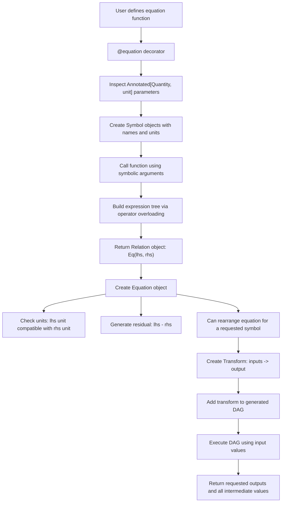
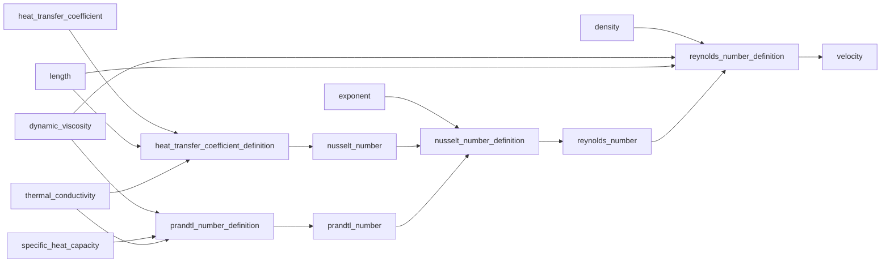

# Symbolic Equation Backend Prototype

This prototype explores a backend-neutral way to define symbolic equations in Python, attach units to symbols, generate residuals, rearrange equations, and automatically build a directed acyclic graph (DAG) of transforms from declared inputs to requested outputs.

The main design principle is:

```text
Equation = undirected mathematical truth
Transform = directed computational use of an equation
DAG = generated sequence of transforms for a particular solve request
```

For example, this equation:

```text
Re = density * velocity * length / dynamic_viscosity
```

does not have to be used only in the written direction. If the user provides `density`, `velocity`, `length`, and `dynamic_viscosity`, the system can compute `Re`. If the user provides `Re`, `density`, `length`, and `dynamic_viscosity`, the system can rearrange the same equation and compute `velocity`.

---

## Package layout

```text
symbolic_backend/
  __init__.py
  annotations.py      # Quantity marker and Display metadata
  decorators.py       # @equation symbolic tracing
  equations.py        # Equation object
  expressions.py      # Symbol, Constant, Binary expression tree
  model.py            # EquationModel DAG planner and solver
  relations.py        # Eq, Equality, inequalities, unit analysis
  solve.py            # symbolic rearrangement
  transforms.py       # Transform and TransformGraph
  units.py            # unit adapter hooks and SimpleUnit test unit system
  examples.py         # velocity-from-HTC example

tests/
  test_velocity_from_htc.py
```

---

## Core idea

The system has three layers:

```text
1. Symbolic equations
   What is mathematically true.

2. Generated transforms
   A chosen direction for using an equation.

3. A DAG solve plan
   A sequence of generated transforms that computes requested outputs from known inputs.
```

The user declares equations once. The solve request decides which direction each equation should be used in.

---

## Defining equations

Equations are written as Python functions decorated with `@equation`.

```python
from typing import Annotated

from symbolic_backend import (
    DIMENSIONLESS,
    Display,
    Eq,
    Equation,
    Quantity,
    equation,
)


@equation
def reynolds_number_definition(
    reynolds_number: Annotated[Quantity, DIMENSIONLESS, Display("Re")],
    density: Annotated[Quantity, kilogram / meter**3],
    velocity: Annotated[Quantity, meter / second],
    length: Annotated[Quantity, meter],
    dynamic_viscosity: Annotated[Quantity, pascal * second],
) -> Equation:
    return Eq(
        reynolds_number,
        density * velocity * length / dynamic_viscosity,
    )
```

This defines:

```text
Re = density * velocity * length / dynamic_viscosity
```

The function name identifies the equation. It does **not** imply that the function returns a variable with the same name.

The symbolic names come from the function parameters:

```text
reynolds_number
density
velocity
length
dynamic_viscosity
```

The units come from the `Annotated[Quantity, unit]` metadata.

---

## How the decorator works

When Python applies `@equation`, the function is not called with numbers. It is called with symbolic quantities.

Conceptually, the decorator does this:

```python
symbolic_args = {
    "reynolds_number": Symbol("reynolds_number", unit=DIMENSIONLESS),
    "density": Symbol("density", unit=kilogram / meter**3),
    "velocity": Symbol("velocity", unit=meter / second),
    "length": Symbol("length", unit=meter),
    "dynamic_viscosity": Symbol("dynamic_viscosity", unit=pascal * second),
}

relation = fn(**symbolic_args)
```

The return value:

```python
return Eq(reynolds_number, density * velocity * length / dynamic_viscosity)
```

becomes an internal relation object:

```python
Equality(
    lhs=Symbol("reynolds_number"),
    rhs=Binary("/", Binary("*", ...), Symbol("dynamic_viscosity")),
)
```

So the decorated function is converted into a symbolic expression tree.

---

## Operator overloading and expression trees

When the equation function executes this:

```python
density * velocity * length / dynamic_viscosity
```

it does not calculate a number. It builds a tree.

```text
        /
      /   \
     *     dynamic_viscosity
   /   \
  *     length
/   \
density velocity
```

Internally, the tree is made from a small set of expression classes:

```text
Symbol
Constant
Binary
```

For example:

```python
density * velocity
```

becomes:

```python
Binary("*", Symbol("density"), Symbol("velocity"))
```

This is what allows the backend to inspect, rearrange, evaluate, and print equations.

---

## Unit handling

Units are attached to symbols through annotations.

```python
density: Annotated[Quantity, kilogram / meter**3]
```

means:

```text
symbol name: density
unit: kilogram / meter³
```

Every expression can infer its unit:

```python
expr.unit()
```

The basic unit propagation rules are:

```text
a * b      -> unit(a) * unit(b)
a / b      -> unit(a) / unit(b)
a + b      -> requires compatible units
a - b      -> requires compatible units
a ** n     -> exponent must be dimensionless
```

For example, Reynolds number checks:

```text
lhs:
  dimensionless

rhs:
  (kg/m³) * (m/s) * m / (Pa*s)
```

Since:

```text
Pa*s = kg/(m*s)
```

the RHS is dimensionally compatible with dimensionless, so the equation passes unit analysis.

The code is designed to plug into a Bilt-style unit system where units expose things like:

```text
unit.dimension
unit.is_dimensionless
unit * unit
unit / unit
unit ** int
```

A small `SimpleUnit` is included only for standalone tests and examples.

---

## Residual form

Every equality can produce a residual.

The equation:

```text
Re = density * velocity * length / dynamic_viscosity
```

can be converted to:

```text
Re - density * velocity * length / dynamic_viscosity = 0
```

In code:

```python
reynolds_number_definition.residual()
```

returns an expression equivalent to:

```text
(Re - (((density * velocity) * length) / dynamic_viscosity))
```

Residual form is useful because it gives a common representation for future numerical solvers.

---

## Symbolic rearrangement

The backend can rearrange simple equations to solve for a requested symbol.

For example:

```python
reynolds_number_definition.solve_expr_for("velocity")
```

starting from:

```text
Re = density * velocity * length / dynamic_viscosity
```

produces an expression equivalent to:

```text
velocity = Re * dynamic_viscosity / (density * length)
```

The rearranger is deliberately simple. It handles expressions where the unknown appears once through invertible arithmetic operations:

```text
x + a = b
x - a = b
a - x = b
x * a = b
x / a = b
a / x = b
x**constant = b
```

It does not attempt to be a full computer algebra system.

---

## From equation to transform

A transform is a directed use of an equation.

The same Reynolds equation can generate either of these transforms:

```text
density, velocity, length, dynamic_viscosity -> reynolds_number
```

or:

```text
reynolds_number, density, length, dynamic_viscosity -> velocity
```

Example:

```python
transform = reynolds_number_definition.as_transform(
    inputs=[
        "reynolds_number",
        "density",
        "length",
        "dynamic_viscosity",
    ],
    outputs=["velocity"],
)
```

The generated transform stores:

```python
inputs = (
    "reynolds_number",
    "density",
    "length",
    "dynamic_viscosity",
)

outputs = ("velocity",)

expressions = {
    "velocity": reynolds_number * dynamic_viscosity / (length * density)
}
```

So the transform is executable.

---

## Automatic DAG generation

The user does not have to manually define transforms.

They can write:

```python
result = model.solve(
    inputs={
        "heat_transfer_coefficient": 4754.327547388351,
        "density": 1000.0,
        "length": 0.01,
        "dynamic_viscosity": 0.001,
        "specific_heat_capacity": 4180.0,
        "thermal_conductivity": 0.6,
        "exponent": 0.4,
    },
    outputs=["velocity"],
)
```

The model sees:

```text
Known:
  heat_transfer_coefficient
  density
  length
  dynamic_viscosity
  specific_heat_capacity
  thermal_conductivity
  exponent

Wanted:
  velocity
```

Then it searches through the available equations and asks:

```text
Can I rearrange any equation to produce a new symbol using only what I already know?
```

For the velocity-from-HTC example, it discovers this plan:

```text
1. cp, mu, k -> Pr
2. h, L, k -> Nu
3. Nu, Pr, exponent -> Re
4. Re, rho, L, mu -> velocity
```

So the code generates a directed graph from undirected equations.

---

## Mermaid overview



---

## Velocity from HTC example

The equations are declared in their conventional forward form:

```text
Re = density * velocity * length / dynamic_viscosity
Pr = specific_heat_capacity * dynamic_viscosity / thermal_conductivity
Nu = 0.023 * Re**0.8 * Pr**exponent
h  = Nu * thermal_conductivity / length
```

But the solve request asks for `velocity` from a supplied `heat_transfer_coefficient`.

The generated plan is:

```text
1. prandtl_number_definition -> prandtl_number
2. heat_transfer_coefficient_definition -> nusselt_number
3. nusselt_number_definition -> reynolds_number
4. reynolds_number_definition -> velocity
```

The generated graph is:



The rearranged expressions used by the generated transforms are:

```text
prandtl_number = specific_heat_capacity * dynamic_viscosity / thermal_conductivity
nusselt_number = heat_transfer_coefficient * length / thermal_conductivity
reynolds_number = (nusselt_number / (0.023 * prandtl_number**exponent)) ** (1 / 0.8)
velocity = reynolds_number * dynamic_viscosity / (length * density)
```

With the provided inputs, the model solves:

```python
{"velocity": 1.0000000000000004}
```

---

## Inequalities

The backend is structured around `Relation` objects rather than raw residual expressions.

That means equality is not the only possible relation type.

Supported relation shapes include:

```python
Equality(lhs, rhs)       # lhs == rhs
LessEqual(lhs, rhs)      # lhs <= rhs
GreaterEqual(lhs, rhs)   # lhs >= rhs
```

For now, the DAG transform solver only uses equalities, because transforms compute values. Inequalities are more naturally used for checking constraints or later optimisation backends.

For example, a future constraint could be declared as:

```python
@constraint
def pressure_limit(
    pressure: Annotated[Quantity, pascal],
    maximum_pressure: Annotated[Quantity, pascal],
):
    return pressure <= maximum_pressure
```

The backend can represent this as:

```text
pressure - maximum_pressure <= 0
```

This keeps the door open for optimisation and residual-block solvers later.

---

## Current limitations

This implementation is intentionally simple.

It works for:

```text
DAG-like systems
one unique explicit solution path
equations that can be rearranged one variable at a time
symbolic powers where the unknown is the base and the exponent is constant
dimensionless symbolic exponents such as Pr**n
```

It does not yet handle:

```text
coupled nonlinear systems
cycles
multiple equations needing to be solved simultaneously
variables appearing multiple times in the same equation
solving for exponents such as n in Nu = 0.023 * Re**0.8 * Pr**n
logarithmic, trigonometric, or general nonlinear rearrangements
ambiguity where two equations can produce the same needed symbol
```

For coupled or cyclic systems, the next layer would be an `ImplicitSolveTransform` that groups equations into a residual block and calls a numerical solver.

---

## Running the example

From the package root:

```bash
python -m symbolic_backend.examples
```

This prints the requested output, generated plan, and rearranged expressions.

---

## Running tests

From the package root:

```bash
PYTHONPATH=. pytest -q
```

The included tests check that the velocity-from-HTC case solves correctly and that unit analysis reports all equations.
