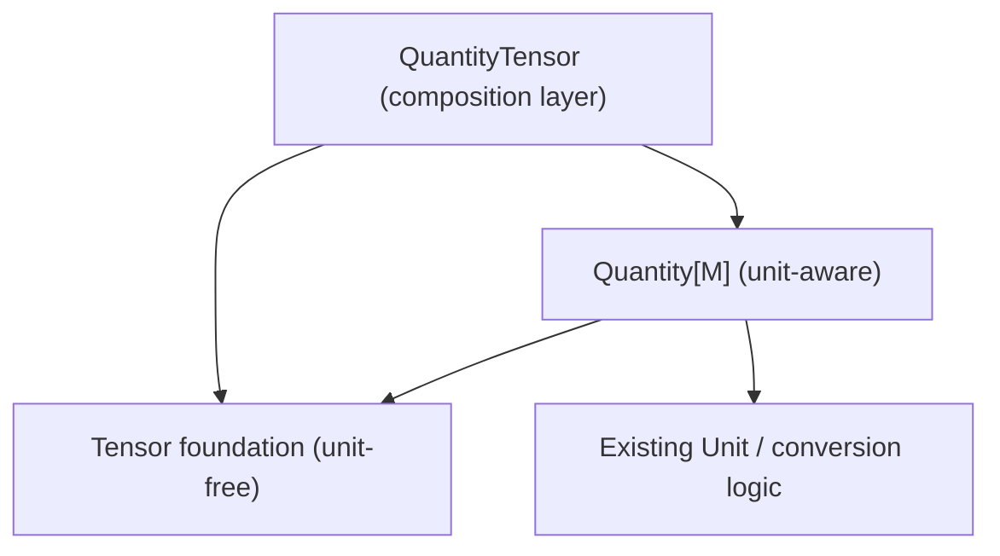

# Quantity ABC / annotation prototype

Explores the agreed approach in [#367](https://github.com/aviation-impact-accelerator/bilt/issues/367), alongside the separate nominal-dimension experiment in [#368](https://github.com/aviation-impact-accelerator/bilt/pull/368).

This is **not** a migration of production `bilt.Quantity`. Existing equations and model fields continue to use the existing runtime types. The aim is to test the shared type contract before touching the compiler, evaluator or current scalar/tensor implementations.

## Proposed API

```python
from typing import Annotated
from bilt import Tensor
from bilt.units.dimensions import MASS
from prototypes.quantity_abc.prototype import Quantity

type Mass = Annotated[Quantity, MASS]
type MassTensor = Annotated[Quantity[Tensor], MASS]
```

- `Quantity[M: float | Tensor = float | Tensor]` is an abstract interface. `M` is inferred covariant by Python's PEP 695 rules. The default permits scalar **or** tensor quantities at system boundaries.
- `ScalarQuantity(Quantity[float])` and `QuantityTensor(Tensor, Quantity[Tensor])` implement the interface. The latter passes both `isinstance(..., Quantity)` and `isinstance(..., Tensor)`.
- `.magnitude` removes the unit, `.unit` is non-optional; `.cast_to` relabels only equivalent units and `.convert_to` applies an existing Bilt conversion.
- `Quantity[Tensor]` makes tensor-only functionality explicit for an equation's input. Bare `Quantity` does not offer tensor methods directly.
- Units, physical dimensions and domain requirements remain `Annotated` metadata. Regular Python type checkers do **not** distinguish mass from length with this approach.

`QuantityTensor` is constructed from existing tensor data, and its `.magnitude` produces a unitless tensor. This does not yet replace `Tensor(unit=...)`; indexing, common arithmetic, conversion of production quantities and tensor method return types remain open for the actual integration.

## Running

```sh
uv run pytest prototypes/quantity_abc/tests -q
uv run ty check prototypes/quantity_abc
uv run pyrefly check prototypes/quantity_abc
```

This experiment uses Bilt's existing library, without adding runtime dependencies. The type-checking examples are deliberately limited to the API contract. They do not claim that a decorated Bilt equation accepts the new annotations today.


## System and implementation example

`typing_examples.py` now contains a complete, executable `MassScale` model,
its `double_mass` equation, an `Implementation`, and an evaluation through
the public system API:

```python
from prototypes.quantity_abc.typing_examples import run_mass_scale
from bilt.units import kilogram

assert run_mass_scale() == 4.0 * kilogram
```

This model currently uses `Annotated[bilt.Quantity, MASS]` because Bilt's
compiler does **not** yet parse the experimental `Quantity[M]` ABC. The
other typing examples exercise the proposed `Mass` and `TensorMass` aliases.

The intended migration is to let the same model use `Mass` on its system
fields and scalar equation ports without changing its equation or
`Implementation` call. An equation that needs tensor methods would instead
request `TensorMass`, explicitly communicating that requirement. This is a
future API, **not** functionality implemented by this prototype.

## Production-migration architecture experiment

The additional `architecture/` package tests a proposed **one-way dependency**
without changing any production classes. It intentionally uses a small,
independent tensor foundation rather than inheriting from production
`bilt.Tensor` (which still imports `bilt.units`).



The foundation cannot import `bilt.units` or any quantity implementation.
Import-boundary tests parse its imports, import it in a fresh Python process
and verify that `bilt.units` has **not** been initialised. Other tests
check both import orders.

`architecture/_quantity.py` tests the **alternative** of a concrete generic
`Quantity` retaining `Quantity(2.0, kilogram)` and `.value` while
`QuantityTensor` satisfies both `Tensor` and `Quantity[Tensor]` at runtime.
This deliberately coexists with the original abstract-base-class experiment;
it does not settle whether `ScalarQuantity` should be a separate production type.

`architecture/typing_examples.py` contains an **executable miniature system
and implementation** using `Annotated[Quantity, MASS]` fields, the same
`double_mass` equation for scalar and tensor magnitudes, and a tensor-only
reduction for `Quantity[Tensor]`. This is a lightweight model fixture, not
Bilt's real `@system`/`Implementation` compiler. The existing
`typing_examples.py` continues to exercise a real production Bilt model.

The unit adapter `typed(kilogram)` demonstrates the intended return
types from `float * Unit` and `Tensor * Unit` without monkeypatching
production `Unit`. The common quantity arithmetic is intentionally limited:
it does not reimplement Bilt broadcasting, absolute-temperature arithmetic,
symbolic lowering, backend dispatch or complete tensor reductions. A future
production PR should preserve those behaviours instead of simply replacing
the production Tensor with this deliberately small example.

Run the focused tests alongside the existing prototype checks:

```sh
PYTHONPATH=.:src uv run pytest -q prototypes/quantity_abc/tests
uv run ty check prototypes/quantity_abc
uv run pyrefly check --search-path . prototypes/quantity_abc
```

## Decisions before a production PR

1. How to migrate the existing scalar `Quantity` and unit-bearing `Tensor` without changing their external behaviour, including `Quantity.value`, tensor reductions and arithmetic.
2. How `bilt.core._port_declaration` should unwrap generic `Quantity[Tensor]`, and use it to select tensor symbolic expressions.
3. Whether `QuantityTensor` should have unit-bearing tensor reduction results (and when indexing yields `ScalarQuantity`) or instead delegate to a separate scalar quantity.
4. How to test checker behaviour for automatic broadcasting and system constructors, which normal Python class typing cannot fully express.
5. Whether an explicit `bilt check`/pytest tracing hook should validate `Annotated` dimensions and domains in CI.

Keeping these questions open avoids assuming that Python's type system can validate physics or Bilt's implicit broadcasting.
